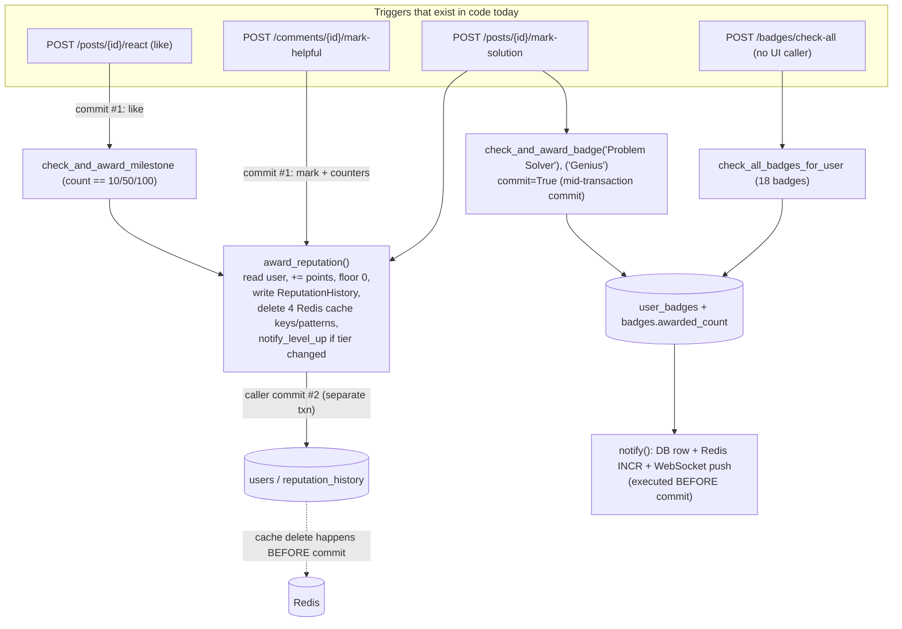

# Feature Production-Readiness Audit — Reputation & Badges

- **Repository:** `Devpaul-01/StudyHub` @ `7fbdaf3` (HEAD at clone time, `main`)
- **Audit date:** 2026-11-21
- **Scope:** the Reputation & Badges feature only (point awarding, reputation ledger/levels, badge definitions/awarding/progress/featuring, and the profile/feed UI that consumes them). Leaderboard, notifications, Redis, and the post/comment routes were read only where this feature depends on them.
- **Method:** static tracing of frontend → routes → services → models → Redis/WebSocket, git-history review, running the existing tests, and throw-away repro tests kept **outside** the repo (see Appendix A). **No application source, test, config, or dependency file in the repo was modified.** The only file added is this report.

Legend used for evidence: **[Confirmed-run]** reproduced by executing code; **[Confirmed-read]** established by reading code/grepping call sites; **[Unverified risk]** plausible from the code but not executed here.

---

## 1. Executive Summary

**Feature audited:** Reputation (`services/reputation_service.py`, `services/reputation_levels.py`, `routes/student/reputation.py`, `ReputationHistory`, `User.reputation*`) and Badges (`services/badge_service.py`, `routes/student/badges.py`, `Badge`, `UserBadge`, profile/feed JS).

**Overall assessment: 🔴 Critical issues found — not production-ready in its current state.**

The architecture is sound in intent (single write path, shared level table, Redis-backed shared cache, no in-process state). The problems are in the *details of the write paths* and in *wiring*:

1. **Reputation can be inflated without limit by one cooperating account.** Three independent paths award points with no idempotency: marking a comment helpful (+3 per mark/unmark cycle), marking a solution (+15 per call, even for the same comment; never reversed), and liking a post at a milestone count (+5/+20/+50 each time the count re-crosses 10/50/100). All three were reproduced by running the real routes (F-01, F-02, F-03). F-01 is a **regression**: a fix commit (`c311772`) was reverted by `401a4cd "restore comments file"`, but the model half of the fix (`CommentHelpfulMark.is_active`) stayed, leaving a model/route mismatch and a column with no migration.
2. **Badges barely work in the running system.** Nothing in the repo ever seeds the `badges` table (F-04). Of 18 badge definitions, only "Problem Solver" and "Genius" are ever evaluated automatically; the other 16 are only evaluated by `POST /badges/check-all`, which no UI code calls (F-05). A user can sit at 100% progress on "First Post" and never receive it (reproduced).
3. **Multi-step writes are not atomic and counters use read-modify-write.** Several flows commit twice or commit mid-transaction (F-06); `User.reputation`, `total_helpful`, `Badge.awarded_count` etc. are written as absolute values computed in Python, so concurrent requests lose updates (F-07, SQL shape reproduced).

**Safe to consider production-ready?** No. Fix F-01 → F-07 before launch (or before this feature is promoted as "reputation is the platform's currency").

### Finding counts

| Severity | Count | IDs |
|---|---|---|
| Critical | 2 | F-01, F-02 |
| High | 5 | F-03, F-04, F-05, F-06, F-07 |
| Medium | 10 | F-08 – F-17 |
| Low | 5 | F-18 – F-22 |
| **Total** | **22** | |

### What was verified by execution
- Existing suites touching the feature: **78 passed** (`test_badge_service`, `test_reputation_service`, `test_badges_routes`, `test_reputation_routes`, `test_posts_comments_reputation_badges`). They pass *because* they don't test the failing scenarios (see §7).
- 9 out-of-repo repro tests: **9 passed**, each asserting the *buggy* behaviour (i.e., each confirms a finding). Details in Appendix A.

---

## 2. Feature Architecture and Execution Flow

### 2.1 Components

| Layer | Component | Role |
|---|---|---|
| Frontend (own profile) | `static/js/profile/profile.api.js`, `profile.delegation.js`, `profile.templates.js` | Reputation tab (`/reputation/me`, `/reputation/history`, `/reputation/levels`), Badges tab (`/badges/my-badges`, `/badges/progress`, `/badges/available`, `/badges/<id>/details`, `/badges/feature/<id>`) |
| Frontend (other user) | `static/js/profile-view/profile-view.templates.js` | Shows badges embedded in the profile payload (uses `escapeHtml`) |
| Frontend (feed) | `static/js/feed/feed.api.js`, `static/js/post/feed.js` | `/badges/top-earners`, `/reputation/rising-stars` sidebar widgets |
| Routes | `routes/student/reputation.py`, `routes/student/badges.py`, `routes/student/posts/comments.py` (mark-solution, mark-helpful), `routes/student/posts/crud.py` (`react_to_post`), `routes/student/profile.py` (embeds badges) | HTTP layer; owns commits |
| Services | `services/reputation_service.py::award_reputation`, `check_and_award_milestone`; `services/badge_service.py` (`check_and_award_badge`, `check_all_badges_for_user`, `calculate_badge_progress`, `seed_badges`); `services/reputation_levels.py`; `services/notification_service.py` (`notify_badge_earned`, `notify_level_up`); `services/cache_service.py` | Business logic |
| Models | `User.reputation/reputation_level/total_helpful/total_posts/login_streak`, `ReputationHistory`, `Badge`, `UserBadge`, `CommentHelpfulMark`, `PostEvent` | Persistence |
| Infra | Redis (cache-aside + unread counter), Flask-SocketIO (`message_ws_manager`), RQ (not used by this feature) | Shared state |

### 2.2 What actually awards reputation or badges (the real triggers)

**Not triggers (confirmed by grep of every `.py`/`.js`):** post creation, login/streak update, connection accept, thread creation, and reputation changes do **not** call any badge check. `post_service.check_helpful_milestones` has zero callers (its own docstring admits it). Only three call sites of `award_reputation` exist: `comments.py:169` (solution), `comments.py:387` (helpful), and `reputation_service.check_and_award_milestone` (via `crud.py:273`).

### 2.3 End-to-end read paths

`GET /reputation/me` → `_compute_my_reputation` (Redis cache `sh:1:rep:me:{uid}`, TTL 120 s) → level, next level, global rank (COUNT of users with higher reputation), last 5 `ReputationHistory` rows.
`GET /reputation/history` → paginated `ReputationHistory` + two SUM queries for `total_gained/total_lost`.
`GET /badges/progress` → cached `sh:1:badge:progress:{uid}` (TTL 180 s) → one `calculate_badge_progress` per unearned badge.
`GET /badges/top-earners` → cached `sh:1:badge:top_earners` (TTL 120 s) + per-viewer overlay.

### 2.4 Schema management note
Tables are created by `db.create_all()` in `app.py`'s `__main__` block; `migrations/versions/` contains only two unrelated migrations (bookmarks, message reports). There is **no migration** for any badge/reputation table or column (relevant to F-10).

---

## 3. Findings and Issues

### F-01 — Helpful-mark farming; the documented fix was reverted (regression) — **Critical** — Data Integrity / Security
- **Location:** `routes/student/posts/comments.py::mark_comment_helpful` (≈L296–400); `models.py::CommentHelpfulMark` (L695–727); git `c311772` → `401a4cd`.
- **Evidence [Confirmed-run, R1]:** the `CommentHelpfulMark` docstring says unmark soft-deletes (`is_active=False`) and "reputation is awarded only on the row's FIRST creation." The route does the opposite: unmark does `db.session.delete(existing)`; the next mark inserts a new row and calls `award_reputation(..., "comment_marked_helpful")` again. Git: commit `c311772 "fix: prevent reputation farming with soft-delete + reactivate"` changed `comments.py`; commit `401a4cd "restore comments file"` reverted that file only. `is_active` is now written/read nowhere in code. Repro: 5 sequential calls → status `[201,200,201,200,201]`, **3 history rows, reputation 9**, a single active mark remains.
- **Problem:** unbounded +3 per mark/unmark cycle (only the `BURST_OK` rate limit bounds speed). Unmark also decrements `total_helpful` but never reverses reputation.
- **Impact:** reputation (the platform's currency) and every derived thing (tier, leaderboard, "Helpful" badges) can be inflated by any pair of accounts.
- **Reproduction:** user B calls `POST /student/comments/{id}/mark-helpful` repeatedly on A's comment.
- **Recommended solution:** (a) Re-apply the intended soft-delete design: unmark sets `is_active=False`; re-mark reactivates; award only when a row is *first created*. (b) Make the award itself idempotent at the DB level (see F-03/F-02: unique ledger key). (c) Decide the reversal policy (Q3).
- **Implementation considerations:** needs a migration for `comment_helpful_marks.is_active` (F-10) with backfill `TRUE`; all readers of `CommentHelpfulMark` (`comments.py:746,760`, post hydration) must filter `is_active=True`; existing inflated users need a data-cleanup decision (Q10).
- **Verification:** mark/unmark/mark ×N → exactly one `comment_marked_helpful` ledger row per (comment, marker); concurrent double-click → one row, 2xx for both.

### F-02 — Mark-solution awards +15 on every call and never reverses — **Critical** — Data Integrity / Security
- **Location:** `routes/student/posts/comments.py::mark_solution` (≈L110–235), `unmark_solution` (≈L80–106).
- **Evidence [Confirmed-run, R2]:** `award_reputation(commenter.id, "comment_marked_solution", ...)` runs whenever `commenter.id != current_user.id`; there is no check that this comment was already the solution or already rewarded. Three identical calls → **+45 (3 history rows)**. `unmark_solution` flips flags only; reputation stayed 45 after unmark. Switching solutions (A→B→A) re-awards A and never takes points from B.
- **Problem / Impact:** the post author (with any accomplice commenter, including a second account) mints +15 per click, bounded only by `WRITE_HEAVY` rate limit. "Problem Solver"/"Genius" badges count `Comment.is_solution` rows so the same abuse yields the badges.
- **Recommended solution:** treat "solution reward" as a one-shot per `(post_id, comment_id)` ledger entry, enforced by a unique ledger key (below); on unmark/switch either reverse via a compensating `-15` entry (preferred; keeps the ledger append-only) or leave and block re-award (Q4). Short-circuit when `comment.is_solution` is already true.
- **Implementation considerations:** reuse the same idempotency mechanism as F-01/F-03: add `idempotency_key` (or a partial unique index on `(user_id, action, related_type, related_id)` for one-shot actions) to `reputation_history`, and make `award_reputation` return the existing row on conflict. Note the notification body hard-codes "+15 reputation" instead of reading `REPUTATION_ACTIONS`.
- **Verification:** repeat/switch/unmark scenarios keep reputation equal to the sum of *effective* ledger entries; badge count follows.

### F-03 — Like-toggle at a milestone re-awards on every re-crossing — **High** — Data Integrity
- **Location:** `services/reputation_service.py::check_and_award_milestone` (`== 10/50/100`), `routes/student/posts/crud.py::react_to_post` (L226–282).
- **Evidence [Confirmed-run, R3]:** post at 9 likes; like/unlike/like/unlike/like by one user → **3 `post_10_likes` rows for the same post, reputation 15**.
- **Problem:** the trigger is an equality test on a mutable counter, not "has this milestone been awarded for this post?". The equality test is also fragile in the other direction: two simultaneous likes can jump 9→11 (lost update, F-07) and skip the milestone entirely.
- **Impact:** +5/+20/+50 farmable; occasional silently missed milestones.
- **Recommended solution:** award only if no ledger row exists for `(post_id, action)`; use `>=` threshold logic with the idempotency key so skipped counts still award exactly once.
- **Verification:** toggle at boundary → one row; concurrent likes crossing the boundary → one row.

### F-04 — Nothing seeds the badge table; absent rows fail silently — **High** — Reliability / Product
- **Location:** `services/badge_service.py::seed_badges` (L250); `app.py`, `start-all.py`, `seed_dev.py`, `scripts/`.
- **Evidence [Confirmed-read]:** `grep -rn seed_badges` shows no caller outside the definition and tests. `check_and_award_badge` begins `badge = Badge.query.filter_by(name=...).first(); if not badge: return None` — i.e., an unseeded database returns "no badge" with no log or error. `/badges/available`, `/progress` return empty lists.
- **Problem:** on a fresh deployment (or any environment whose operator didn't run `seed_badges()` by hand) the whole badge feature is inert and no alarm is raised. **[Unverified]** whether production was seeded manually (Q1).
- **Recommended solution:** idempotent seeding at deploy/startup (`flask seed-badges` CLI or a guarded call in app init), plus a `logger.warning` when a referenced badge name is missing. Make seeding *upsert* (update description/rarity/criteria for existing rows), since today existing rows are never updated.
- **Verification:** empty DB → run deploy step → 18 rows; re-run → no duplicates; changing a definition updates the row.

### F-05 — 16 of 18 badges are never evaluated automatically — **High** — Product / End-to-end
- **Location:** `badges.py::check_all_badges` (only caller of `check_all_badges_for_user`); `comments.py:183` (only 2 badge names); `post_service.check_helpful_milestones` (dead).
- **Evidence [Confirmed-run, R4]:** creating a post increments `total_posts` (`crud.py:1179`) but awards nothing; `/badges/progress` then shows "First Post" at **100%** while `user_badges` is empty; only a manual `POST /badges/check-all` (201, "Earned 2 new badge(s)") awards it. No static/JS file references `check-all`. Login streak (`auth_service.update_login_streak`), connections, thread creation, reputation changes also never trigger checks.
- **Problem / Impact:** engagement, consistency, social, and milestone badges (including "Reputation Master", "Department Hero", "Early Adopter") are effectively unreachable; the UI shows full progress bars for badges that never arrive.
- **Recommended solution:** evaluate badges at the events that change their inputs, ideally via the existing RQ queue (`services/job_queue.py`) with a per-user idempotent job (`check_all_badges_for_user` is already idempotent in intent) enqueued after commit: post create/delete, login, connection accepted, thread created/member joined, reputation level change. Keep `/badges/check-all` as a manual fallback (rate-limited).
- **Implementation considerations:** removes the need for `commit=True` inside routes (F-06); job must tolerate duplicates (F-08).
- **Verification:** integration test per trigger; end-to-end "create 1 post → First Post notification".

### F-06 — Multi-step flows are not atomic; one swallows its error — **High** — Reliability / Data Integrity
- **Location & evidence [Confirmed-read]:**
  - `mark_comment_helpful`: `commit()` for mark + counters, then `award_reputation(...)`, then a second `commit()`. A crash/exception between them leaves a mark with no reward; the retry path sees `existing` and *unmarks* instead of repairing.
  - `react_to_post`: like committed first; milestone award in a separate `try/except Exception: db.session.rollback()` with **no logging** — a failed award vanishes silently and is never retried (the count has moved past the boundary).
  - `mark_solution`: `check_and_award_badge(..., commit=True)` runs *inside* the route's open transaction and therefore commits the solution flag + reputation award early; the notification and activity writes that follow commit separately. If the later commit fails, state is half-applied.
- **Impact:** lost awards, double awards on retry, and states that no reconciliation job repairs (`reconciliation_service` covers post/thread counters only, not reputation/badges).
- **Recommended solution:** one transaction per user action (like + milestone; mark + award; solution + award + badge). Make `check_and_award_badge` always non-committing (the commit parameter exists only to batch; routes should own commits). Log, don't swallow.
- **Verification:** fault-injection test (raise inside `award_reputation`) asserts the like/mark is rolled back or an outbox entry exists.

### F-07 — Counters and reputation use Python read-modify-write (lost updates) — **High** — Scalability / Data Integrity
- **Location:** `reputation_service.award_reputation` (`user.reputation += points_change`), `comments.py` (`comment.helpful_count += 1`, `author.total_helpful += 1`), `badge_service` (`badge.awarded_count += 1`), `crud.py` (`post.positive_reactions_count += 1`).
- **Evidence [Confirmed-run SQL shape, R5]:** captured SQL: `UPDATE users SET total_helpful=?, total_helps_received=? WHERE users.id = ? (8, 1, 1)` and `UPDATE users SET reputation=?, reputation_level=? ... (103, 'Learner', 1)`. These are absolute values computed in Python, not `col = col + 1`. The inline comment at `comments.py` (≈L335) claims the DB's row-level serialization makes concurrent updates correct; that holds for relative updates only. `award_reputation` also reads via `User.query.get` with no `FOR UPDATE`.
- **Problem:** under any concurrency (two gunicorn workers *or* two threads/greenlets), two awards to the same user can both read N and both write N+delta; the ledger shows two rows whose `reputation_before/after` overlap. Same for `Badge.awarded_count`, which is also a hot row (every user earning "First Post" updates it).
- **Recommended solution:** atomic SQL: `UPDATE users SET reputation = GREATEST(reputation + :d, 0) ... RETURNING reputation` (or `SELECT ... FOR UPDATE` on the user row), derive `reputation_before/after` from the result; use `awarded_count = awarded_count + 1` or drop the column in favour of `COUNT(user_badges)` (see §5). On SQLite (tests) use the same expression form.
- **Implementation considerations:** `RETURNING` needs Postgres/SQLite≥3.35 (both fine); the tier recompute then happens from the returned value.
- **Verification:** concurrent-award test on Postgres (two sessions/threads) asserts final reputation == sum of deltas and ledger chain is contiguous. **Not executed here** (no Postgres in the sandbox); the mechanism is confirmed, the interleaving is an **[Unverified risk]**.

### F-08 — Duplicate badge award race → IntegrityError and full-batch rollback — **Medium** — Reliability
- **Location:** `badge_service.check_and_award_badge` / `check_all_badges_for_user`.
- **Evidence [Confirmed-read; not executed]:** check-then-insert (`UserBadge.query...first()` then `db.session.add`). `UniqueConstraint('user_id','badge_id')` protects data, but nothing catches `IntegrityError`. With `commit=False` inside the batch, the error surfaces at the final `commit()` (or at the `flush()` inside `notify`) and the route returns 500 "Failed to check badges"; the other badges evaluated in that pass are rolled back with it. A double-clicked "check" or two triggers (once F-05 is fixed) make this likely.
- **Recommended solution:** `INSERT ... ON CONFLICT DO NOTHING` (or `begin_nested()` savepoint + catch) per badge; only notify when the insert actually happened.
- **Verification:** two concurrent `check_all` calls → both 2xx, one `user_badges` row each, one notification.

### F-09 — The "immutable ledger" cannot reproduce the stored total — **Medium** — Data Integrity / Product
- **Location:** `award_reputation` (`points_change` stores the *requested* delta; `reputation_after` is floored); `routes/student/reputation.py::get_reputation_history` (summary computed from `SUM(points_change)`); `ARCHITECTURE.md` §7 claim.
- **Evidence [Confirmed-run, R6]:** user at 3 receives `-10`: stored reputation 0, ledger sum −10, row `before=3, after=0`. Also: users created with non-zero reputation but no history (`seed_dev.py` sets 120; any legacy data) make `net_change != current_reputation`. No job reconciles `users.reputation` vs history (the reconciliation service covers post/thread counters only).
- **Impact:** the UI's "Total Gained / Lost / Net" can disagree with the displayed points; the claim "total is independently reconstructable by summing history" is false whenever the floor engages.
- **Recommended solution:** store the *effective* delta (`after - before`) and optionally the requested one; add a reconciliation check (`users.reputation` vs `SUM(effective)` + an opening-balance row for legacy users); add `CHECK (reputation >= 0)`.
- **Currently latent:** only −10 `content_reported`/−2 `post_disliked` can trigger the floor and neither is called today (F-17).

### F-10 — Model column added with no migration; `create_all()` won't alter existing tables — **Medium** — Reliability / Deployment
- **Location:** `models.py:722` `CommentHelpfulMark.is_active = db.Column(Boolean, nullable=False, default=True)`; `migrations/versions/` (2 unrelated files); `app.py:629` `db.create_all()`.
- **Evidence [Confirmed-read]:** the column was added by `c311772`; no Alembic revision mentions `comment_helpful_marks` or any badge/reputation table. Every `CommentHelpfulMark.query...` (mark-helpful, comment listings at `comments.py:746/760`) selects `is_active`.
- **Impact:** any database created before `c311772` (e.g., production) will raise "column does not exist" on those queries → mark-helpful and comment hydration 500. **[Unverified risk]** — depends on how production was provisioned (Q2).
- **Recommended solution:** Alembic revision `ADD COLUMN is_active BOOLEAN NOT NULL DEFAULT TRUE` (+ the new ledger idempotency index from F-02), and decide whether Alembic is the single source of truth.

### F-11 — Notifications, unread counter, and WebSocket push fire before commit — **Medium** — Reliability / End-to-end
- **Location:** `notification_service.notify` (flush, `counter_cache_service.increment_unread_notification_count`, `_broadcast`) called from `badge_service.check_and_award_badge` and `reputation_service.award_reputation` (level-up).
- **Evidence [Confirmed-read]:** the Redis `INCR` and `emit_to_user` happen immediately; the DB row is only durable at the caller's later commit. If the transaction rolls back (F-08 IntegrityError, any later exception), the user already received a live "Badge Earned"/"Level Up" push and a +1 unread count for a notification row that doesn't exist; the counter self-heals only at TTL.
- **Recommended solution:** register side-effects to run `after_commit` (SQLAlchemy event or a small "post-commit hooks" list on `g`/session.info) — DB write inside the transaction; Redis INCR + WS push after it.

### F-12 — Cache invalidation: pre-commit, full-keyspace SCAN, and 10 s Redis timeouts inside a DB transaction — **Medium** — Reliability / Performance
- **Location:** `reputation_service.award_reputation` (L201–204), `cache_service.delete_pattern`, `extensions.py` (`socket_timeout=10`, `retry_on_timeout=False`).
- **Evidence [Confirmed-read]:** every award does `delete` + two `delete_pattern` (each a `SCAN MATCH ... COUNT 200` loop over the **whole Redis keyspace**, which also holds rate-limit counters, RQ queues, Socket.IO and unread counters) + another `delete`, all *before* the transaction commits and while the DB transaction is open. With Redis hung, each call can block up to 10 s (≈40 s per award) with a DB transaction held; with Redis down (`redis_client is None`) each call raises/logs a traceback (observed in test output) but fails open. Separately, because the delete precedes the commit, a concurrent `GET /reputation/me` can re-populate the cache with the old value for up to 120 s (narrow window; TTL-bounded). `cache_service` also logs every get/set/delete at INFO (21 `log.info` calls, including full argument dicts in `cached`), which is noisy at production volume.
- **Recommended solution:** invalidate **after commit** (same hook as F-11); replace SCAN-by-pattern with explicit keys, or a per-user cache *version* key (`sh:1:rep:ver:{uid}` embedded in the dependent keys, bumped with one `INCR`); use short timeouts (≈0.2–0.5 s) for the cache client; drop INFO-level per-call logging to DEBUG.
- **Trade-off:** version keys leave orphaned entries that expire via TTL (acceptable; all have TTLs).

### F-13 — Unescaped user-controlled strings in own-profile badge modal — **Medium** — Security (potential stored XSS)
- **Location:** `static/js/profile/profile.templates.js::buildBadgeDetailsModal` — `alt="${e.name}" title="${e.name}"` and `src="${e.avatar ...}"` for "Recently earned by" (data from `/badges/<id>/details → recent_earners`).
- **Evidence [Confirmed-read]:** `profile.templates.js` contains no escaping helper (0 matches for escape/sanitize); the other-user template (`profile-view.templates.js`) does use `escapeHtml`. `name` is user-editable and only length-checked (`routes/student/profile.py:1263` requires ≥ 3 chars; no output sanitisation found in the profile/auth routes). A display name such as `x" onerror="…` would break out of the attribute for every viewer of that badge's modal.
- **Status:** **[Unverified risk]** — not exercised in a browser; no server-side name sanitisation was found, so exploitability depends on the response-side only. Badge `name`/`description` are server-seeded (trusted).
- **Recommended solution:** escape all interpolated user fields (`escapeHtml`), including `src`; optionally validate names server-side as defence in depth.

### F-14 — Badge-details API omits `is_featured`; UI reads it — **Medium** — Product / End-to-end
- **Location:** `badges.py::get_badge_details`; `profile.templates.js::buildBadgeDetailsModal` (`data.is_featured ? '★ Unfeature' : '☆ Feature on profile'`).
- **Evidence [Confirmed-run, R8]:** details response keys are `badge, has_earned, earned_at, progress, recent_earners`; `is_featured` is absent, so the button always reads "Feature on profile", even for an already-featured badge.
- **Related:** `feature_badge` is a *toggle*, so a retry/double-tap silently un-features; the max-3 rule is check-then-act (two concurrent requests when 2 are featured can both pass → 4 featured). **[Unverified risk]** for the race.
- **Recommended solution:** add `is_featured` to the details payload; change the endpoint to an explicit `PUT {featured: true|false}` (idempotent); enforce max-3 atomically (single `UPDATE ... WHERE (SELECT COUNT(*) ...) < 3` or row lock on the user).

### F-15 — "Reputation Master" (1000) vs "Master" tier (≥ 1001) — **Medium** — Product
- **Evidence [Confirmed-run, R7]:** at exactly 1000 points `get_reputation_level_name` → **Expert**, yet `Reputation Master` ("Reached 1000 reputation points", criteria `{"reputation": 1000}`) is awarded. This is the same boundary the earlier tier-table consolidation fixed for levels; the badge criterion wasn't aligned.
- **Recommended solution:** product decision (Q8): set criterion to 1001, or rename badge/tier, or move the tier boundary to 1000.

### F-16 — Top-earners and per-user badge endpoints — **Medium** — Product / Security / Reliability
- **Location:** `badges.py::_compute_top_earners`, `top_earners`, `get_user_badges`.
- **Evidence:** [Confirmed-run, R9] a `suspended` user with a badge appears in `/badges/top-earners` (no `User.status` filter; `_user_map` doesn't filter either). [Confirmed-read] the route ignores `?limit=` (frontend sends `limit=10`; backend hard-codes 20); ordering by `count(...) DESC` has no tie-breaker, so equal counts can reorder between cache refreshes. `get_user_badges/<id>` returns 200 + empty list for non-existent IDs, ignores blocks/privacy settings, and has **no frontend caller** (other-user badges come embedded in the profile payload).
- **Recommended solution:** filter to approved users, add a deterministic tie-break (`earned_at`/`user_id`), honour `limit`, return 404 for unknown users, apply the same privacy/block rules as the profile endpoint — or remove the unused endpoint after confirming no external clients (Q12).

### F-17 — Advertised point sources that nothing awards; docs drift — **Medium** — Product / Maintainability
- **Evidence [Confirmed-read]:** `REPUTATION_ACTIONS` has 11 entries; the only ones ever awarded are `post_10/50/100_likes`, `comment_marked_solution`, `comment_marked_helpful`. **No call sites** for `post_marked_helpful`, `post_disliked`, `content_reported`, `helpful_streak_7`, `thread_created`, `thread_completed`. `GET /reputation/levels` returns *all* of them, and the profile "How you earn (and lose) points" modal renders them — users are told they can earn points in ways that don't exist. `ARCHITECTURE.md` §7's diagram listed callers (badge criteria, login streak, thread milestone) that never awarded reputation; the actual number of award call sites is 3. *(Correction added after remediation: the "15+ call sites" phrase I originally attributed to §7 belongs to the §10 notification diagram, not to reputation.)* The `routes/student/reputation.py` header lists +10 (solution) and +15 (helpful post) whereas code says 15 and 5.
- **Recommended solution:** either wire the actions you want (Q9) or hide unimplemented ones from `/reputation/levels`; correct the docs/docstrings.

### F-18 — Query-pattern inefficiencies and ordering — **Low** — Performance
- `my-badges` and `user-badges` call `Badge.query.get` per row even though `UserBadge.badge` exists (N+1; `profile.py` already uses a join). `check_all_badges_for_user` runs ≈18 × (badge lookup by name + `UserBadge` lookup + criteria query) plus an `ORDER BY joined_at LIMIT 1` for every evaluation of Early Adopter; `_compute_badge_progress` repeats `Badge.query.get`/`User.query.get` per badge (cached 180 s). `ORDER BY Badge.rarity DESC` (badges.py:70, profile.py:790/1080) sorts **alphabetically** (`rare > legendary > epic > common`), not by rarity.
- **Recommendation:** load `Badge` rows once and pass objects; use `joinedload`; sort with an explicit rarity rank (CASE or Python dict). Low priority; user counts are small today.

### F-19 — Badge semantics that will surprise users — **Low** — Product
- Badges are never revoked, while reputation and counts can fall (e.g., unmark solution, deleting posts decrements `total_posts`). "Department Hero" (top-3 in department) is awarded permanently, only when *that user's* check runs, using a rank that ignores ties and isn't restricted to approved self. "Early Adopter" is relative to the earliest user's `joined_at` (shifts if that user is deleted; `joined_at=None` would raise `TypeError`). `/badges/progress` is cached 180 s and only invalidated on award, so progress bars lag activity by up to 3 minutes. [Unverified risk] on `joined_at` nullability.
- **Recommendation:** decide revocation policy (Q7); compute Early Adopter against a fixed launch date config.

### F-20 — Dead code and duplication (maintainability) — **Low**
See §5 for the full classification. Highlights: `ReputationAction` enum (no references), `post_service.check_helpful_milestones` (no callers), `routes/student/reputation_levels.py` shim (no importers), `check_and_award_milestone(comment_id=…)` (unused parameter), `BADGE_DEFINITIONS[*]["color"]` (never persisted; `Badge` has no `color`), `RARITY_COLORS.uncommon` (no such rarity), `notify_level_up` docstring ("not yet called") now stale, badge serialisation duplicated in four places (`my-badges`, `user-badges`, `profile.py` ×2).

### F-21 — Error hiding / observability gaps — **Low** — Reliability
- `react_to_post` swallows milestone failures without logging (F-06). `award_reputation` returns `None` silently for unknown action keys, and `custom_points if custom_points else …` treats `0` as "no custom points". `check_and_award_badge` returns `None` for missing badge names with no log (F-04). No metric/log line records awards (user, action, points, before/after) outside the DB row. Routes catch `Exception` and return a generic 500 message.
- **Recommendation:** structured log line per award/badge; WARNING on unknown key/badge; `custom_points is not None`.

### F-22 — Rate-limiting assumptions — **Low** — Scalability (future)
- Read endpoints use `PUBLIC_READ` keyed by **IP** (`ip_key`); users behind one campus NAT share a budget. In production the limiter uses Redis storage but is configured with an in-memory fallback, so during a Redis outage each worker enforces its own independent budget. Both are acceptable now; revisit if the user base concentrates behind shared IPs. [Unverified risk] — actual limit values were not evaluated.

---

## 4. Horizontal Scalability Assessment

### 4.1 Current architecture and assumptions
- **Good:** no in-process caches, locks, or counters for this feature. Caches (`sh:1:rep:me:*`, `sh:1:badge:*`, leaderboard) live in Redis and are fail-open. Notifications go through `message_ws_manager`, which the code documents as queue-backed for cross-instance delivery. No scheduler/RQ job touches reputation or badges, so there is no duplicate-job risk **today**. Request handling is stateless (JWT via `token_required`).
- **Instance-local state found:** none specific to this feature.

### 4.2 Immediate problems (present even on a single multi-worker deployment)
| # | Problem | Why it fails across instances | Fix | Extra infra |
|---|---|---|---|---|
| S-1 | Lost updates on `users.reputation`, `total_helpful`, `Badge.awarded_count`, `positive_reactions_count` (F-07) | Two workers read the same row version and write absolute values | Atomic `UPDATE … SET col = col + :d` / `FOR UPDATE` | none |
| S-2 | Check-then-insert for badges, helpful marks, featured limit (F-01, F-08, F-14) | Two workers pass the "doesn't exist" check | Unique constraint + `ON CONFLICT DO NOTHING` / catch `IntegrityError` | none (constraints exist for badges and marks) |
| S-3 | Non-idempotent awards (F-01/02/03) | Retries, double-clicks, or two instances handling duplicate requests double-pay | Ledger idempotency key (unique index) | none |
| S-4 | Side effects before commit (F-11, F-12) | A rollback on one instance leaves Redis/WS state that other instances/clients already consumed | After-commit hooks | none |
| S-5 | Full-keyspace SCAN per award (F-12) | Cost grows with total Redis keys, shared by all instances | Explicit keys / version key | none |

**Do not add a distributed lock for this feature.** `services/distributed_lock.py` exists, but every problem above is solved more simply and more robustly with row-level atomic SQL and unique constraints, which stay correct if Redis is down.

### 4.3 Future scaling improvements (not required now)
- Move badge evaluation to RQ jobs (F-05 fix) — keeps request latency flat as badge count grows; job must be idempotent.
- Replace `COUNT(*)`-based rank queries (`/reputation/me`) by cached/approximate ranks only if user count reaches the hundreds of thousands (index `users.reputation` already exists).
- `badges.awarded_count` is a write hotspot; prefer `COUNT(user_badges)` cached for 5 min (see §5).
- Crash tolerance: an instance dying between commit #1 and #2 in `mark_comment_helpful`/`react_to_post` loses the award permanently (F-06). A single transaction (or an outbox row) fixes this.

---

## 5. Data Usage and Cleanup Report

Classification: **CU** = Confirmed unused · **PU** = Potentially unused — requires verification · **RI** = Required indirectly — retain · **RD** = Redundant — can potentially be consolidated.

| Resource | Current usage | Evidence | Classification | Recommendation |
|---|---|---|---|---|
| `CommentHelpfulMark.is_active` | Declared NOT NULL; never read/written | Only occurrences are the model + docstring; fix reverted (`401a4cd`) | **CU today** (but intended to be required) | **Implement** soft-delete per F-01 (do not drop). Needs migration (F-10) |
| `ReputationAction` enum | Imported in `routes/student/reputation.py`, never used | `grep ReputationAction\.` → 0 hits outside the definition | **CU** | Remove, or adopt at call sites (strings are used today) |
| `REPUTATION_ACTIONS`: `post_marked_helpful`, `post_disliked`, `content_reported`, `helpful_streak_7`, `thread_created`, `thread_completed` | Exposed by `/reputation/levels` and UI modal; no award call sites | grep of all `.py/.js/.html` | **CU (as awardable)** | Product decision Q9: wire or hide |
| `post_service.check_helpful_milestones` | Zero callers | Own docstring + grep; also counts `PostReaction(reaction_type="helpful")` while the badge criterion uses `User.total_helpful` (two different definitions) | **CU** | Replace by event-driven check (F-05), then delete |
| `routes/student/reputation_levels.py` shim | No importers | grep `routes.student.reputation_levels` → docstrings only | **CU** | Delete (no dependencies) |
| `check_and_award_milestone(comment_id=…)` param | Never read | Function body only uses `post_id` | **CU** | Remove param (call sites pass only `post_id`) |
| `BADGE_DEFINITIONS[*]["color"]` | Not persisted, not read | `Badge` model has no `color`; seeding copies other fields | **CU** | Remove, or add column if wanted |
| `RARITY_COLORS.uncommon` (JS) | No badge has this rarity | seed list: common/rare/epic/legendary | **CU** | Remove or keep for future rarity |
| `PostEvent` table (`post_events`, incl. `awarded_badge_id`) | Defined as "track post events for badges and analytics" | Zero references outside `models.py` | **PU** | Verify prod row count / external SQL, then drop via migration |
| `GET /badges/user-badges/<id>`, `POST /badges/check-all` | Routes with tests, no frontend caller | grep of `static/` and `templates/` | **PU** (check-all becomes needed after F-05; user-badges likely redundant) | Keep check-all; confirm external clients before removing user-badges (Q12) |
| `GET /reputation/stats` | Route + cache, no frontend caller | grep for `reputation/stats` in static/templates → none | **PU** | Verify with API consumers before removal |
| API fields: `by_category`, `by_rarity`, `total_unearned`, `earned/total` (badge endpoints); `criteria` in `/badges/<id>/details`; `reputation_before` in history | Returned; no JS reads them | grep of `static/js` (excluding showcase data) | **PU** | Verify mobile/other consumers (`openapi.yml`), then trim; `criteria` also leaks internal keys |
| `Badge.created_at` | Set by default only | No reads found | **PU** | Low value; keep (audit trail) |
| `Badge.awarded_count` | Displayed in UI; used for ordering | `badges.py:71,90,272`, `profile.templates.js:907` | **RD** (derivable from `COUNT(user_badges)`) + F-07 hotspot | Keep until cache-based count exists; make atomic + reconcile job |
| `User.reputation_level` | Read by profile/search/leaderboard | derived from `reputation` via `update_reputation_level` | **RD** | Keep (denormalised for reads); ensure only `award_reputation` writes it; reconcile |
| `User.total_posts` vs `Post` count | `total_posts` is a maintained counter; `profile.py` also does `Post.query...count()` | `crud.py:1179/1515`, `profile.py:771/1060` | **RD** (two sources of truth) | Add to reconciliation job; badges use the counter |
| `UserBadge.is_featured`, `earned_at` | UI | `badges.py`, `profile.templates.js` | **RI** | Retain |
| `ReputationHistory.related_type/related_id` | History API/UI; basis for idempotency (new) | `reputation.py` | **RI** | Retain; will carry the unique key |
| `Badge.is_active` | Filter in all badge reads | `badge_service`, `badges.py` | **RI** | Retain (no UI/admin to toggle — Q12) |
| Duplicate indexes on `reputation_history` | `user_id` (index=True) and composite `(user_id, created_at)` | `models.py:1431–1445` | **RD** | Drop the single-column `user_id` index in a migration (composite covers it); low priority |

**Removal dependencies / migrations:** dropping `PostEvent` or any index requires an Alembic revision and a pre-check of production data; removing API fields requires checking `openapi.yml`/mobile consumers; nothing above requires data preservation except `post_events` (export before drop if it contains rows).

---

## 6. End-to-End Data Consistency Report

| Path | Expected | Actual | Layer mismatch | Correction |
|---|---|---|---|---|
| User action → "Mark solution" → reputation | One +15 per solved question | +15 per click (R2) | route ↔ ledger | One-shot idempotent award (F-02) |
| Mark helpful → `ReputationHistory` | One +3 per marker/comment | +3 per cycle (R1) | model docstring ↔ route | Restore soft-delete (F-01) |
| Post create → badge | "First Post" awarded | Counter updated, no evaluation (R4) | route ↔ badge service | Event-driven check (F-05) |
| `/badges/progress` | Progress reflects reality | 100% for an unearned badge; cached 180 s | service ↔ UI | Trigger + invalidate on counter change |
| `/badges/<id>/details` → modal | Shows featured state | Field missing (R8) | API ↔ JS | Add field (F-14) |
| `/badges/top-earners?limit=10` | 10 rows, approved users | 20 rows incl. suspended (R9) | JS ↔ API | Honour `limit`, filter (F-16) |
| `/reputation/history` summary | `net_change == current_reputation` | Diverges after floor or legacy balance (R6) | ledger ↔ `users.reputation` | Effective-delta ledger + reconcile (F-09) |
| `/reputation/levels` "how to earn" | Only live actions | 6 of 11 actions never awarded | API ↔ behaviour | Wire or hide (F-17) |
| Badge notification → client | Pushed only if persisted | Pushed/INCR before commit | notify ↔ transaction | After-commit hooks (F-11) |
| `ReputationMaster` badge ↔ tier name | Consistent | Badge at 1000, tier "Master" at 1001 (R7) | badge criteria ↔ tier table | Align (F-15) |
| Notification body "+15 reputation" | Matches `REPUTATION_ACTIONS` | Hard-coded string | route ↔ constant | Read from constant |
| Docs ↔ code | "15+ call sites", point values | 3 call sites; docstring values differ | docs ↔ code | Correct docs (F-17) |

---

## 7. Testing Gaps

Existing tests (all passing) include `tests/unit/services/test_badge_service.py`, `test_reputation_service.py`, `tests/integration/test_badges_routes.py`, `test_reputation_routes.py`, `test_posts_comments_reputation_badges.py`. Gaps — **no tests were written or changed**:

| # | Missing test | Behaviour to verify | Level |
|---|---|---|---|
| T-1 | Mark-helpful cycle | mark → unmark → mark yields exactly one ledger row per (comment, marker) (regression for F-01; the existing file never exercises unmark) | Integration |
| T-2 | Mark-solution repeat/switch/unmark | One award per (post, comment); reversal/blocked-re-award per decision Q4 | Integration |
| T-3 | Like milestone boundary toggle | Like/unlike around 10/50/100 awards once per post; counts that skip the boundary still award once (the existing like test explicitly says it can't force the boundary) | Integration + Unit |
| T-4 | Concurrent award | N parallel awards to one user → final reputation == sum of deltas, contiguous before/after chain | Concurrency (Postgres) |
| T-5 | Concurrent badge award / `check-all` double submit | One `user_badges` row, one notification, both requests 2xx | Concurrency |
| T-6 | Concurrent mark-helpful double click | One mark, one award, no 500 | Concurrency |
| T-7 | Fault injection after first commit | Exception in `award_reputation` leaves no half-applied state (like/mark rolled back or outbox row) | Integration |
| T-8 | Badge triggers | post create / login streak / connection accepted / thread create / level-up each evaluates the right badges | Integration |
| T-9 | Seeding | `seed_badges` idempotent + updates changed definitions; missing-badge warning | Unit |
| T-10 | Ledger invariant | `users.reputation == opening + SUM(effective_delta)` property test incl. floor | Unit/Property |
| T-11 | API contract | `/badges/<id>/details` contains `is_featured`; `/top-earners` honours `limit`, excludes non-approved | Integration |
| T-12 | Feature toggle | Idempotent set; max-3 under concurrency | Integration/Concurrency |
| T-13 | Frontend escaping | Badge-details modal escapes names/avatars (jsdom or Playwright) | Frontend/E2E |
| T-14 | After-commit side effects | On rollback no Redis INCR / WS emit | Integration |
| T-15 | Redis down/slow | Award latency bounded; request still succeeds | Integration (existing `raising_redis_client` fixture can be extended) |
| T-16 | Migration test | Upgrade from pre-`c311772` schema works with `is_active` | CI migration test |
| T-17 | Tests that pass but under-verify | `test_like_toggle_and_milestone_are_separately_committed` asserts only that the like persists, not that a failed award is surfaced or retried | Strengthen |

---

## 8. Recommended Implementation Plan

Ordered by the requested priority (correctness/data-loss → security → reliability/concurrency → scalability → product → performance → cleanup). Each milestone is independently shippable.

### M1 — Stop reputation inflation (Critical)
- **Objective:** make every award idempotent and restore the reverted fix.
- **Issues:** F-01, F-02, F-03.
- **Files:** `services/reputation_service.py`, `routes/student/posts/comments.py`, `routes/student/posts/crud.py`, `models.py` (`ReputationHistory`, `CommentHelpfulMark`).
- **Implementation:** add an idempotency key (e.g., `ReputationHistory.idempotency_key` UNIQUE, built as `f"{action}:{related_type}:{related_id}"` for one-shot actions; user-scoped for helpful: include marker id) and make `award_reputation` return the existing row on conflict. Restore soft-delete/reactivate for helpful marks. Decide reversal policy (Q3/Q4) and implement as compensating ledger rows.
- **DB:** migration: `is_active` column, `idempotency_key` + unique index (nullable for non-one-shot actions; partial unique on Postgres).
- **Tests:** T-1, T-2, T-3. **Dependencies:** Q3, Q4, Q5, Q10. **Risks:** existing inflated balances; ledger rows predating the key need backfill or exclusion.

### M2 — Schema, migrations, seeding (High)
- **Objective:** make the deployed schema and data match the code.
- **Issues:** F-04, F-10.
- **Files:** `migrations/versions/*` (new), `badge_service.seed_badges` (upsert), CLI/startup hook, deploy docs.
- **Implementation:** Alembic revisions for all model drift; `flask seed-badges` (idempotent upsert) run in deploy; WARNING when a named badge is missing.
- **Tests:** T-9, T-16. **Dependencies:** Q1, Q2, Q14. **Risks:** migrating a live table; run in a maintenance window if table is large (tiny here).

### M3 — Transaction boundaries and atomic counters (High)
- **Objective:** one transaction per user action; no lost updates; side-effects after commit.
- **Issues:** F-06, F-07, F-08, F-11, F-21.
- **Files:** `reputation_service.py`, `badge_service.py` (remove commit parameter use in routes; `ON CONFLICT DO NOTHING`), `comments.py`, `crud.py`, `notification_service.py` (+ after-commit hook).
- **Implementation:** atomic `UPDATE … RETURNING` for reputation and counters; award/badge inside the route's single commit; hook queue for notify/Redis/WS; log instead of swallow.
- **Tests:** T-4, T-5, T-6, T-7, T-14. **Dependencies:** M1. **Risks:** behavioural change for callers relying on `commit=True`; update the 2–3 call sites together.

### M4 — Make badges actually trigger (High)
- **Objective:** evaluate badges when their inputs change.
- **Issues:** F-05 (+ F-19 partly).
- **Files:** `services/job_queue.py`/`services/jobs/*` (new job), post create/delete, login (`auth_service.record_login_and_commit`), connections accept, thread create, `reputation_service` (level/threshold crossing).
- **Implementation:** enqueue `check_all_badges_for_user(user_id)` after commit (idempotent job); keep `/badges/check-all` as manual fallback.
- **Tests:** T-8. **Dependencies:** M3 (idempotent award), Q6. **Risks:** job volume (cheap queries; dedupe by `user_id`).

### M5 — API/UI consistency and XSS hygiene (Medium)
- **Issues:** F-13, F-14, F-15, F-16.
- **Files:** `badges.py`, `profile.templates.js`, `profile.delegation.js`, `profile.api.js`, `badge_service` (criterion for Reputation Master per Q8).
- **Implementation:** add `is_featured`; explicit set/unset endpoint + atomic max-3; escape interpolations; approved-only, `limit`, deterministic tie-break; 404/privacy on `user-badges`.
- **Tests:** T-11, T-12, T-13. **Dependencies:** Q8, Q11, Q12.

### M6 — Ledger integrity and reconciliation (Medium)
- **Issues:** F-09.
- **Implementation:** store effective delta; opening-balance row for legacy users; `CHECK (reputation >= 0)`; add `users.reputation`, `Badge.awarded_count`, `User.total_helpful` to `reconciliation_service` (report-only first).
- **Tests:** T-10. **Dependencies:** M1/M3, Q10.

### M7 — Redis/cache hygiene (Medium)
- **Issues:** F-12, F-22.
- **Implementation:** post-commit invalidation; explicit keys or version key (no SCAN); short cache-client timeouts; demote per-call INFO logs.
- **Tests:** T-15. **Dependencies:** M3's hook.

### M8 — Performance and cleanup (Low)
- **Issues:** F-17, F-18, F-20, F-21 (remainder), §5 removals.
- **Implementation:** remove dead code/shims, trim unused API fields after consumer check, fix `rarity` ordering, join/preload, update docs (ARCHITECTURE §7, route docstrings).
- **Dependencies:** Q9, Q12.

---

## 9. Questions and Decisions Required

| # | Question | Why it matters | Options |
|---|---|---|---|
| Q1 | Was the production `badges` table seeded (and how)? | If not, the feature is currently inert (F-04); if yes by hand, we need the same upsert in deploy | (a) seeded manually → add idempotent CLI; (b) not seeded → seed now |
| Q2 | Does the production `comment_helpful_marks` table have `is_active`? Is Alembic the intended source of truth (only 2 revisions exist)? | Determines whether mark-helpful/comment listing is currently failing (F-10) | (a) add migration now; (b) manual ALTER; (c) adopt Alembic fully |
| Q3 | When a helpful mark is removed, should the +3 be reversed? | Defines the fix for F-01 | (a) never award twice, no reversal (simplest); (b) compensating −3 on unmark and +3 on re-mark (fully consistent ledger) |
| Q4 | When the accepted solution is unmarked or switched, should the previous author lose the +15? | F-02 correctness vs. user friction | (a) reverse on unmark/switch; (b) keep once-per-comment, block re-award; (c) lock the solution once chosen |
| Q5 | Should like milestones be strictly once per post, even if the count later drops and rises again? | F-03 | (a) once ever (recommended); (b) re-award after dropping below |
| Q6 | How should badge evaluation run? | Latency vs. complexity | (a) inline after commit; (b) RQ job per event (recommended); (c) nightly sweep + on-login |
| Q7 | Should badges ever be revoked (reputation drop, unmark solution, department rank loss)? | F-19 | (a) never (achievements are permanent); (b) revoke some categories; (c) make "Department Hero" a live/seasonal status |
| Q8 | "Reputation Master": 1000 or 1001 (or rename)? | F-15 | (a) criterion 1001; (b) rename badge; (c) tier boundary at 1000 |
| Q9 | Implement or remove the six non-awarded actions (`post_marked_helpful`, `post_disliked`, `content_reported`, `helpful_streak_7`, `thread_created`, `thread_completed`)? | Users are told about them (F-17); `content_reported` negative points need moderation workflow | (a) hide from `/levels` until built; (b) implement a subset |
| Q10 | What to do with reputation already inflated by F-01/02/03? | Fairness and leaderboard integrity | (a) leave; (b) recompute from deduplicated ledger; (c) reset flagged accounts. Needs your approval before any data change |
| Q11 | Should suspended/blocked users and privacy settings affect badge/reputation visibility (top earners, user-badges)? | F-16 | (a) hide suspended only; (b) full parity with profile privacy |
| Q12 | Are there external/mobile clients of `/badges/user-badges`, `/badges/check-all`, `/reputation/stats`, or unused fields? Is there an admin way to toggle `Badge.is_active`? | Decides removal vs. retention (§5) | (a) keep all; (b) remove after checking `openapi.yml` consumers |
| Q13 | Do you want anti-collusion rules (e.g., minimum account age, per-pair daily caps on helpful/solution awards)? | Idempotency stops repeats of the *same* action but not many fresh posts between two accounts | (a) none for now; (b) per-pair caps; (c) min account age/verification |
| Q14 | Keep `User.reputation_level` and the `PostEvent` table? | Cleanup (§5) | (a) keep both; (b) drop `PostEvent` after verifying it's empty |
| Q15 | Expected instance count/traffic in the next 6–12 months? | Decides whether M7/§4.3 items are "now" or "later" | (a) ≤ 4 workers: defer SCAN/version-key work; (b) larger: do it with M3 |

---

## 10. Final Recommendation

**Must fix before production:** F-01, F-02, F-03 (M1); F-04 and F-10 (M2 — and answer Q1/Q2 first, because they may already be breaking production); F-06, F-07 (M3); F-05 (M4) if badges are a promised feature.
**Should fix soon:** F-08, F-11, F-12 (M3/M7); F-13 (XSS hygiene), F-14, F-15, F-16 (M5); F-09 (M6).
**Can safely postpone:** F-18, F-19, F-22 and the future-scaling items in §4.3.
**Should be removed (after the stated verification):** `ReputationAction`, `routes/student/reputation_levels.py`, `check_helpful_milestones` (once F-05 replaces it), unused `comment_id` parameter, `BADGE_DEFINITIONS.color`, `RARITY_COLORS.uncommon`, possibly `PostEvent`, `/badges/user-badges`, `/reputation/stats`, and unused response fields (Q12/Q14).
**Needs your approval/clarification:** Q1–Q15 above; notably any data change to existing balances (Q10) and every migration.
**Recommended order:** M1 → M2 → M3 → M4 → M5 → M6 → M7 → M8 (M2 can run in parallel with M1; do Q1/Q2 immediately).

---

## Appendix A — Verification log

**Existing tests (run, not modified):**
`pytest tests/unit/services/test_badge_service.py tests/unit/services/test_reputation_service.py tests/integration/test_badges_routes.py tests/integration/test_reputation_routes.py tests/integration/test_posts_comments_reputation_badges.py` → **78 passed**.
Environment note: `psycopg2` could not be built in the sandbox (no `pg_config`); it was skipped. `requirements.txt` lists the source package `psycopg2` (not `-binary`), which needs libpq headers at build time — a deployment-environment consideration, not a feature finding.

**Out-of-repo repro tests (not added to the repo; the repo's fixtures were reused via `-p tests.integration.conftest`):** 9/9 passed, each asserting the buggy behaviour:

| ID | Result line (abridged) | Confirms |
|---|---|---|
| R1 | codes `[201,200,201,200,201]`, rep 9, 3 history rows, 1 active mark | F-01 |
| R2 | rep after 3 identical marks 45; after unmark 45; 3 history rows | F-02 |
| R3 | rep 15; 3 `post_10_likes` rows for one post | F-03 |
| R4 | after post: `total_posts=1`, 0 badges, "First Post" progress 100%; `check-all` → 201 "Earned 2 new badge(s)" | F-05 |
| R5 | `UPDATE users SET total_helpful=?, …` (8,1,1); `UPDATE users SET reputation=?, reputation_level=?` (103,'Learner',1) | F-07 (SQL shape) |
| R6 | reputation 0, ledger sum −10, row before/after 3→0 | F-09 |
| R7 | tier at 1000 = Expert, "Reputation Master" awarded | F-15 |
| R8 | `/badges/<id>/details` has no `is_featured` | F-14 |
| R9 | suspended user listed in `/badges/top-earners?limit=1` | F-16 |

I can supply the scratch test file on request; it was kept out of the repo to respect "do not write or modify tests during this audit."

**Not verified (explicitly):** concurrency interleavings on PostgreSQL (F-07, F-08, F-14 race), browser execution of F-13, production data/schema state (F-04, F-10), and the actual numeric rate-limit values (F-22).

## Appendix B — Key file/function index

`services/reputation_service.py` (`award_reputation`, `check_and_award_milestone`, `REPUTATION_ACTIONS`) · `services/reputation_levels.py` · `services/badge_service.py` (`BADGE_DEFINITIONS`, `seed_badges`, `_user_qualifies`, `check_and_award_badge`, `check_all_badges_for_user`, `calculate_badge_progress`) · `routes/student/reputation.py` · `routes/student/badges.py` · `routes/student/posts/comments.py` (`mark_solution` L~106, `unmark_solution` L~80, `mark_comment_helpful` L~296) · `routes/student/posts/crud.py` (`react_to_post` L226, `create_post` L1179, delete L1515) · `routes/student/profile.py` (badge embeds L786/L1076) · `services/notification_service.py` (`notify`, `notify_badge_earned`, `notify_level_up`) · `services/cache_service.py` · `extensions.py` (Redis client) · `models.py` (`User` L367, `CommentHelpfulMark` L695, `PostEvent` L1369, `Badge` L1390, `UserBadge` L1409, `ReputationHistory` L1429) · `static/js/profile/profile.{api,delegation,templates}.js` · `static/js/profile-view/profile-view.templates.js`.

---

## Appendix C — Remediation status (branch `fix/reputation-badges-audit`)

Answers received: **Q1 = no** (badges were never seeded), **Q2 = no** (production lacks `comment_helpful_marks.is_active`). Policy questions Q3–Q9 were not answered, so the recommended options were implemented (below). Full test suite after the changes: **1527 passed, 2 skipped**; `scripts/check_layering.py` passes.

| Finding | Status | Commit(s) | Notes |
|---|---|---|---|
| F-01 helpful farming | Fixed | `6c5d074`, `43429df` | Soft-delete restored; award keyed on (comment, marker); counters atomic; single transaction |
| F-02 solution farming | Fixed | `d5eab2c`, `890ea12` | Idempotent per marking event; unmark/switch appends a compensating −15 |
| F-03 like milestones | Fixed | `890ea12`, `9b6c5f1` | `>=` + ledger, once per post; legacy rows matched on (action, post) |
| F-04 no seeding | Fixed | `1b1572b`, `fb10dff` | Idempotent upsert on startup + `flask seed-badges`; missing badge logged |
| F-05 badges never evaluated | Fixed | `46edda8`, `0c39ca3`, `7c410cd`, `672fec3`, `bc6429d`, `1ceb2f3` | RQ job after commit on post/login/connection/thread/helpful/level-up; `/check-all` kept |
| F-06 non-atomic flows | Fixed | `d5eab2c`, `6c5d074`, `9b6c5f1`, `1b1572b` | One commit per action; services never commit; milestone failure logged and self-healing |
| F-07 lost updates | Fixed | `890ea12`, `1174942`, `1b1572b` | Row lock for reputation; atomic relative updates for counters |
| F-08 duplicate badge race | Fixed (SQLite-verified) | `1b1572b` | SAVEPOINT + UNIQUE; Postgres concurrency not executed |
| F-09 ledger vs total | Fixed going forward | `43429df`, `890ea12`, `d6a1335` | Effective delta stored; `CHECK (reputation >= 0)`; reconciliation **reports** legacy mismatches, no backfill |
| F-10 missing migration | Fixed | `43429df` | Guarded Alembic revision `c4a81d5e7f20` (idempotent; tested up/up/down/up) |
| F-11 pre-commit side effects | Fixed | `64d7a28`, `dcb9bb9` | `services/after_commit.py` |
| F-12 cache/Redis | Fixed (timeout default unchanged) | `b9c9122`, `3ac3b4a`, `890ea12`, `ace4a31` | No SCAN; per-user version key; invalidate after commit; INFO→DEBUG. Socket timeout is env-tunable but still defaults to 10 s because RQ shares the client |
| F-13 XSS risk | Fixed in badge views | `63cb277` | Quote-safe escaper; other unescaped parts of `profile.templates.js` are outside this feature |
| F-14 `is_featured` / toggle | Fixed | `29353a3`, `63cb277`, `4a02620` | Field added; explicit `{featured}`; max-3 under row lock |
| F-15 Reputation Master | Fixed | `1b1572b` | Criterion 1001 (Master tier start) |
| F-16 top-earners / user-badges | Fixed | `29353a3` | Approved only, tie-break, `?limit=`, 404/blocked handling |
| F-17 advertised actions / docs | Fixed | `890ea12`, `ffb45a3`, `4260f26` | `/levels` lists only awardable actions; docs corrected |
| F-18 N+1 / ordering | Mostly fixed | `1b1572b`, `7c0b713`, `29353a3` | `check_all` and badge lists no longer N+1; rarity ranked; per-badge `Badge/User.query.get` in progress calc already hit the identity map and was left |
| F-19 badge semantics | Partly addressed | `1b1572b`, `890ea12` | Badges are **permanent** (documented); `PLATFORM_LAUNCH_DATE`; NULL-safe early adopter; department hero requires approved + department; progress cache invalidated after commit |
| F-20 dead code | Done for confirmed-unused items | `890ea12`, `de847cb`, `17548a1`, `1b1572b`, `63cb277` | Removed `ReputationAction`, `check_helpful_milestones`, the shim, `comment_id` param, badge `color`, `RARITY_COLORS.uncommon` |
| F-21 observability | Fixed | `890ea12`, `9b6c5f1`, `1b1572b` | Structured award log line; warnings for unknown action/badge; `custom_points` of 0 handled |
| F-22 rate limits | Fixed for this feature's routes | `ffb45a3`, `29353a3` | `token_required` now wraps the limiter so `user_or_ip_key` really sees the user. **Systemic note:** the same decorator order (limiter above `@token_required`) is used across the codebase, so `user_or_ip_key` falls back to IP elsewhere; not changed here. The Redis-outage in-memory fallback is unchanged |

**Deliberately not changed (needs your decision or verification):** the `post_events` table, `/badges/user-badges` (hardened, kept), `/reputation/stats`, unused response fields (`by_category`, `by_rarity`, `total_unearned`, `criteria`, `reputation_before`), the `users.reputation_level` column, and **existing inflated balances** (Q10 — no data was modified). Run `flask seed-badges` or just redeploy to seed; run `flask db upgrade` for the new migration (the revision is safe on databases built by `create_all()`).

**Policy choices made (Q3–Q9, Q13):** helpful reward once per marker/comment with no reversal; solution reward reversed on unmark/switch; like milestones once per post; badges never revoked; six unwired actions hidden from `/reputation/levels`; no anti-collusion caps (Q13) beyond idempotency.

**Test infrastructure change:** `tests/sqlite_savepoints.py` makes the SQLite test engine honour SAVEPOINT/ROLLBACK like Postgres; without it, rollback and `begin_nested()` behaviour could not be tested faithfully.
