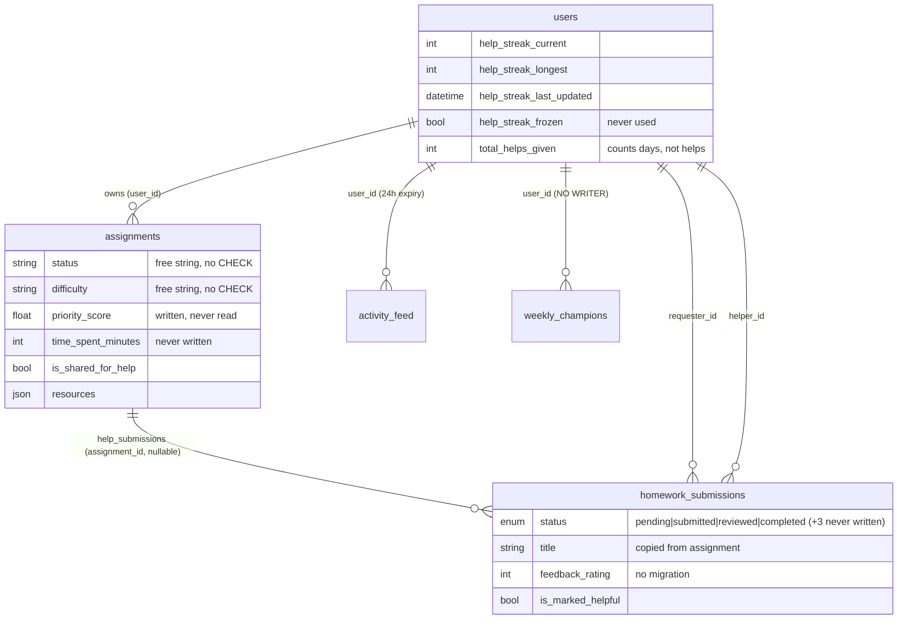

# Feature Production-Readiness Audit — Homework

| | |
|---|---|
| **Feature audited** | Homework (personal assignments + peer-help marketplace + help streak + weekly champions + homework activity feed) |
| **Repository / commit** | `Devpaul-01/StudyHub` @ `7fbdaf3` (shallow clone of default branch) |
| **Audit date** | 2026-11-20 |
| **Scope rule** | Homework only. Other systems (auth, notifications, WebSocket, rate limiter, uploads, leaderboard) were read only where the homework feature depends on them. |
| **Changes made to the repo** | None. `git status` was clean at the end. This file is the only addition (explicitly requested). |

## How to read the evidence labels

Every finding carries one of these labels so you can tell what was actually verified:

- **[Reproduced]** — I ran the behaviour against a **scratch copy** of the repo (outside the repository, in the session scratchpad) using the project's own pytest fixtures (SQLite + fakeredis, the same setup as CI). Output quoted in Appendix A.
- **[Code-confirmed]** — Read directly in the source, with file/line references, but not executed.
- **[Executed-template]** — The frontend template function was executed in Node with a hostile payload; it was *not* run in a real browser.
- **[Unverified risk]** — Plausible from the code/config but I could not verify it here (typically needs Postgres, a real Redis, multiple processes or the production DB). The missing piece is stated.

**What I ran:** the existing homework tests (`tests/unit/services/test_homework_service.py` + 3 integration files): **106 passed** (SQLite, fakeredis). I did **not** run: Postgres, real Redis, multiple workers, a browser, load tests, or the full suite. `psycopg2` could not be built in the sandbox, so the environment used SQLite only.

---

# 1. Executive Summary

**Overall assessment: NOT production-ready in its current state. Critical issues found.**

29 findings: **1 Critical, 3 High, 14 Medium, 11 Low.**

The feature works on its happy path (106 existing tests pass, ownership checks on every endpoint are correct, and several earlier audit fixes — N+1 online-status batching, pure priority scoring, single-commit feedback — are genuinely in place). The problems are in what happens outside the happy path, and in a few places where the product promise and the code disagree.

**Most important findings**

1. **F-01 (Critical) — Stored cross-user XSS.** Every homework field a user controls (title, subject, description, solution text, feedback text, student name, resource name/URL) is interpolated into `innerHTML` templates with no escaping, the backend stores it raw, and no Content-Security-Policy header is set. A connection who views the feed executes the attacker's script as themselves. Demonstrated by executing the card template in Node (not in a browser).
2. **F-02 / F-08 (High / Medium) — Privacy leaks via the activity feed.** Marking a *private* (unshared) assignment complete via `PUT` publishes its title to all connections **[Reproduced]**. `offered_help` events publish the *requester's* name and assignment title to the *helper's* connections, who may not know the requester **[Reproduced]**.
3. **F-03 (High) — Destructive deletes.** A requester can cancel (hard-delete) a **completed** submission, and deleting an assignment silently hard-deletes every helper's submission with no notification **[Reproduced]**. The helper's work and the evidence for their streak vanish; the counters remain.
4. **F-04 (High, unverified) — Schema is not under migration control.** `migrations/versions/` contains two unrelated migrations; nothing creates `assignments`, `homework_submissions`, `activity_feed` or `weekly_champions`, and `feedback_rating` is tagged `MIGRATION-001: missing columns` with no migration. If production lacks that column, every `HomeworkSubmission` query fails.
5. **F-05 / F-06 / F-07 — Logic bugs in the help lifecycle** **[Reproduced]**: no unique constraint on `(assignment_id, helper_id)`; every feedback is marked "helpful" even at rating 1; `total_helps_given` counts *days*, not helps; `submit_solution` writes an activity row and commits *before* validating, attributing it to the wrong name.

**Major reliability / scalability concerns**

- No row locking or conditional updates anywhere; feedback, submit and streak updates are read-modify-write (F-12). Needs Postgres to prove, but the code shape is unambiguous.
- Every authenticated read is rate-limited by **IP**, not user, contradicting the limiter's own docstring; a campus NAT shares one 300/min bucket (F-13). Limiter state is per-process if `REDIS_URL` is unset.
- List/feed/stats endpoints load every matching row into Python and sort there; `help_requests_count` is an N+1 (F-16).

**Is it safe to consider production-ready?** No. F-01 alone blocks that. F-02, F-03 and F-04 should also be resolved or consciously accepted first.

**Positive evidence worth recording** (so the assessment is balanced): every route that touches a specific assignment or submission enforces ownership/participation correctly (verified by code and by existing 403/404 tests); notification creation shares the request transaction; the feature holds **no process-local state** (no module-level caches, locks or counters in `homework_system.py` / `homework_service.py`); homework uploads go to Cloudinary rather than local disk; WebSocket fan-out is Redis-backed when `REDIS_URL` is set; the activity-feed cleanup job is lock-protected and idempotent.

---

# 2. Feature Architecture and Execution Flow

## 2.1 Components

| Layer | Files |
|---|---|
| Frontend (ES modules) | `static/js/homework/homework.{api,state,render,templates,modals,events,delegation,submission,quick-actions,streak,champions,stats,utils,init,showcase-data}.js`; CSS `static/css/homework/homework.css`; markup in `templates/post/feed.html` (`feed2.html` also includes the CSS); activity cards in `static/js/activity/*` call `offer-help` |
| HTTP layer | `routes/student/homework_system.py` (1,708 lines, one blueprint `student_homework`, 20 routes) |
| Service layer | `services/homework_service.py` (priority score, cursor slicing, suggestions), `services/activity_service.py` (`record_live_activity`), `services/notification_service.py` (`notify_homework_*`), `services/online_status_service.py`, `services/rate_limit_service.py` |
| Cross-feature dependencies | `routes/student/posts/crud.py::upload_post_resource` (file upload → Cloudinary), `routes/student/helpers.py::token_required`, `services/leaderboard_service.py` (reads `help_streak_*`, `total_helps_given`, `WeeklyChampion`), `services/websocket_messages.py` (`emit_to_user` / `emit_to_room`) |
| Models | `Assignment`, `HomeworkSubmission` (+ `HomeworkSubmissionStatus` enum), `ActivityFeed`, `WeeklyChampion`; user columns `help_streak_current/longest/last_updated/frozen`, `total_helps_given` |
| Background | `services/jobs/maintenance_jobs.py::cleanup_expired_activity_feed_job` (daily 03:00 UTC, distributed-lock + RQ). **No homework job writes anything.** |
| Redis | Rate-limit counters, notification unread INCR, WebSocket message queue. The feature itself uses no Redis keys. |

## 2.2 Endpoints (all under `/student`, all `@token_required`)

| Method + path | Function | Limiter |
|---|---|---|
| GET `/assignments` | `get_my_assignments` | 300/min **by IP** |
| POST `/assignments` | `create_assignment` | 30/min by user |
| PUT `/assignments/<id>` | `update_assignment` | 30/min by user |
| DELETE `/assignments/<id>` | `delete_assignment` | 30/min by user |
| POST `/assignments/<id>/quick-actions` | `assignment_quick_actions` | 60/min by user |
| GET `/homework/feed` | `get_homework_feed` | 300/min by IP |
| POST `/homework/<id>/offer-help` | `offer_homework_help` | 30/min by user |
| GET `/homework/<id>/helpers` | `get_assignment_helpers` | 300/min by IP |
| GET `/homework/my-help-requests` · `/homework/helping` | inbox lists | 300/min by IP |
| GET `/homework/submission/<id>` | `get_submission_details` | 60/min by user |
| POST `…/submit-solution` · `…/give-feedback` | lifecycle | 30/min by user |
| DELETE `…/cancel` | `cancel_help_request` | 30/min by user |
| GET `/homework/stats` · `/homework/stats/charts` | analytics | 300/min by IP |
| GET `/homework/my-streak` · `/homework/champions` | gamification | 300/min by IP |
| GET `/activity/feed` · `/activity/pulse` | live activity | 300/min by IP |

## 2.3 Data model



There is **no unique constraint** on `homework_submissions(assignment_id, helper_id)`, no `ondelete` on any feature FK, and no CHECK on `assignments.status/difficulty`.

## 2.4 Lifecycle

```mermaid
sequenceDiagram
    autonumber
    actor R as Requester (browser)
    participant API as homework_system.py
    participant DB as Postgres
    participant AF as activity_service
    participant WS as Socket.IO (Redis MQ)
    actor H as Helper (browser)

    R->>API: POST /assignments {title, due_date(local, no tz), share_for_help}
    API->>DB: INSERT assignment (priority_score persisted) + COMMIT
    API->>AF: record_live_activity('started_homework') only if shared
    AF->>DB: INSERT activity_feed + COMMIT
    AF->>WS: emit per connection
    H->>API: GET /homework/feed (connections' shared, active assignments)
    H->>API: POST /homework/<id>/offer-help {} (message ignored)
    API->>DB: SELECT existing → INSERT submission(pending) + notification → COMMIT
    API->>AF: 'offered_help' (includes requester name + title)
    H->>API: POST submit-solution {solution_text, resources}
    API->>AF: 'submitted_solution' + COMMIT  (BEFORE validation)
    API->>DB: UPDATE submission → submitted + notification → COMMIT
    R->>API: POST give-feedback {feedback_text, mark_complete, reaction_type}
    API->>DB: UPDATE submission → completed|reviewed; streak update; notification → COMMIT
    API->>AF: 'achieved_streak' (global) if new record
    R->>API: DELETE cancel (any status!) / DELETE assignment (cascade-deletes all submissions)
```

State machine as implemented (`pending → submitted → completed|reviewed`; `reviewed` is terminal; `accepted/declined/cancelled` exist in the enum but nothing writes them; cancel = hard delete).


---

# 3. Findings and Issues

Severity counts: **Critical 1 · High 3 · Medium 14 · Low 11 (29 total).**
Line numbers refer to commit `7fbdaf3`. `hs` = `routes/student/homework_system.py`.

## Index

| ID | Title | Sev | Category | Evidence |
|---|---|---|---|---|
| F-01 | Stored XSS through every homework text/URL field | Critical | Security | Executed-template |
| F-02 | Completing a *private* assignment publishes its title to connections | High | Security | Reproduced |
| F-03 | Cancel/delete hard-deletes completed help records silently | High | Data Integrity | Reproduced |
| F-04 | Feature tables not under migration control; `feedback_rating` has no migration | High | Reliability | Unverified risk |
| F-05 | No uniqueness on (assignment, helper); offer-help is check-then-insert | Medium | Data Integrity | Code-confirmed |
| F-06 | Feedback is always "helpful"; rating ignored; `total_helps_given` counts days | Medium | Bug | Reproduced |
| F-07 | `submit_solution` commits side effects before validating; wrong name in event | Medium | Bug | Reproduced |
| F-08 | `offered_help` event leaks requester identity to the helper's connections | Medium | Security | Reproduced |
| F-09 | Missing input validation on create/update; faults reported as 400 | Medium | Bug | Reproduced |
| F-10 | Due dates are timezone-naive; interpreted as UTC | Medium | Bug | Code-confirmed |
| F-11 | State-machine gaps (completed/unshared/reviewed/start_working) | Medium | Product | Reproduced |
| F-12 | Read-modify-write without locks (feedback, submit, streak) | Medium | Reliability | Unverified risk |
| F-13 | IP-keyed rate limits on authenticated reads; per-process fallback | Medium | Scalability | Code-confirmed |
| F-14 | Helpers never see the assignment's attachments | Medium | Product | Code-confirmed |
| F-15 | "Weekly Champions" is permanently empty (no writer) | Medium | Product | Code-confirmed (documented) |
| F-16 | Unbounded in-memory loading, N+1 counts, synchronous fan-out | Medium | Performance | Code-confirmed |
| F-17 | README promises reputation for completed help; none is awarded | Medium | Product | Code-confirmed |
| F-29 | Shared `uploadedResources` state leaks attachments between flows | Medium | Bug | Code-confirmed |
| F-18 | "Mind blown" reactions are never counted in charts | Low | Bug | Reproduced |
| F-19 | Submission copies of title/description go stale | Low | Data Integrity | Reproduced |
| F-20 | Cursor pagination unstable on time-dependent priority sort | Low | Bug | Reproduced (unit) |
| F-21 | Dead / contract-mismatched frontend code | Low | Maintainability | Reproduced + Code-confirmed |
| F-22 | Error handling hides faults; one route leaks `str(e)` | Low | Reliability | Code-confirmed |
| F-23 | Stats/filter payloads inconsistent; streak never decays; UTC day boundary | Low | Product | Reproduced |
| F-24 | Notifications lack deep links / dangle after delete | Low | Product | Code-confirmed |
| F-25 | Stale-response races and double-submit windows in the UI | Low | Reliability | Code-confirmed |
| F-26 | Missing FK `ondelete`, CHECKs, composite indexes | Low | Maintainability | Code-confirmed |
| F-27 | Test suite: stale docstring, SQLite-only, no concurrency | Low | Maintainability | Code-confirmed |
| F-28 | Activity retention (24h stored) vs read windows (2h / 30m) | Low | Maintainability | Code-confirmed |

> Numbering: F-29 was found last and is placed with the Mediums.

---

## F-01 — Stored XSS through every homework text/URL field
- **Severity / Category:** Critical / Security · **Evidence:** [Executed-template] + [Code-confirmed]
- **Location:** `static/js/homework/homework.templates.js` — `renderConnectionsHomeworkCard` (L339–), `renderMyHomeworkCard` (L204–), `renderResourcesSection` (L20–60), `renderResourceItem` (L638–664); `homework.submission.js` L216, 236, 323, 400; `homework.events.js` L583, 621; `homework.modals.js` L658–668 (`viewResource`), L779. Backend stores raw: `hs` L615, 645–647 (`.strip()` only), 1380–1385, 1424–1425.
- **Evidence:** There is no escape/sanitize function anywhere in `static/js/homework/` (grep for `escape|sanitize|DOMPurify` finds only unrelated `textContent` assignments). Templates are assembled as strings and assigned via `innerHTML` / `insertAdjacentHTML` (`homework.render.js` L79, 103, 154, 195, 326, 376, …). I executed `renderConnectionsHomeworkCard` in Node with a hostile payload; the output contained, verbatim:
  `<h3 class="hw-card-title"></h3>`, `<p class="hw-card-description"><script>alert(1)</script></p>`, `data-resource-url="javascript:alert(3)"`, and a name value that breaks out of an `alt=""` attribute. The backend never validates resource URL schemes (`hs` L637–640 only require non-empty `url`/`type`). No `Content-Security-Policy` is set anywhere in the application code (`grep -i content-security-policy` finds nothing; `app.py` only sets `X-Content-Type-Options`; `SECURITY.md` lists `X-XSS-Protection`). A reverse proxy/CDN could add one — not verifiable from the repo.
- **Problem:** Any user can store HTML/JS in an assignment (`title`, `subject`, `description`, `resources[].filename/url/type`) or a solution/feedback. It runs in the browser of every connection who sees the feed, the helper list, or a submission. `viewResource` also puts the raw URL into an `<iframe src>` / `` / `<source src>`.
- **Impact:** Script runs with the victim's session. The access-token cookie is HttpOnly by default (good), but the CSRF cookie is intentionally JS-readable and requests are same-origin, so the script can perform any action as the victim (send messages, create/delete assignments, offer help, change profile). The attack reaches exactly the audience a student assignment is shared with.
- **Reproduction:** User A creates an assignment titled `` with `share_for_help=true`; connected user B opens the Connections feed tab. (I verified the generated HTML, not execution in a real browser.)
- **Recommended solution:** (1) Escape on output: add one `escapeHtml()` (and `escapeAttr`) helper to `homework.utils.js` and apply it to every interpolated server value in the homework templates, or build the DOM with `textContent`. (2) Validate `resources[].url` server-side: scheme allow-list (`https:`; the Cloudinary host) and enforce `type ∈ {image, video, pdf, document, …}`; reject `javascript:`/`data:`. (3) Add a CSP (start in `Content-Security-Policy-Report-Only`) as defence in depth. Do **not** rely on sanitising at store time alone — the same strings are rendered in other places (activity cards, notifications).
- **Implementation considerations:** Escaping must be applied at *render*, otherwise legacy rows stay dangerous. `activity.feed.js` / `activity.js` render `activity_data` (assignment titles) and need the same treatment (adjacent surface — confirm before changing). Some templates intentionally contain HTML you generate (icons); only escape data, not markup. CSP will need an inventory of inline scripts in `feed.html` before enforcing.
- **Verification:** Unit test in Node/Jest or Playwright that renders every template with ``/`"><svg onload>`/`javascript:` payloads and asserts no executable markup/handler exists; API test that `javascript:` resource URLs are rejected; browser check that CSP report-only produces no violations before enforcement.

## F-02 — Completing a private assignment publishes its title to connections
- **Severity / Category:** High / Security (privacy) · **Evidence:** [Reproduced R4]
- **Location:** `hs` `update_assignment` L744–753 (contrast L665–674 and the comment at L661–664).
- **Evidence:** `create_assignment` only fires an activity when `assignment.is_shared_for_help` (and says why). `update_assignment` fires `completed_homework` whenever `just_completed` is true, with **no `is_shared_for_help` check**. Repro: a private assignment titled "Secret therapy homework" updated to `status=completed` produced an `ActivityFeed` row, and `GET /activity/feed` as a connection returned `assignment_title` and the actor's name. Note the *quick-action* `mark_complete` path (L817–820) emits **no** activity — the two completion paths behave differently.
- **Problem:** A user who never shared an assignment has its title/subject broadcast (feed + live WebSocket `activity_feed_update`) to all accepted connections.
- **Impact:** Disclosure of private study data that the UI/contract says is private ("a private `Assignment` becomes visible … the moment it's marked shared-for-help").
- **Recommended solution:** Emit `completed_homework` only when `assignment.is_shared_for_help` (matching create), and make both completion paths go through one function so they cannot diverge.
- **Considerations:** Decide whether completion of a shared assignment should be published at all (Question Q-2). Existing `completed_homework` rows for private assignments expire within 24 h, so no data fix is needed.
- **Verification:** Integration test: private assignment → PUT completed → no `ActivityFeed` row; shared → one row; both completion routes behave identically.

## F-03 — Cancel/delete hard-deletes completed help records silently
- **Severity / Category:** High / Data Integrity · **Evidence:** [Reproduced R12, R13]
- **Location:** `cancel_help_request` `hs` L1499–1538 (requester branch L1514–1515 has no status condition; `db.session.delete` L1530); `delete_assignment` L770–794 (bulk `.delete()` L784).
- **Evidence:** Requester `DELETE …/cancel` on a `completed` submission → `200`, row gone. `DELETE /assignments/<id>` with a completed submission → `200`, submission gone, **0 notifications** to the helper. `HomeworkSubmission.assignment_id` is `nullable=True` (`models.py`) yet nothing ever sets it null, and the `CANCELLED` enum value is never written.
- **Problem:** The helper's solution, the requester's feedback, the reaction and `response_time_seconds` are destroyed with no trace, while `User.help_streak_*` / `total_helps_given` (derived from them) remain. Requesters can also revoke a completed help after the helper has been credited. Helpers whose open offers are deleted get no notice.
- **Impact:** Data loss, irreproducible stats (`/homework/stats*` are computed from these rows), and a trivial way to wipe a helper's history.
- **Recommended solution:** Terminal-state submissions (`completed`, `reviewed`) must not be deletable by the requester; use the existing `cancelled` status (soft cancel) for pending/submitted. On assignment delete, either (a) block while non-terminal submissions exist, or (b) set `assignment_id = NULL` (the column is already nullable, suggesting that was the intent) and mark open ones `cancelled` + notify helpers. Keep denormalised title on the submission so detached rows remain readable.
- **Considerations:** Needs a product decision (Q-5). Soft-cancel means every list/stat query must treat `cancelled` explicitly (stats dictionaries currently enumerate four statuses). No schema change if you use the existing enum value and nullable FK.
- **Verification:** Tests: requester cancel on completed → 409/403; cancel on pending → status `cancelled`, row retained, helper notified; delete assignment → helper notified, completed submissions retained with null `assignment_id`.

## F-04 — Feature tables not under migration control; `feedback_rating` has no migration
- **Severity / Category:** High (unverified) / Reliability · **Evidence:** [Code-confirmed] for the repo state, [Unverified risk] for production
- **Location:** `migrations/versions/` (only `b17c0a9d2e41_bookmark_indexes_and_folder_backfill.py`, `f75e60334a86_add_message_reports_table.py`); `models.py` `HomeworkSubmission.feedback_rating` (commented `# MIGRATION-001: missing columns`); `create_all()` appears only in `seed_dev.py` and the test conftests.
- **Problem:** Nothing in the repository creates or evolves `assignments`, `homework_submissions`, `activity_feed` or `weekly_champions`. `feedback_rating` was evidently added after the table existed; its comment says a migration is needed, but none exists. SQLAlchemy selects every mapped column, so if production lacks `feedback_rating`, **every** query on `HomeworkSubmission` fails (offers, lists, feedback, stats, delete-cascade).
- **Impact:** Either the production schema was hand-managed (drift risk, no way to reproduce a new environment) or the feature is already broken there. I cannot tell which from the repo.
- **Recommended solution:** First *verify* against production: `\d homework_submissions` (does `feedback_rating` exist? any unique index? FK `ondelete`?). Then baseline the schema with an Alembic revision that reflects reality, so subsequent constraint changes (F-05, F-26) are normal migrations.
- **Considerations:** Do not run `create_all()` in production. Any new unique constraint (F-05) needs a dedupe step first.
- **Verification:** `alembic upgrade head` on an empty DB produces the same schema as production (`alembic revision --autogenerate` shows no diff).

## F-05 — No uniqueness on (assignment, helper); offer-help is check-then-insert
- **Severity / Category:** Medium / Data Integrity · **Evidence:** [Code-confirmed]; constraint absence [Reproduced R11 — `__table__.constraints` shows only PK/FKs]
- **Location:** `hs` `offer_homework_help` L1047–1076; `models.py` L326–364 (no `__table_args__`).
- **Problem:** The "already helping" guard is a SELECT followed by an INSERT with nothing in the database enforcing it. Two simultaneous requests (double-click — `handleOfferHelp` in `homework.events.js` only uses `confirm()` and doesn't disable the button — or two tabs/instances) both pass the SELECT and insert two submissions.
- **Impact:** Duplicate submissions for one helper: duplicate notifications to the requester, double-counted `help_count`/stats, two solution threads. Behaviour across multiple app instances is identical (this is not instance-local state, it is a missing DB guarantee).
- **Reproduction:** Fire two `POST /homework/<id>/offer-help` concurrently as the same helper (needs Postgres to observe; SQLite in-memory serialises).
- **Recommended solution:** Add `UniqueConstraint("assignment_id", "helper_id")` and handle `IntegrityError` by returning the existing submission (idempotent `200`/`409`). Also take the assignment's state into account (F-11).
- **Considerations:** Migration must first dedupe existing duplicates (keep the most advanced status). Requires F-04's baseline. If you later want "re-offer after cancel", soft-cancel (F-03) + a partial unique index (`WHERE status <> 'cancelled'`) is the way.
- **Verification:** Concurrent-request test on Postgres: N parallel offers → exactly one row, others get the same submission id; migration test with seeded duplicates.

## F-06 — Feedback is always "helpful"; rating ignored; `total_helps_given` counts days
- **Severity / Category:** Medium / Bug · **Evidence:** [Reproduced R2, R3]
- **Location:** `give_feedback` `hs` L1434–1446 and L1450–1454; `_update_help_streak` L103–123.
- **Evidence:** Feedback with `rating=1` and no `is_helpful` produced `is_marked_helpful=True`, `status=completed` — because L1445 `if not is_marked_helpful and data.get("is_helpful", True)` defaults to helpful. The UI never sends `rating` or `is_helpful` (`homework.submission.js` L566–570), so **every completed feedback counts as helpful**. Two completed helps by the same helper on the same day yielded `total_helps_given == 1`, `help_streak_current == 1`: the early-return at L103–108 skips `total_helps_given += 1` (L123), so the counter increments once per *day*.
- **Problem:** "Helpful" carries no information; the streak/leaderboard credit can be farmed (self-created second account connected to the first: share → offer → submit junk → feedback). `total_helps_given`, shown on leaderboards (`leaderboard_service.py` L358, 846), is wrong.
- **Impact:** Corrupted gamification metrics and an abuse path. (Impact is limited because no reputation is awarded — see F-17; that changes if you add it.)
- **Recommended solution:** Decide what "helpful" means (Q-9). Minimum: default `is_helpful` to **False**, derive it from an explicit rating/reaction, and increment `total_helps_given` on every newly completed helpful submission independently of the daily streak check. Consider ignoring credit where requester and helper share an IP/device pattern or are mutual-only accounts (policy decision).
- **Considerations:** Backfill: existing `total_helps_given` can be recomputed from `COUNT(homework_submissions WHERE helper_id=… AND status='completed' AND is_marked_helpful)` — but F-03 means some history is already gone.
- **Verification:** Tests: rating 1–2 → not helpful, no streak credit; two completions same day → `total_helps_given == 2`, streak `1`; completion on consecutive days → streak `2`.

## F-07 — `submit_solution` commits side effects before validating; wrong name in event
- **Severity / Category:** Medium / Bug · **Evidence:** [Reproduced R5] + [Code-confirmed]
- **Location:** `hs` L1364–1376 vs L1378–1382.
- **Evidence:** `record_live_activity(...)` is called (it **commits internally** — `activity_service.py` L115–116) *before* `solution_text` is validated. An empty-text request returned `400` yet left an `ActivityFeed` row `submitted_solution`. `response_time_seconds` is also assigned and committed by that call, so the helper's "response time" is measured to the first *attempt*, not to the first real solution. The payload uses `'requester_name': current_user.name` where `current_user` is the **helper**. `data = request.get_json()` (L1378) is `None` for a missing/invalid body → `AttributeError` → generic 400.
- **Impact:** Connections see "submitted a solution" events for submissions that failed validation; response-time stats are wrong; the event shows the helper's own name as the requester.
- **Recommended solution:** Validate first; mutate; commit once; fire the activity after commit (the pattern `give_feedback` already follows, L1473–1489). Use the requester's name. Parse the body with `request.get_json(silent=True) or {}` and return a real 400 for malformed input.
- **Verification:** Test that an invalid body creates no `ActivityFeed` row and leaves `response_time_seconds` null; a valid body creates exactly one, with the requester's name.

## F-08 — `offered_help` event leaks requester identity to the helper's connections
- **Severity / Category:** Medium / Security (privacy) · **Evidence:** [Reproduced R16]
- **Location:** `hs` L1078–1088; `activity_service.py` `_broadcast_to_connections` L129–163.
- **Evidence:** The event is recorded under the **helper's** id with `requester_name`, `requester_id`, `assignment_title`. A third user connected only to the helper retrieved it from `GET /activity/feed` including the requester's name and the assignment title.
- **Problem:** Assignments are shared with the requester's connections. Broadcasting it to the *helper's* connections (who may be strangers to the requester) widens the audience beyond what the requester chose.
- **Recommended solution:** Strip requester identity and title from `offered_help` (use subject-level info like the global pulse does via `anonymize_for_global`), or do not broadcast it. Same review for `submitted_solution`.
- **Considerations:** Product decision (Q-2). The UI card for `offered_help` may rely on those fields (`activity.feed.js`) — check before removing.
- **Verification:** Test that a user connected only to the helper cannot see the requester's name/title.

## F-09 — Missing input validation on create/update; faults reported as 400
- **Severity / Category:** Medium / Bug · **Evidence:** [Reproduced R8, R9]
- **Location:** `create_assignment` L612–653, `update_assignment` L706–733, `submit_solution` L1380–1385, `give_feedback` L1424–1425, 1428–1432.
- **Evidence (observed responses):** `PUT {"status":"banana"}` → 200, and the assignment then lists with `status='banana'`, `difficulty='impossible'`, `title=''` (all accepted); `estimated_hours: -5` → 200; past `due_date` on update → 200 (create rejects it); `estimated_hours:"abc"` → generic 400 from a `TypeError`; `title: null` → generic 400 (`.strip()` on `None`); create with `difficulty:"nonsense"`, `estimated_hours:-3` → 201; create with an ISO `Z` suffix → generic 400 (`can't compare offset-naive and offset-aware datetimes`, L624/628); non-JSON body → generic 400 (a 415 turned into 400). `status` outside `not_started/in_progress/completed` makes the row disappear from the default "active" list and from every stats bucket. Length: `title` is `String(200)` — over-length input is caught as an exception and reported as "Failed to create assignment" (not verified on Postgres, where it raises). `description`, `solution_text`, `feedback_text` are unbounded `Text`; `resources`/`solution_resources`/`feedback_resources` are arbitrary unbounded JSON with no per-item schema (L634–640 checks only on create; update L720–723 only checks it is a list; solution/feedback resources are not checked at all).
- **Impact:** Corrupt rows, confusing errors, and storage-abuse potential. Because `error_response` defaults to HTTP 400, genuine server faults are indistinguishable from client mistakes for clients and monitors (see F-22).
- **Recommended solution:** One request-validation helper per payload: enum allow-lists for `status`/`difficulty`, numeric range for `estimated_hours`, max lengths, normalise `due_date` (see F-10) to naive UTC and apply the future-date rule consistently or deliberately not on update, validate `resources` items (`url` scheme allow-list, `type` allow-list, max count, max filename length), coerce `None` strings safely, and return 422/400 with a field-specific message. Keep one place so create/update can't diverge again.
- **Considerations:** Existing rows may already contain bad values — query `SELECT status, count(*) FROM assignments GROUP BY 1` before adding a CHECK (F-26).
- **Verification:** Parametrised API tests for each invalid field (expect 4xx with the specific message), plus a 5xx-path test to confirm real faults are not 400.

## F-10 — Due dates are timezone-naive and interpreted as UTC
- **Severity / Category:** Medium / Bug · **Evidence:** [Code-confirmed]
- **Location:** UI: `<input type="datetime-local">` (`templates/post/feed.html` L901, 1040) → value like `2026-11-25T10:00` sent as-is (`homework.modals.js` L143, 428). Server: `hs` L624 `fromisoformat`, L628 compares with `datetime.utcnow()`; `homework_service.calculate_priority_score` and every `hours_until_due`/`is_overdue` use `utcnow()`. Edit form reads it back with `new Date(due_date)` (L55–66), which treats the naive string as *local* time again.
- **Problem:** The user's wall-clock time is stored as if it were UTC. The round trip in the UI hides it, but the server's notions of "overdue", "urgent", priority ordering, smart suggestions and the "Due date must be in the future" check are off by the user's UTC offset. For a Lagos user (UTC+1) an assignment due in 30 minutes is already "overdue" by the server. For users at UTC+13/+14, creating something due in the next 13 hours is rejected as "in the past".
- **Recommended solution:** Send an unambiguous instant from the client (`new Date(value).toISOString()`), parse it server-side and convert to naive UTC (`dt.astimezone(UTC).replace(tzinfo=None)`) — which also fixes the `Z` crash in F-09. Display in local time (the UI already does via `new Date(...)` once the string carries `Z`).
- **Considerations:** Existing rows are "local-as-UTC" and cannot be corrected without knowing each user's zone (Q-6). A forward-only fix (new rows correct, old rows within a day or two of expiry anyway) is usually acceptable.
- **Verification:** Tests with fixed clocks across offsets; UI test that editing a stored due date shows the same wall-clock time as entered.

## F-11 — State-machine gaps
- **Severity / Category:** Medium / Product · **Evidence:** [Reproduced R11, R24]
- **Location:** `hs` L1033–1034 (offer), L1361–1362 (submit), L1421–1456 (feedback), L822–824 (start_working), L833–838 (unshare).
- **Evidence (observed):**
  - An offer on an assignment that is `completed` but still shared → **201** (offer-help never checks `assignment.status`).
  - After the owner unshares, an existing helper can still submit a solution → **200**; unshare doesn't close or even surface open offers (and `get_assignment_helpers` then refuses to list them: "not shared", L149–150).
  - `give_feedback` with `mark_complete=false` sets `reviewed`; afterwards neither side can act: second feedback → 400 "solution not submitted yet", helper resubmit → 400. `reviewed` is a dead end, so the helper never gets streak credit for that help. (The UI checkbox is checked by default, so this affects users who uncheck it.)
  - `start_working` on a `completed` assignment sets `in_progress` but leaves `completed_at` set; `mark_complete` on an already-completed one overwrites `completed_at`.
  - `ACCEPTED/DECLINED/CANCELLED` exist in the enum but there is no accept/decline step: anyone connected can attach themselves to an assignment and the requester cannot refuse.
  - Submissions between users who later block each other remain readable and actionable (participants-only check; blocking flips the `Connection` row but these routes only check connection at offer time).
- **Recommended solution:** Define the lifecycle once as a transition table (`allowed = {pending: {submitted, cancelled}, submitted: {submitted, reviewed, completed}, reviewed: {completed, submitted}, …}`) and enforce it in the three mutating routes; reject offers on non-active assignments; on unshare/complete, mark open offers `cancelled` and notify. Make `start_working` clear `completed_at`.
- **Considerations:** Several of these are product rules (Q-4). The smallest safe subset: block offers on completed assignments, allow `reviewed → completed`, clear `completed_at` on reopen.
- **Verification:** Transition-matrix test enumerating every (state, action) pair.

## F-12 — Read-modify-write without locks (feedback, submit, streak)
- **Severity / Category:** Medium / Reliability · **Evidence:** [Unverified risk] — needs concurrent requests against Postgres
- **Location:** `give_feedback` L1421–1471; `submit_solution` L1361–1393; `_update_help_streak` L96–129 (`user.help_streak_current += 1`, `total_helps_given += 1` on an ORM object loaded without `FOR UPDATE`).
- **Problem:** Two concurrent `give-feedback` calls for one submission both pass `status == "submitted"`, both write, both notify the helper (duplicate notification; second overwrites feedback/reaction). Two different requesters completing two of the same helper's submissions at once both read the same `help_streak_last_updated` and both increment, so the streak can advance by 2 for one day (or increments are lost). Behaviour is identical with one worker and several; running multiple instances only raises the probability.
- **Recommended solution:** Use conditional updates: `UPDATE homework_submissions SET status='completed', … WHERE id=:id AND status='submitted'` and check `rowcount == 1` (idempotent: second call returns the current state). For the streak, `SELECT … FOR UPDATE` on the user row or a single `UPDATE users SET help_streak_current = CASE …` expression. Row locks are compatible with PgBouncer **transaction** pooling (the config's mode) because they live inside one transaction; avoid session-level advisory locks.
- **Considerations:** No new infrastructure; no Redis lock needed. Keep the single-commit structure introduced by AUDIT ENG-8.
- **Verification:** Postgres-backed concurrency tests (threads or `pytest-xdist`) asserting one notification, one status transition, and correct streak after N parallel calls.

## F-13 — IP-keyed rate limits on authenticated reads; per-process fallback
- **Severity / Category:** Medium / Scalability · **Evidence:** [Code-confirmed]
- **Location:** every read route in `hs` uses `key_func=ip_key` with `PUBLIC_READ` (300/min); writes use `user_or_ip_key`. `services/rate_limit_service.py::user_or_ip_key`'s docstring documents that IP keys are "the wrong granularity once a user is known (a shared campus/NAT network would otherwise rate-limit unrelated students together)" and says user keys are used "on every `@token_required`-protected route" — the homework reads contradict that. `config.py` L175: `RATE_LIMIT_STORAGE_URI` falls back to `memory://` if neither `RATE_LIMIT_STORAGE_URI` nor `REDIS_URL` is set.
- **Problem:** A university network typically presents many students from one IP. The homework tab alone issues several GETs on load (assignments, streak, champions, stats, activity feed/pulse, tab lists), so a lecture-hall of students could share one 300/min bucket and hit 429s (I did not measure the exact request count per page load or simulate NAT load). In memory-storage mode each worker keeps its own counters, so the effective limit scales with instance count and resets on restart; the Redis-failure `in_memory_fallback` has the same per-instance property (by design, fail-open).
- **Recommended solution:** Switch the authenticated read routes to `user_or_ip_key` (one-word change per route). Make production startup fail loudly (or at least log at ERROR) if `RATE_LIMIT_STORAGE_URI` resolves to `memory://` while more than one worker/instance is configured.
- **Considerations:** Per-user limits are *less* protective against an unauthenticated flood, but these routes are all behind `token_required` anyway. No new infrastructure.
- **Verification:** Test that two users from one IP don't share a bucket; deployment check that the limiter reports Redis storage.

## F-14 — Helpers never see the assignment's attachments
- **Severity / Category:** Medium / Product (end-to-end mismatch) · **Evidence:** [Code-confirmed]; submission-detail keys [Reproduced R23]
- **Location:** UI renders `hw.resources` on the connections card (`homework.templates.js` L363); `get_homework_feed` payload (`hs` L967–992) has no `resources`; `get_submission_details` returns `assignment: {id, due_date, status}` only (L1328–1332); `get_homework_im_helping_with` has no resources either.
- **Impact:** A student attaches the problem sheet to an assignment (the create/edit form has an upload widget and persists `resources`), then shares it — and the helper can't see the file. The request to help is often unanswerable.
- **Recommended solution:** Include `resources` in the feed and submission-detail payloads (to participants/connections only), and render them with the F-01 escaping and URL validation.
- **Considerations:** Resources are Cloudinary URLs; confirm they are not private/signed per owner. Decide whether *all* connections or only offering helpers should see files (Q-10).
- **Verification:** API test asserting `resources` present for a connection and absent for non-connections; UI test rendering the card.

## F-15 — "Weekly Champions" is permanently empty (no writer)
- **Severity / Category:** Medium / Product · **Evidence:** [Code-confirmed]; already documented in `ARCHITECTURE.md` §5.6 and `PRODUCT_OVERVIEW.md` §10
- **Location:** reader `hs` L407–491; `leaderboard_service.py` L818–819; model `models.py` L182–216; `grep` finds no `WeeklyChampion(` constructor or insert anywhere.
- **Impact:** The dashboard panel can only ever show `null`/empty plus `your_progress`, which *is* computed live from submissions. The champion-badge flag in the leaderboard is always false.
- **Recommended solution:** A product decision (Q-7): either build the weekly job (it belongs next to the existing locked scheduler jobs, with an idempotent upsert keyed by `(week_start, champion_type, subject)` and a unique index) or hide the UI/endpoint until it exists. Not both.
- **Considerations:** If built, it must tolerate duplicate execution (the scheduler uses a Redis `SET NX` lock, so this is already supported) and define "champion" against `is_marked_helpful` (F-06 first, otherwise champions are meaningless).
- **Verification:** Job test: run twice → identical rows; week boundary handling (`week_start` is Monday, UTC).

## F-16 — Unbounded in-memory loading, N+1 counts, synchronous fan-out
- **Severity / Category:** Medium / Performance · **Evidence:** [Code-confirmed]; no profiling done
- **Location:** `get_my_assignments` L510–585 (`query.all()`, Python sort, per-page-item `HomeworkSubmission.query…count()` at L565–567 = up to 50 extra queries/page); `get_homework_feed` L901–1000 (loads every shared active assignment from all connections, sorts in Python; `total`/`available_subjects` computed over the full set); `get_homework_stats`, `get_homework_chart_data` (`.all()` over all of a user's rows); `get_activity_feed`, `get_homework_feed` and `_broadcast_to_connections` each re-read the user's full connection list; `record_live_activity` emits one Socket.IO message per connection synchronously in the request thread (`activity_service.py` L159–163). The service itself documents the priority-sort limitation (`homework_service.py` L115–124).
- **Impact:** Cost grows with the user's history and number of connections, not with page size. For typical student volumes this is fine today; it is the first thing to degrade with growth, and the synchronous fan-out adds latency to write requests for highly connected users.
- **Recommended solution (smallest effective):** (1) Replace the per-row count with one grouped query (the feed route already does exactly this at L949–957). (2) Compute stats with `GROUP BY status` instead of loading rows. (3) For `due_date`/`created_at` sort, use SQL `ORDER BY` + keyset pagination; keep the in-Python priority sort but cap the loaded set (e.g. non-completed only, limit N). (4) Later, move connection fan-out to a single room per user-neighbourhood or an RQ job. None of this needs new infrastructure.
- **Verification:** Query-count assertions (SQLAlchemy event listener) on list endpoints; a synthetic-data benchmark (the repo has `benchmarks/`) before/after.

## F-17 — README promises reputation for completed help; none is awarded
- **Severity / Category:** Medium / Product · **Evidence:** [Code-confirmed]
- **Location:** `README.md` L75 ("a completed homework help … awards or deducts reputation through a single write path (`award_reputation()`)"); `homework_system.py` and `homework_service.py` never call `award_reputation` (the only mention is in a comment, L89); `reputation_service.py`/`badge_service.py` have no homework action.
- **Impact:** Either the docs overstate the product or the integration was lost. It also means the abuse risk in F-06 is currently confined to streak/leaderboard fields.
- **Recommended solution:** Decide (Q-3). If reputation should be awarded, do it inside the same transaction as the `completed` transition (so it is atomic with the state change and idempotent via the conditional update in F-12), only for genuinely helpful completions, with an anti-collusion rule.
- **Verification:** Test that completing exactly once awards exactly once, even under retries.

## F-29 — Shared `uploadedResources` state leaks attachments between flows
- **Severity / Category:** Medium / Bug (cross-record data leak) · **Evidence:** [Code-confirmed]
- **Location:** `homework.state.js` L84, 232–253; cleared only in `homework.modals.js` L268 (when the *create-assignment* modal opens); read by `handleSubmitSolution` (`homework.submission.js` L521–524) and `homework.delegation.js` L563–590 (solution upload), and by `handleCreateAssignment` (`homework.modals.js` L393). Neither `openSubmissionDetailModal` nor a successful submit clears it.
- **Problem:** The same array backs both "attachments for a new assignment" and "attachments for a solution". Closing the create modal doesn't clear it, and a successful solution submission leaves its files in place. Next solution (for a *different* submission/requester) is posted with the previous files, and files attached to a private assignment draft can be sent along with a solution to someone else.
- **Impact:** Wrong files attached to the wrong record, including potentially private documents delivered to another user.
- **Recommended solution:** Separate state per flow (`createResources`, `solutionResources`), clear the solution list when the submission modal opens and after a successful submit.
- **Verification:** UI test: attach file in submission A, submit, open submission B, submit → B has no files; draft assignment attachments never appear in a solution.

---

## Low-severity findings

### F-18 — "Mind blown" reactions are never counted in charts · [Reproduced R7]
`give_feedback` accepts `mindblown` (L1429, and the UI sends exactly that, `homework.submission.js` L351) but `get_homework_chart_data` maps `mind_blown` (L1652–1657). A stored `mindblown` reaction yields count 0 in "Reactions Received". **Fix:** one shared constant for reaction keys. **Verify:** unit test round-trips every accepted reaction through the chart.

### F-19 — Submission copies of title/description go stale · [Reproduced R25]
`offer_homework_help` copies `title/description/subject/difficulty` into the submission (L1057–1066); every list and notification reads the copy. After the owner renames the assignment the helper still sees "Original title". **Classification: Redundant.** Either join to the assignment for display and keep the copy only as a fallback when `assignment_id` is null (see F-03), or refresh the copy on assignment update. Requires a decision on detached rows (Q-5).

### F-20 — Cursor pagination unstable on time-dependent sort · [Reproduced R17 at unit level]
`slice_by_cursor` finds the cursor id in the freshly re-sorted list; priority changes with time/status. If the cursor row is no longer in the list (completed, deleted, dropped by the filter), the function silently restarts from index 0 → repeated items. `total` is recomputed each call. Acknowledged in the service docstring. **Fix:** for due_date/created_at use keyset on `(sort_value, id)`; for priority, snapshot the ordering server-side or accept and document. Also `loadMoreMyHomework` passes only `status`, not `subject`/`sort` (`loadMoreMyHomework` in `homework.render.js`), so a filtered/sorted first page is followed by an unfiltered/default-sorted next page *if* those filters are ever set in the UI (not verified that the UI currently sets them).

### F-21 — Dead or contract-mismatched frontend code · [Reproduced R1] + [Code-confirmed]
- `homework.quick-actions.js` sends `start|complete|reopen|share|unshare|delete`; the backend accepts `start_working|mark_complete|share_for_help|unshare`. Every one except `unshare` returns `400 Invalid action` (R1). It is currently **unreachable**: `renderQuickActions`/`renderBulkActionsBar` are never called and nothing renders `data-action="enable-bulk-mode"` (only the handler exists), so users don't hit it today — it would break the moment someone wires it in. `homework.events.js` (`toggleAssignmentStatus`) uses the correct names; that is the live path.
- `give-reaction` handler (`homework.delegation.js` L251–259) imports `handleReactionClick`, which `homework.submission.js` does not export; nothing renders `data-action="give-reaction"`.
- `initStreakWebSocket` is commented out in `homework.init.js`; the `streak_updated` event it listens for is emitted by no backend code (`grep`: only `push_notifications.notify_streak_updated`, a push helper).
- `static/css/homework.css` (4,913 lines) is referenced by no template/script; the app loads `static/css/homework/homework.css` (4,982 lines; the two differ by ~348 diff lines).
- `homework.quick-actions.js` is both imported by `homework.delegation.js` and loaded as a separate `<script type="module">` in `feed.html` L2902 (harmless duplicate).
**Classification:** potentially unused — verify with the owner before deleting (Section 5).

### F-22 — Error handling hides faults; one route leaks `str(e)` · [Code-confirmed]
Every route catches `Exception` and returns `error_response("Failed to …")`, which defaults to **HTTP 400** (`helpers.py` `error_response`). Real server faults (DB down, constraint errors) therefore look like client errors, and logs record `str(e)` without a traceback (`current_app.logger.error(f"…: {str(e)}")`; no `exc_info`). `get_assignment_helpers` (L212–216) returns `str(e)` to the client in a 500, exposing internals. **Fix:** log with `exc_info=True`, return 500 for unexpected exceptions, never echo exception text, let validation errors be specific 4xx (F-09).

### F-23 — Stats/filter payloads inconsistent; streak never decays; UTC day boundary · [Reproduced R21, R22] + [Code-confirmed]
- `GET /assignments` computes `stats` and `total` over the *filtered* set: with the default `status=active`, `stats.completed` is always `0` (R22).
- `GET /homework/feed` computes `available_subjects` from the already-subject-filtered set, so selecting "Math" collapses the list to `['Math']` (R21). (No frontend consumer references `available_subjects` or `filters_applied` — see Section 5.)
- `help_streak_current` is only reset on the *next* help; `GET /homework/my-streak` and the leaderboards (`leaderboard_service.py`) keep showing e.g. 7 after a week of inactivity, flagged only by `streak_at_risk`.
- The streak day is `datetime.utcnow().date()`; a Lagos user helping at 00:30 local counts for the previous UTC day.
**Fix:** compute stats over the unfiltered owner set, compute `available_subjects` before applying the subject filter, expose an *effective* streak (0 if `last_updated < yesterday`), and decide on a streak-day timezone (Q-13).

### F-24 — Notifications lack deep links / dangle after delete · [Code-confirmed]
`notify_homework_feedback_received` and `notify_homework_help_cancelled` carry no `related_type/related_id` (`notification_service.py` L271–297), so there is nothing to open. `homework_help_offer`/`solution_submitted` point at a submission id that F-03 can delete, leaving a dead link. Also, `notify()` increments the Redis unread counter and pushes best-effort *before* the route commits (`offer_homework_help` L1072–1076); if the commit then fails, the counter is inflated and a ghost push may have been delivered [Unverified risk — read from `notify()`'s docstring, not exercised].

### F-25 — Stale-response races and double-submit windows in the UI · [Code-confirmed]
`loadMyHelpRequests` / `loadHelpingWith` / tab loaders set a loading state and render whatever response arrives last; there is no request token or `AbortController`, so switching filters quickly can render an older response over a newer one. `handleOfferHelp` uses `confirm()` but leaves the button enabled (double-click → F-05). `handleCreateAssignment` re-enables the button on a 5 s timer *and* in `finally` (`homework.modals.js` L408–420), so a slow request (>5 s) allows a second submission. **Fix:** per-loader sequence counter; disable buttons until the request settles; send an idempotency key for create.

### F-26 — Missing FK `ondelete`, CHECKs, composite indexes · [Code-confirmed]
No `ondelete` on `Assignment.user_id`, `HomeworkSubmission.requester_id/helper_id/assignment_id`, `ActivityFeed.user_id`, `WeeklyChampion.user_id` (there is currently no account-deletion route, so this is latent). `assignments.status/difficulty` and `homework_submissions.difficulty/reaction_type` are free strings. Indexes are single-column; the hot queries filter on `(user_id, status)`, `(is_shared_for_help, status, user_id)` and `(helper_id|requester_id, status)`. **Fix (after F-04):** add CHECK/enum constraints once existing data is verified clean, add composite indexes only when the queries in F-16 are moved into SQL.

### F-27 — Test suite: stale docstring, SQLite-only, no concurrency · [Code-confirmed]
`tests/integration/test_homework_submission_routes.py` docstring L1–20 describes a serious enum `LookupError` and "xfail tests below" — there are no xfail tests, `submitted/reviewed` are valid enum members now, and the submit/feedback tests pass. The docstring is misleading. CI runs only SQLite + fakeredis (`integration-tests.yml`), while production uses Postgres behind PgBouncer; constraint, locking and enum-CHECK behaviour differ. See Section 7.

### F-28 — Activity retention vs read windows · [Code-confirmed]
Rows live 24 h (`ACTIVITY_EXPIRY_HOURS`, plus a daily cleanup job) but `GET /activity/feed` reads only the last **2 h** (`hs` L242) and `/activity/pulse` the last **30 min** (L333); the docs describe a 24-hour feed. Either the windows or the retention is wrong. Low impact (cleanup keeps the table bounded); cosmetic until someone relies on the stated 24 h.


---

# 4. Horizontal Scalability Assessment

## 4.1 Current architecture and assumptions

- **Application state:** The feature holds **no process-local state**. `homework_system.py` / `homework_service.py` contain no module-level caches, locks, counters or queues; priority scores are pure functions; pagination cursors are ids recomputed per request; online status is derived from `users.last_active` in the database. Browser state (`homeworkState`) is per-tab and not shared by design.
- **Auth:** stateless JWT in a cookie/Bearer header, decoded per request (`token_required`) — instance-independent.
- **Shared infrastructure actually used by this feature:** Postgres (all data), Redis (rate-limit counters, notification unread INCR — atomic, WebSocket message queue), Cloudinary (uploads via `upload_post_resource`; no local-filesystem dependency on the homework path), the APScheduler + Redis `SET NX EX` lock + RQ pattern for the one cleanup job.
- **Crash tolerance:** each state change is one DB transaction (the notification row is created in the same transaction — an effective outbox). The only things that can be lost on a crash between commit and the next statement are best-effort side channels (`record_live_activity` row/WebSocket push), which is acceptable.

## 4.2 Immediate problems (actual today, with one instance or several)

| # | Issue | Why it matters across instances | Fix | Extra infra |
|---|---|---|---|---|
| S-1 | Duplicate offers (F-05) | The race exists with one worker; N workers/users multiply it. Only the DB can arbitrate. | Unique constraint + `IntegrityError` handling | None |
| S-2 | Read-modify-write on submission/streak (F-12) | Two instances process "feedback" and "streak" concurrently with stale reads. | Conditional `UPDATE … WHERE status=…` / `FOR UPDATE` (works under PgBouncer transaction pooling because the lock lives in one transaction) | None |
| S-3 | IP-keyed limiter on authenticated reads (F-13) | NAT-shared users throttle each other; if storage resolves to `memory://`, each instance has its own counters, so the effective limit is `limit × instances` and resets on restart | `user_or_ip_key`; refuse/alert on `memory://` in multi-instance deploys | None (Redis already present) |

## 4.3 Conditional / configuration risks

- **WebSocket delivery:** `emit_to_user`/`emit_to_room` reach other instances only when `REDIS_URL` is set (`websocket_messages.py` wires `message_queue`; `app.py` logs `[WS_MESSAGE_QUEUE_DISABLED]` otherwise). Without it, `activity_feed_update` events silently reach only sockets on the emitting instance. [Unverified risk — depends on deployment env.]
- **Fail-open Redis:** `extensions.py` sets `redis_client = None` if Redis is unreachable at import; the limiter falls back to in-memory, notification counters fail open. Acceptable by design, but it means *correctness of feature data never depends on Redis* — that is a good property and should be preserved (do not move the fixes above into Redis locks).

## 4.4 Future scaling improvements (not needed now)

- **Fan-out cost (F-16):** `record_live_activity` loops over every accepted connection and emits one message each, synchronously after the request's commit. Fine for tens of connections; move to a per-user "followers" room or an RQ job if connection counts grow.
- **List endpoints (F-16):** load-all-then-sort-in-Python makes memory/CPU per request proportional to history. Moving due-date/created-at sorts and stats into SQL is the proportionate fix; do not introduce a cache layer for this.
- **Database contention:** Hot rows are `users` (streak counters) and `assignments`/`homework_submissions` per user — low contention. The `users.help_streak_*` update is the only cross-user hot spot and a single-statement UPDATE removes it.
- **Connection usage:** `token_required` does `User.query.get` per request and routes then reload users again (`User.query.get(...)` appears several times per request) — minor, only relevant under PgBouncer limits.

## 4.5 Not recommended

Distributed locks around feedback/offer/streak: the database already provides the needed atomicity (unique constraint, conditional update, row lock), and Redis locks would add a failure mode (lock expiry, Redis outage) to code whose correctness currently does not depend on Redis.

---

# 5. Data Usage and Cleanup Report

Classification key: **1** Confirmed unused · **2** Potentially unused — requires verification · **3** Required indirectly — retain · **4** Redundant — can potentially be consolidated. "Evidence" lists what I searched (Python, JS, templates, tests, docs) — a single search hit/miss was never treated as conclusive without checking writers *and* readers.

| Resource | Current usage | Evidence | Class | Recommendation |
|---|---|---|---|---|
| `assignments.priority_score` (column) | Written on create/update/quick-action; **never read** by any route, service, job, template or JS; list/feed recompute it per request | `grep priority_score` outside `homework_*` and tests → only `models.py`; `homework_service.py` docstring says read paths must not use it | 1 (read side) / 4 (duplicate of a pure function) | Stop persisting; later drop column via migration. Keep the *API field* only if an external client (see `openapi.yml`/mobile) uses it — **verify before removing**. Needs a migration; no data to preserve. |
| API field `priority_score` in list/feed/create/update responses | Returned; no JS reads it (sorting is server-side) | `grep` in `static/js`, `templates` | 2 | Verify no external consumer, then remove |
| `assignments.time_spent_minutes` | Default 0, returned in list, **no write path**, no JS reads it | `grep time_spent_minutes` → model + one response key | 1 | Drop column and response key (migration; nothing to preserve) — or build the feature it was meant for |
| `assignments.estimated_hours` | Used in priority bonus and UI | `homework_service.py` L65; templates | 3 | Keep; add validation (F-09) |
| `assignments.resources` | Written by owner UI, shown to owner, **not exposed to helpers** | F-14 | 3 | Keep; expose to helpers |
| `assignments.completed_at` | Set/cleared on completion | `hs` L729–733, 819 | 3 | Keep; fix reopen (F-11) |
| `homework_submissions.title/description/subject/difficulty` | Copied at offer time, read by lists/notifications | F-19, R25 | 4 | Consolidate to the assignment via join; retain only as fallback for detached rows. Depends on F-03 decision; no migration if you only change read paths |
| `homework_submissions.assignment_id` nullable | Always populated; nullable but never null | `hs` L1060; no code path nulls it | 3 | Keep nullable *if* adopting `SET NULL` on assignment delete (F-03) |
| `HomeworkSubmissionStatus.ACCEPTED / DECLINED / CANCELLED` | Defined; **no code writes them**; cancel hard-deletes | `grep HomeworkSubmissionStatus` → only definition; no string literals `"accepted"/"declined"/"cancelled"` in homework routes | 2 | Keep until lifecycle decision (Q-4/Q-5); `cancelled` is the natural soft-cancel state |
| `homework_submissions.feedback_rating` | Written only if the client sends `rating` (UI never does); not returned by any endpoint | `homework.submission.js` L566–570; `grep feedback_rating` | 2 | Decide with F-06: either add a rating UI + use it, or drop it. **Migration state unknown (F-04)** |
| `is_marked_helpful` | Gates streak, champions progress, helper badge in UI | `hs` L189, 461–467, 1453 | 3 | Keep, but fix semantics (F-06) |
| `reaction_type` | Written/read; chart key mismatch for `mindblown` | F-18 | 3 | Keep |
| `reaction_at` | Written; returned in helper list; **no frontend consumer** | `grep reaction_at` in `static/js` → none (excluding showcase) | 2 | Keep column (cheap); drop from response if confirmed unused |
| `response_time_seconds` | Used by stats chart | `hs` L1675–1696 | 3 | Keep (fix F-07) |
| `solution_resources` | Written/rendered | submission views | 3 | Keep; validate (F-09) |
| `feedback_resources` | Rendered by UI; **UI never sends it** | `homework.events.js` L623–633; no sender in `handleSubmitFeedback` | 2 | Keep until feedback-attachment decision |
| `weekly_champions` table | Read by `get_current_champions` and `leaderboard_service`; **no writer** | F-15; `grep WeeklyChampion` | 3 (read paths depend on it) | Keep; decide build-vs-hide (Q-7). Do **not** drop without removing both readers |
| `weekly_champions.avg_response_time_minutes` | `String(50)`, never read or written | model only | 2 | If the job is built, change to numeric; otherwise drop with the table decision |
| `activity_feed` table | Written by `record_live_activity`; read by feed/pulse/leaderboard-adjacent code; cleaned daily | `activity_service.py`, `maintenance_jobs.py` | 3 | Keep; reconcile retention (F-28) |
| `users.help_streak_frozen` | **No reader or writer** anywhere (Python, JS, templates) | `grep help_streak_frozen` → `models.py` only | 1 (in repo) | Users-table column shared with leaderboard code; confirm with owner then drop via migration or implement "streak freeze" |
| `users.total_helps_given` | Written once per day (bug), read by leaderboards | F-06; `leaderboard_service.py` L358, 846 | 3 | Keep, fix and recompute |
| API fields `available_subjects`, `filters_applied` (feed) | Returned; no frontend reference | `grep` in `static/js`, `templates` → none | 2 | Remove or use after F-23 |
| API field `help_requests_count` | Used by UI card | `homework.templates.js` | 3 | Keep; replace N+1 (F-16) |
| Offer `message` (client → server) | Sent by `homeworkAPI.offerHelp(id, message)` (default `''`); `handleOfferHelp` doesn't pass one; backend reads `data` and **discards it** (L1055) | `hs` L1055–1066 | 1 (data collected, never persisted) | Remove the unused parameter on both sides, **or** persist it as the offer note — product decision (Q-4) |
| `homeworkState.uploadedResources` (frontend) | Shared across two unrelated flows | F-29 | 4 | Split per flow |
| `homework.quick-actions.js` (`renderQuickActions`, bulk mode, `handleBulkAction`) | Imported but never rendered | F-21 | 2 | Delete or fix the action names and wire it in |
| `give-reaction` handler / `handleReactionClick` | Handler present, target function missing, never rendered | F-21 | 1 | Remove handler |
| `initStreakWebSocket` / `streak_updated` listener | Disabled in `init.js`; no emitter | F-21 | 1 | Remove or implement the emitter |
| `static/css/homework.css` | Not referenced by any template/script; app loads `css/homework/homework.css` | `grep` of all templates/JS/Python/docs | 2 | Verify not served to other pages/CDN, then delete the duplicate |
| `homework.showcase-data.js` | Demo data; referenced by showcase seeds | `message.showcase-seed.js`, `container-detect.js` mention homework | 2 | Out of scope; leave |
| `push_notifications.notify_assignment_due_soon` | Defined, **no caller** — due-date reminders do not exist | `grep notify_assignment_due_soon` outside `tests/` → definition only (I did not check whether tests reference it) | 2 | Product question Q-11 (build reminders vs. delete helper) |
| `Assignment.calculate_priority()` | Already removed (comment explains) | `models.py` | — | No action |

**Dependencies/migrations for removals:** all column drops above (`priority_score`, `time_spent_minutes`, `help_streak_frozen`, `feedback_rating`, `reaction_at`) need an Alembic migration **after** F-04's baseline; none contain data worth preserving except `feedback_rating` (currently NULL for all UI-created rows by construction) — export before dropping if you have ever accepted ratings through the API. `help_streak_frozen`/`total_helps_given` live on `users`, which other features read — coordinate with the leaderboard owner. Frontend-only removals need no migration.

---

# 6. End-to-End Data Consistency Report

| Data path | Frontend | API / backend | Persisted / returned | Mismatch → Correction |
|---|---|---|---|---|
| Due date | `datetime-local` string (no tz) | parsed as naive, compared to `utcnow` | stored naive; returned without tz; UI reparses as local | Wall-clock stored as UTC (F-10). Send/convert instants. Also fixes `Z` crash (F-09) |
| Create/Update fields | title/subject/…/`estimated_hours` as typed | no enum/range/length checks | arbitrary strings stored | `status:"banana"` accepted (R8) → validation layer (F-09) |
| Quick actions | `toggleAssignmentStatus` uses correct names (live); `quick-actions.js` uses `start/complete/share/reopen` (dead) | accepts `start_working/mark_complete/share_for_help/unshare` | — | Dead path returns 400 (R1). Delete or align (F-21) |
| Completion event | PUT vs quick-action | PUT emits `completed_homework` (even for private), quick-action emits nothing | `activity_feed` | Two behaviours for one action (F-02) |
| Offer message | `offerHelp(id, message)` | reads body, drops it | not stored | Collected, discarded (§5) |
| Assignment resources → helper | uploaded + saved; feed card renders `hw.resources` | feed payload has no `resources` | stored in `assignments.resources` | Helper sees nothing (F-14) |
| Solution/feedback attachments | shared `uploadedResources` array | stores whatever list is sent (no validation) | `solution_resources` JSON | Wrong-flow leakage (F-29) |
| Feedback "helpful" | UI sends text + `mark_complete` + optional reaction only | defaults `is_helpful=True`; `rating` unused | `is_marked_helpful=True` always | Meaningless flag (F-06) |
| Reaction | UI value `mindblown` | accepts `mindblown` | `reaction_type='mindblown'` | Chart key `mind_blown` → count 0 (F-18) |
| Streak | UI reads `current_streak` | increments once/day; no decay | `help_streak_*`, `total_helps_given` | Counter counts days; stale streak shown (F-06, F-23) |
| Submission title/description | helper list/detail | copied at offer time | `homework_submissions.*` | Stale after assignment edit (F-19) |
| Stats | `/assignments` `stats` | computed over the filtered list | — | `completed` always 0 under default filter (F-23) |
| Cancel/delete | `confirm()` then DELETE | hard-deletes any status | rows removed | History destroyed, counters remain (F-03) |
| Notifications | in-app notification list | feedback/cancel lack `related_id` | `notifications` | No deep link / dangling (F-24) |
| Streak events | listens for `streak_updated` (disabled) | never emitted | — | Dead (F-21) |
| User sees success but operation failed | `submit-solution` empty text | activity row + commit before 400 (R5) | `activity_feed` row exists | Success event for failed operation (F-07) |
| Operation succeeded but UI reports failure | create/update with an ISO `Z` timestamp from any non-UI client | generic 400 after exception | nothing saved | Correctly nothing saved, but wrong error text; UI itself doesn't send `Z` (F-09/F-10) |
| Partial failure | `offer_homework_help` | notify (Redis INCR + push) before commit | DB commit may fail afterwards | Ghost counter/push possible (F-24, unverified) |

---

# 7. Testing Gaps

**Existing coverage (verified by running it):** 106 tests, all passing — priority scoring, cursor slicing, suggestions, happy-path CRUD, ownership 403/404, simple list/filter behaviour, basic offer/submit/feedback/cancel, stats happy path. The suite is genuinely useful for regression of the happy path.

**Tests that pass but don't verify the real behaviour**

| Existing test | Gap |
|---|---|
| `test_requester_can_give_feedback_after_solution_submitted` | Passes while rating is ignored and everything is "helpful" (F-06) |
| `test_also_deletes_associated_help_requests` | Encodes the destructive behaviour (F-03) as desired |
| `TestGetCurrentChampions::test_includes_a_registered_champion` | Inserts a row by hand; nothing exercises a producer (F-15) |
| Docstring in `test_homework_submission_routes.py` | Describes a bug and xfails that no longer exist (F-27) |

**Recommended new tests (not written — per instructions)**

| Level | Behaviour to verify | Finding |
|---|---|---|
| Unit (frontend, Node/Jest) | Every template escapes `<`, `>`, `"`, `'` in title/subject/description/name/filename/url; `javascript:` URLs never reach `href/src/iframe` | F-01 |
| Integration | Private assignment completion (PUT and quick-action) emits no activity; shared emits one | F-02 |
| Integration | `offered_help`/`submitted_solution` payload for a connection-of-helper contains no requester identity | F-08 |
| Integration | Requester cancel of `completed` is rejected; delete-assignment notifies helpers and keeps terminal rows | F-03 |
| Integration (Postgres) | Concurrent offers → exactly one submission; unique-violation path returns idempotent result | F-05 |
| Integration (Postgres) | Concurrent `give-feedback` → one transition, one notification; concurrent streak updates → correct streak/`total_helps_given` | F-12 |
| Integration | rating 1–2 not helpful, no streak; two completions same day → `total_helps_given == 2` | F-06 |
| Integration | Invalid body → no activity row, `response_time_seconds` stays null; event names the requester | F-07 |
| Integration | Parametrised validation: bad `status`, `difficulty`, hours, lengths, resource URL scheme/type, `null` strings, non-JSON body, `Z` timestamps | F-09, F-10 |
| Integration | Transition matrix for submission states and assignment states; offer blocked on completed/unshared; `reviewed → completed` works; reopen clears `completed_at` | F-11 |
| Integration | Authz negatives not covered today: helper cannot call give-feedback; requester cannot call submit-solution; blocked pair cannot continue; non-connection cannot read a submission | F-11 |
| Integration | Feed/detail include `resources` for connections only | F-14 |
| Unit | Reaction keys accepted by `give-feedback` all appear in the chart | F-18 |
| Unit | Keyset pagination stable when rows change between pages | F-20 |
| Integration | Query-count test for list endpoints (no N+1) | F-16 |
| Integration | Two users, same IP, separate rate-limit buckets; limiter storage is Redis in non-dev config | F-13 |
| E2E (Playwright) | Create-with-attachment → share → connection sees file; submit solution twice in different submissions → no leaked files; rapid double-click offer → one submission; rapid filter switching renders last selection | F-14, F-29, F-25 |
| Failure/recovery | Redis down → homework endpoints still succeed; commit failure after `notify()` leaves counter consistent (or documents the gap) | F-24 |
| Migration | Alembic upgrade on empty DB equals production schema; dedupe-then-unique migration with seeded duplicates | F-04, F-05 |
| Regression | One test per Reproduced item R1–R25 in Appendix A (they already exist as throwaway scripts) | all |

---

# 8. Recommended Implementation Plan

Ordered by your priority list. **One recommended exception:** F-01 (Critical, independent, small) should ship first as a hotfix regardless of its category; it needs your approval (Q-1).

## Milestone 0 — Decisions and facts (no code)
- **Objective:** Resolve the questions blocking safe design.
- **Issues:** F-04, plus Q-1…Q-14 in §9.
- **Work:** Inspect the production schema (`\d homework_submissions`, existing duplicates `SELECT assignment_id, helper_id, count(*) … HAVING count(*)>1`, distinct `assignments.status`), confirm `REDIS_URL` and limiter storage in production.
- **Infra/DB changes:** none. **Tests:** none. **Dependencies:** access to production read-only. **Risks:** none.

## Milestone 1 — Critical correctness and data-loss
- **Objective:** Stop silent data destruction and corrupt state.
- **Issues:** F-03, F-05, F-06, F-07, F-09, F-10, F-11, F-29.
- **Files:** `hs`, `homework_service.py` (new validation + transition table), `models.py`, new Alembic revision(s), `homework.state.js`, `homework.submission.js`, `homework.modals.js`.
- **Implementation:** request-validation helper; conditional transitions; soft-cancel; `assignment_id` SET NULL; unique `(assignment_id, helper_id)` with dedupe; ISO-instant due dates; fix `helpful`/`total_helps_given`; validate-then-commit in `submit_solution`; split `uploadedResources`.
- **DB/infra:** baseline migration (F-04) + dedupe + unique constraint; optional CHECKs after data audit.
- **Tests:** items from §7 for these findings. **Dependencies:** Milestone 0. **Risks:** migration on live data (take backup, dedupe deterministically), behaviour change to cancel semantics (Q-5).

## Milestone 2 — Security and privacy
- **Objective:** Close XSS and activity leaks.
- **Issues:** F-01, F-02, F-08, F-22 (the `str(e)` leak).
- **Files:** `homework.utils.js` + all homework templates/modals, `activity.feed.js`/`activity.js` (adjacent), `hs`, `activity_service.py`, `app.py` (CSP report-only).
- **Tests:** §7 security rows. **Risks:** CSP must start report-only; escaping can double-escape if some fields are pre-escaped elsewhere (verify per template). **Dependencies:** none (can be pulled forward).

## Milestone 3 — High-impact reliability and concurrency
- **Objective:** Make multi-request and multi-instance behaviour correct.
- **Issues:** F-12, F-25, F-24 (commit-ordering), F-22 (status codes/logging).
- **Implementation:** conditional `UPDATE … WHERE status=…`, `FOR UPDATE`/single-statement streak update, idempotency key on create, request sequencing in UI, commit-then-notify ordering or explicit outbox ordering.
- **Tests:** Postgres concurrency tests (new CI job with a Postgres service). **Risks:** adding Postgres to CI changes the test infrastructure (Q-14).

## Milestone 4 — Horizontal scalability
- **Objective:** Remove instance-count-dependent behaviour.
- **Issues:** F-13 (and deployment check for WS `message_queue`).
- **Implementation:** `user_or_ip_key` on read routes; startup assertion/alert if limiter is `memory://` with >1 worker; confirm `REDIS_URL` for WS.
- **Infra:** none new. **Tests:** §7 limiter rows. **Risks:** low.

## Milestone 5 — Product and end-to-end consistency
- **Issues:** F-14, F-15, F-17, F-18, F-19, F-20, F-23, F-24 (deep links).
- **Implementation:** expose `resources`; build-or-hide champions; reputation decision; shared reaction constants; effective streak; stats over unfiltered set; related ids on notifications.
- **Dependencies:** Q-3, Q-7, Q-10, Q-13. **Risks:** F-15/F-17 are product work, not bug fixes — do not start without decisions.

## Milestone 6 — Performance
- **Issues:** F-16, F-26 (composite indexes), F-28.
- **Implementation:** grouped counts, `GROUP BY` stats, SQL ordering/keyset for due_date/created_at, cap on priority-sort load, reconcile feed windows.
- **Tests:** query-count + benchmark. **Risks:** keyset pagination changes cursor format (clients must treat cursors as opaque — the UI does).

## Milestone 7 — Cleanup and maintainability
- **Issues:** F-21, F-27, §5 items (dead code, unused columns/fields, duplicate CSS, stale docstring).
- **Implementation:** delete confirmed-unused code; drop confirmed-unused columns via migrations; fix the stale test docstring.
- **Risks:** removing `priority_score`/`reaction_at` from responses could break an external client — verify `openapi.yml` consumers first.

---

# 9. Questions and Decisions Required

| ID | Question | Why it matters | Options |
|---|---|---|---|
| Q-1 | OK to ship the F-01 XSS fix first, ahead of your stated priority order? And enable a CSP (report-only first)? | Critical and independent of everything else | (a) Escape-on-render now, CSP report-only (recommended); (b) wait for Milestone 2 |
| Q-2 | Should completion of a *shared* assignment be published? Should `offered_help`/`submitted_solution` be visible to the helper's connections, and with what data? | Privacy contract (F-02, F-08) | Publish only for shared; strip requester/title (use subject-only like the global pulse); or stop publishing these events |
| Q-3 | Should completed help award reputation (README says it does)? How much, and what anti-collusion rule? | F-17; also raises the stakes of F-06 | None (fix docs); award on `completed ∧ helpful` once; award with per-requester/day caps |
| Q-4 | Intended offer lifecycle: does the requester accept/decline helpers? Multiple helpers per assignment? Persist the offer `message`? | F-11 and the unused enum values/`message` field | Keep open-offer model but close offers on unshare/complete; add accept/decline using the existing enum values; drop `message` |
| Q-5 | Cancel/delete semantics: soft-cancel vs hard delete; keep completed help history when an assignment is deleted? | F-03, F-19 | Soft-cancel + `assignment_id` SET NULL and keep denormalised title (recommended); block deletion while active offers exist; keep today's hard delete (accept data loss) |
| Q-6 | Time zones: store UTC with client-sent ISO instants, or add a per-user timezone? Is a forward-only fix acceptable for existing rows? | F-10 | Client sends `toISOString()` (recommended); per-user tz setting; leave as is |
| Q-7 | Weekly Champions: build the weekly job or hide the panel? | F-15 | Build (needs "helpful" definition first); hide UI/endpoint; remove table later |
| Q-8 | How is the production schema managed? Does `feedback_rating` exist there? Are there duplicate `(assignment_id, helper_id)` rows? | F-04, F-05 | Baseline Alembic from prod; dedupe policy (keep most advanced status) |
| Q-9 | What makes help "helpful" — requester rating, reaction, or just completion? Keep or drop `feedback_rating`? | F-06, §5 | Rating ≥ 3 or reaction required; completion = helpful (current de-facto); drop the column |
| Q-10 | Who may see an assignment's attachments — all connections, or only offering helpers? | F-14 (privacy of files) | All connections who can see the card; only after an offer; only on submission detail |
| Q-11 | Do you want due-date reminders? `notify_assignment_due_soon` exists with no caller. | §5 | Build a scheduled job (locked + idempotent); delete the helper |
| Q-12 | OK to delete confirmed dead frontend code and the duplicate CSS? | §5, F-21 | Delete now; keep until a later cleanup; wire quick-actions/bulk mode in instead |
| Q-13 | Streak semantics: days or helps? Day boundary in UTC or user timezone? Should the displayed streak decay? | F-06, F-23 | Count helps and days separately; effective streak (0 after a missed day); per-user tz |
| Q-14 | Are you willing to add a Postgres service to CI for concurrency/constraint tests? | SQLite can't prove F-05/F-12 | Postgres service container (recommended); keep SQLite and rely on staging tests |

---

# 10. Final Recommendation

**Must be fixed before production**
- F-01 stored XSS (then CSP report-only).
- F-02 private-assignment leak and F-08 requester-identity leak (privacy).
- F-03 destructive cancel/delete.
- F-04 verify (and baseline) the production schema — a missing `feedback_rating` would take down the whole submission lifecycle.
- F-05, F-06, F-07, F-09 (data-integrity and correctness of the help flow).

**Should be fixed soon**
- F-10 timezone handling, F-11 lifecycle rules, F-12 atomic transitions, F-13 limiter key, F-14 attachments for helpers, F-29 attachment leakage, F-16 N+1 / unbounded loads.

**Can safely be postponed**
- F-15/F-17 (product decisions), F-18…F-28 (Low), future fan-out re-architecture (§4.4).

**Should be removed (after your approval)**
- `assignments.priority_score`, `assignments.time_spent_minutes`, `users.help_streak_frozen` (columns; migrations); unused response fields (`available_subjects`, `filters_applied`, `reaction_at`, probably `priority_score`); dead frontend code (`quick-actions.js` bulk path, `give-reaction`, `initStreakWebSocket`), duplicate `static/css/homework.css`, the offer `message` plumbing (or persist it).

**Requires your approval or clarification**
- Q-1 through Q-14 (especially Q-1, Q-2, Q-5, Q-8).

**Recommended order of implementation**
M0 (facts/decisions) → F-01 hotfix → M1 (data integrity) → M2 (remaining security/privacy) → M3 (concurrency) → M4 (scalability config) → M5 (product consistency) → M6 (performance) → M7 (cleanup).

---

# Appendix A — Reproduction ledger

All run on a **scratch copy** of the repo (outside the repository) with the project's own integration fixtures (SQLite in-memory + fakeredis; same as CI). The repo itself was never modified. Results are SQLite-specific where noted; concurrency and Postgres behaviours were **not** exercised.

| ID | Check | Observed |
|---|---|---|
| R1 | `quick-action` names used by `quick-actions.js` | `start`, `complete`, `share`, `reopen`, `delete` → **400 Invalid action** |
| R2 | give-feedback `rating=1`, no `is_helpful` | `is_marked_helpful=True`, `status=completed`, `feedback_rating=1` |
| R3 | two completed helps, same helper, same day | `total_helps_given=1`, `help_streak_current=1` |
| R4 | PUT `status=completed` on a **private** assignment | `ActivityFeed(completed_homework)` created; connection's `GET /activity/feed` returns the title |
| R5 | submit-solution with blank text | **400** but `ActivityFeed(submitted_solution)` row exists |
| R6 | `GET /homework/my-help-requests?status=bogus` | **200**, empty (not a bug on SQLite; Postgres behaviour not tested) |
| R7 | feedback `reaction_type=mindblown`, then chart | "Mind Blown 🧠" count **0** |
| R8 | PUT `status=banana`, `difficulty=impossible`, `title="   "`, `estimated_hours=-5`, past `due_date` | all **200**; `estimated_hours="abc"` and `title=null` → generic **400** |
| R9 | create with `Z` suffix / bad difficulty & hours / non-JSON / null title | **400** (naive-vs-aware compare) / **201** / **400** (415 swallowed) / **400** |
| R11 | offer → owner unshares → helper submits; offer on completed+shared; start_working on completed | submit **200**; new offer on unshared **403**; offer on completed+shared **201**; `completed_at` remains set; no unique constraint present |
| R12 | requester cancels a **completed** submission | **200**, row deleted |
| R13 | delete assignment with a completed submission | **200**, submission deleted, **0** notifications to the helper |
| R16 | user connected only to the helper reads `/activity/feed` | sees `offered_help` with `requester_name`, `assignment_title` |
| R17 | `slice_by_cursor` with unknown cursor | returns the first page again |
| R21 | feed `?subject=Math` | `available_subjects == ['Math']` |
| R22 | `GET /assignments` default | `stats.completed == 0`, `total` counts only active |
| R23 | helper's submission detail / helping list | no `resources`, assignment object has only `id,due_date,status` |
| R24 | feedback with `mark_complete=false`, then complete / resubmit | both **400**; helper streak stays 0 |
| R25 | rename assignment after an offer | helper still sees the original title |
| — | Node: `renderConnectionsHomeworkCard` with hostile payload | ``, `<script>`, `javascript:` URL and attribute breakout present verbatim |
| — | Existing suites | `106 passed` (4 homework files) |

## Appendix B — What I could not verify

- Production schema, data volumes, or whether `REDIS_URL`/`RATE_LIMIT_STORAGE_URI` are set in production.
- Any behaviour under Postgres/PgBouncer, concurrent requests, or multiple workers (F-05, F-12, F-24 commit-ordering).
- Script execution in a real browser (F-01 was verified at the HTML-generation level).
- Whether any external client (mobile app, `openapi.yml` consumers) depends on fields marked "potentially unused".
- Frontend behaviour of the activity-feed cards (`static/js/activity/*`) beyond the `offer-help` call — adjacent code, only read where it called homework endpoints.
