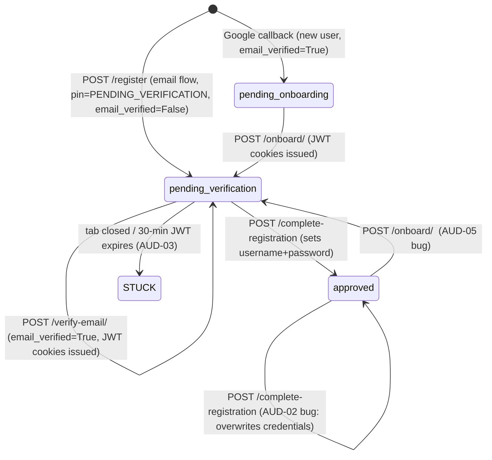

# Feature Production-Readiness Audit — Authentication & Onboarding

- **Repository:** `Devpaul-01/StudyHub` (Flask / SQLAlchemy / Redis-RQ / Flask-SocketIO)
- **Audit date:** 2026-11-19
- **Scope:** Registration, email verification, login/logout, token refresh, password reset, Google OAuth, onboarding wizard, onboarding suggestions/connect, complete-registration.
- **Method:** Static trace of frontend → API → services → models; existing tests run (121 passed); 17 scratch characterization tests written **in a throw-away copy of the repo** (`/home/claude/scratch`, outside the audited tree). No application source, config, dependency, test or DB state in the audited repo was changed. This file is the only addition.

**Evidence labels used below**
- **[Reproduced]** — demonstrated by running a scratch test against the real `create_app()` (SQLite + fakeredis). Test IDs `V1…V15` refer to the scratch file (summarised in Appendix A).
- **[Code]** — confirmed by reading the cited code; not executed.
- **[Unverified risk]** — plausible, depends on deployment or behaviour I could not observe.

---

## 1. Executive Summary

**Feature audited:** Authentication & Onboarding.

**Assessment: Critical issues found. Not production-ready in its current state.**

| Severity | Count |
|---|---|
| Critical | 1 |
| High | 6 |
| Medium | 10 |
| Low | 5 |
| **Total** | **22** |

**Most important findings**

1. **AUD-01 (Critical)** — The onboarding endpoints the live frontend actually calls (`/student/connections/suggestions-by-email/<email>`, `/onboard-connect/<email>/<id>`, `/onboard-connect-all/<email>`) have **no authentication**. Anyone who knows an email can create *already-accepted* connections for that user with arbitrary users, **overwrite an existing block**, and trigger notifications. [Reproduced V1, V2, V2b, V3]
2. **AUD-02 (High)** — `POST /complete-registration` has no state check and no current-password check. Any holder of a valid access cookie can overwrite an *approved* account's username and password. The route is CSRF-exempt and also accepts `text/plain` bodies. [Reproduced V4, V15]
3. **AUD-03 (High)** — A user who verifies email but doesn't finish `complete-registration` in the same browser session is **permanently stuck**: login, verify-link replay, onboarding and password reset all dead-end. [Reproduced V7, V7b]
4. **AUD-04 (High)** — `role_required` ignores `User.status`; half-registered users (no username, no password) hold a fully working API session. [Reproduced V6]
5. **AUD-05 (High)** — `POST /onboard/<email>` unconditionally sets `status="pending_verification"`, demoting approved users. [Reproduced V5]
6. **AUD-07 (High)** — Password reset does not revoke refresh tokens. [Reproduced V9]

**Major scalability concerns** (details in §4): non-atomic single-use token consumption and refresh rotation (AUD-08); rate limiter defaults to `memory://` (AUD-13); logout does not disconnect WebSockets on other instances (AUD-15); per-request O(N) scan of all approved users in the unauthenticated suggestions endpoints (AUD-16). The Flask `session` is a client-side cookie, so it works across instances **provided `SECRET_KEY` is identical everywhere**.

**Safe to consider production-ready?** No. AUD-01 alone is a release blocker. AUD-02 to AUD-07 should be fixed in the same release.

**Strengths worth keeping** (not findings): DB-backed refresh tokens with hashing, rotation, family revocation and reuse detection; opaque single-use email/reset tokens; CSRF double-submit on authenticated routes; fail-open rate limiter; email sent through a retryable RQ job; Google-account-takeover guard via `google_id`.

---

## 2. Feature Architecture and Execution Flow

### 2.1 Components

| Layer | Files |
|---|---|
| Frontend | `templates/auth/{register,login,verify-email,complete-registration,reset_request,verify_reset,set_password}.html`, `templates/onboard.html` (live), `templates/onboarding.html` (orphan), `static/js/core/api.js` |
| Auth routes | `routes/student/auth.py` (`register`, `login`, `validate_user`, `reset_password_api`, `set_password`, `verify_email_api`, `check_username`, `complete_registration`, `refresh_token`, `verify_auth`, `logout`, `onboard`, `google_callback`, legacy `/onboard/suggestions*`, `/onboard/request-all*`) |
| **Live** onboarding connect routes | `routes/student/connections/crud.py:66, :205, :301` |
| Helpers | `routes/student/helpers.py` (`_build_access_token`, `role_required`, `verify_token`, `set_auth_cookies`) |
| Services | `services/auth_service.py` (`finalize_password`, reset/verify token issue+consume, refresh issue/rotate/revoke), `services/rate_limit_service.py`, `services/job_queue.py`, `services/jobs/email_jobs.py` |
| CSRF | `routes/student/__init__.py` (`enforce_csrf`, `CSRF_EXEMPT_*`) |
| Models | `User`, `StudentProfile`, `OnboardingDetails`, `PasswordResetToken`, `EmailVerificationToken`, `RefreshToken` (`models.py`) |
| Infra | Redis (rate limits, RQ email queue, presence), SMTP via Flask-Mail, Google OAuth via Flask-Dance, client-side Flask `session` cookie |

### 2.2 Account state machine (as implemented)



### 2.3 Happy-path sequence (email signup)

```mermaid
sequenceDiagram
    participant U as Browser
    participant A as Flask /student
    participant DB as DB
    participant Q as Redis/RQ
    U->>A: POST /register {full_name,email}
    A->>DB: INSERT user (sentinel pin) + token; COMMIT
    A->>Q: enqueue verification email
    Q-->>U: email with /verify-email/<token>
    U->>A: POST /verify-email/<token>
    A->>DB: mark token used, email_verified=True
    A-->>U: Set-Cookie access/refresh/csrf (status still unapproved)
    U->>A: POST /onboard/<email> (JWT cookie)
    A->>DB: upsert OnboardingDetails; status=pending_verification
    U->>A: GET /connections/suggestions-by-email/<email>   (NO AUTH)
    U->>A: POST /connections/onboard-connect-all/<email>   (NO AUTH)
    U->>A: POST /complete-registration {email,username,password}
    A->>DB: username, pin, status=approved
```

Google signup: `/google/start → /google/callback` creates the user (`pending_onboarding`), stores `session["google_email"]` as proof, redirects to `/student/onboard/<email>`; the rest is identical.

### 2.4 Auth proofs in play

| Proof | Lifetime | Used by |
|---|---|---|
| `access_token` JWT cookie (claims: user_id, username, name, email, role) | 30 min | everything via `role_required` |
| `refresh_token` (DB-backed, hashed, rotating) | 7 days | `/refresh-token` (rejects non-approved users) |
| `csrf_token` cookie | with tokens | double-submit check on non-exempt POSTs |
| Flask `session["google_email"]` (client-side signed cookie) | ≤ 1 h (`PERMANENT_SESSION_LIFETIME=3600`) | `_is_request_authorized_for_email` |
| "verification token" JWT | 5 h | `verify_token()` — **no code issues these any more** (AUD-09) |

---

## 3. Findings and Issues

### AUD-01 — Live onboarding connect/suggestion endpoints are unauthenticated
- **Severity:** Critical  **Category:** Security / Data Integrity  **Status:** Confirmed bug [Reproduced V1, V2, V2b, V3]
- **Location:** `routes/student/connections/crud.py` — `connections_suggestions_by_email` (:66), `onboard_connect_single` (:205), `onboard_connect_all` (:301). Called by `templates/onboard.html:859, 946, 977`.
- **Evidence:** No `@token_required` and no `_is_request_authorized_for_email`; the docstrings state "No token required - uses email from URL path". CSRF is enforced for these paths, but double-submit only checks that a cookie and header match each other, so any API caller can supply both (V1 passes with a self-made matching pair and **no access token**). Only limit: 5/min per IP.
- **Problem:**
  1. Identity is an email address from the URL.
  2. Connections are created directly as `accepted` (no consent from either side).
  3. For an existing row, `status` is set to `accepted` regardless of its current value, including `blocked` (V2) and `rejected`. A block can be undone by a stranger.
  4. Bulk variant: `ids` is unbounded, element types unchecked, N+1 `User.query.get` + one `Connection` query per id.
  5. Each new connection sends a "X connected with you!" notification to the target.
  6. `suggestions-by-email` returns 200/404 depending on whether the email exists (enumeration) and returns candidate profile data.
- **Impact:** Anyone can force social-graph changes, bypass blocks and spam notifications for any registered user (targets can be harvested through the 200/404 oracle). If "accepted connection" gates messaging or visibility, this is a privacy breach.
- **Reproduction:** `POST /student/connections/onboard-connect/<victim_email>/<any_user_id>` with `Cookie: csrf_token=x` and `X-CSRF-Token: x`.
- **Recommended solution:**
  1. Require an authenticated principal (access JWT whose `email`/`user_id` matches). Drop the email from the path (derive the user from the token) or keep it only as a sanity check.
  2. Never overwrite `blocked`/`rejected` rows. Only create a row when none exists; leave blocked pairs untouched and report them as skipped.
  3. Decide product semantics (Q5): direct-accept vs `pending` request (the legacy `auth.py` variant creates `pending`).
  4. Cap `ids` (e.g. ≤ 25), validate each is a positive `int`, batch-load targets and existing connections with two `IN (...)` queries, skip non-`approved` targets and the user's own blockers.
  5. Return a uniform response for unknown emails (moot once auth is required).
- **Implementation considerations:** onboarding users already hold a JWT after `POST /onboard/<email>`, so the frontend needs no new credential; only the 401 path for Google users before onboarding POST needs checking. Keep the existing `uq_connections_pair`/savepoint race handling.
- **Verification:** Unauthenticated call → 401; foreign JWT → 403; blocked pair stays blocked; `ids` > cap → 400; two concurrent bulk calls leave exactly one row per pair.

### AUD-02 — `complete-registration` can overwrite an approved account's credentials
- **Severity:** High  **Category:** Security  **Status:** Confirmed bug [Reproduced V4, V15]
- **Location:** `routes/student/auth.py:1355` (`complete_registration`), authorisation at :1418, `status="approved"` at :1441; `get_json_data` (:100); `CSRF_EXEMPT_PATHS` in `routes/student/__init__.py`.
- **Evidence:** The handler requires only `_is_request_authorized_for_email(email)` (valid access cookie *or* Google session for that email). It never checks that the user is in a pending state, never asks for the current password, then calls `finalize_password` and sets `username`/`status`. The path is CSRF-exempt. `get_json_data` falls back to `json.loads(raw_body)` for any content type, so `text/plain` works (V15), defeating the "JSON requires a CORS preflight" protection that exempt routes implicitly rely on.
- **Impact:** A stolen or briefly exposed access token (30 min) becomes permanent account takeover (new password, changed username, no re-auth). A stale Google session proof (≤1 h) does the same. Cross-site exploitation is currently blocked only by `SameSite=Lax`.
- **Recommended solution:**
  1. Allow the route only when `user.status in {pending_verification, pending_onboarding}` **and** `pin == PENDING_VERIFICATION` (i.e. no password set yet). Otherwise 409.
  2. Credential changes for existing accounts belong to a separate authenticated endpoint requiring the current password (or a fresh reset token).
  3. Remove `/complete-registration` from CSRF exemptions (users reach it holding a CSRF cookie after verify/onboard) or, if the Google-only case truly lacks one, exempt only that branch.
  4. In `get_json_data`, require `request.is_json` (or `Content-Type: application/json`) for state-changing routes.
- **Implementation considerations:** pairs with AUD-03 (the recovery design may need a second legitimate entry point). Existing test `test_successful_completion_via_token` uses a token type production never issues (AUD-22).
- **Verification:** approved user POST → 409 and password unchanged; `text/plain` → 400/415; missing CSRF header → 403.

### AUD-03 — Verified-but-incomplete users are permanently stuck
- **Severity:** High  **Category:** Bug / Product  **Status:** Confirmed [Reproduced V7, V7b]
- **Location:** `login` (:964), `verify_email_api` (:1236), `onboard` (:606), `complete_registration` (:1355), `set_password` (:1140).
- **Evidence:** For a user with `email_verified=True`, sentinel `pin`, `username=None`:
  - `login` → "complete your registration… check your email for the verification link" (the link is already consumed);
  - `complete-registration` and `onboard` POST → 401 without a cookie/session proof;
  - re-opening the consumed verify link returns "already verified" and redirects to `/student/onboard/<email>`, whose POST then 401s;
  - password reset succeeds (`finalize_password`) but login still says "complete your registration" because `username` is `None` (V7b); status is never changed.
  - The only proof is the 30-min access JWT from `verify_email_api`/`onboard`; `/refresh-token` refuses non-approved users, so it can't be renewed.
  - The only exit is signing in with Google using the same email, via the `pin == "PENDING_VERIFICATION"` shortcut in `google_callback` (:300) — accidental, undiscoverable, and impossible for users without a Google account.
- **Impact:** Any user who closes the tab, loses connection, or takes >30 min between verification and password setup loses the account and can never re-register (AUD-06).
- **Recommended solution (simplest reliable):** make "resume registration" explicit.
  1. When login or a stale verify link finds a verified-but-incomplete user, send a **fresh email-verification token** (rate-limited, uniform response) whose consumption re-issues cookies and resumes at onboarding/complete-registration.
  2. Alternatively let the token from `set-password` complete the account (password + username in one step).
  3. Replace the dead-end login message with one that triggers (1).
- **Trade-offs:** needs a resend endpoint (also fixes AUD-06). No new infrastructure.
- **Verification:** E2E: verify, wait for JWT expiry, log in → receive link → reach complete-registration → approved.

### AUD-04 — Unapproved users have a fully working API session
- **Severity:** High  **Category:** Security / Bug  **Status:** Confirmed [Reproduced V6]
- **Location:** `routes/student/helpers.py:156` (`role_required` checks `role` only); `models.py` `User.is_active` (defines the correct predicate, unused).
- **Evidence:** `verify_email_api` and `onboard` mint access tokens for users with no username and no password; V6 shows `GET /student/users/me` → 200 for such a user. `User.is_active` encodes "verified + approved + username + real pin" but no decorator uses it. WebSocket connect (`services/websocket_messages.py` ~:384) also validates only the JWT signature.
- **Impact:** Users bypass the registration state machine and can post, message and appear in the product with `username=None`; any later `status` change (suspension) is ignored for up to 30 min.
- **Recommended solution:** in `role_required`, after loading the user, reject unless `user.status == "approved"` (and `is_active`), with an allow-list decorator (e.g. `@allow_pending`) for the few routes onboarding needs (suggestions/connect, `/auth/me`, onboard, complete-registration). Mirror in the WebSocket handshake.
- **Implementation considerations:** the allow-list must be audited against the ~250 `@token_required` routes; start by listing routes the onboarding pages call.
- **Verification:** pending user → 403 on a representative sample of feature routes; 200 on allow-listed ones.

### AUD-05 — `POST /onboard/<email>` demotes and rewrites approved accounts
- **Severity:** High  **Category:** Bug / Data Integrity  **Status:** Confirmed [Reproduced V5]
- **Location:** `routes/student/auth.py:606–690`, status write at :663.
- **Evidence:** No status guard; any authorised caller sets `status="pending_verification"`, overwrites `name`, upserts onboarding data and re-issues tokens. The route is CSRF-exempt (`/student/onboard/` prefix).
- **Impact:** An approved user (or anyone with their cookie) can be pushed back into the incomplete state; combined with AUD-02 it forms a credential-reset chain. Also resets onboarding data silently.
- **Recommended solution:** only set the status when it is `pending_onboarding`; for approved users either 409 or update onboarding data only (if "edit preferences" is intended, see Q3). Remove the CSRF exemption for requests carrying a JWT cookie (only the Google-session-only case needs it).
- **Verification:** approved user POST leaves `status == "approved"`.

### AUD-06 — Registration can strand an account; no resend; email squatting
- **Severity:** High  **Category:** Reliability / Product  **Status:** Confirmed [Reproduced V8]; squatting & cleanup [Code]
- **Location:** `register` (:841, commit before `send_verification_email` at :949); `utils.py:112–140`; `services/job_queue.py`.
- **Evidence:** The user and token are committed **before** the email is enqueued. If `email_queue.enqueue` raises (Redis down — `job_queue.py` falls back to `redis://localhost:6379/0` when unset), the response is an error, the row persists, and retrying returns "Email already registered" (V8). There is **no resend endpoint** (`grep -i resend` → nothing). `scheduler.py`/`services/jobs/*` have no cleanup of unverified accounts or expired tokens.
- **Impact:** (a) transient Redis/SMTP outages permanently lock out emails; (b) anyone can pre-register someone else's email, which blocks the owner from signing up and never expires.
- **Recommended solution:**
  1. Add `POST /resend-verification` (uniform response, per-email and per-IP throttle) that invalidates earlier tokens and issues a new one.
  2. On registration of an email that exists but is `email_verified=False` and still pending, re-send instead of failing (uniform response).
  3. Wrap enqueue in try/except → either roll the user back or leave a retryable state with a clear message.
  4. Add a maintenance job deleting unverified accounts and expired token rows older than N days (Q7).
- **Verification:** simulate enqueue failure → retry succeeds; unverified account older than N days is purged; resend invalidates the older link.

### AUD-07 — Password reset does not revoke sessions
- **Severity:** High  **Category:** Security  **Status:** Confirmed [Reproduced V9]; other reset tokens [Code]
- **Location:** `services/auth_service.py:178` (`finalize_password`), `:214` (`issue_password_reset_token`), `routes/student/auth.py:1140`.
- **Evidence:** After `set-password`, the user's refresh token remained `revoked=False` (V9). From code, issuing a new reset token does not invalidate earlier unused ones.
- **Impact:** A reset (the standard "I think I was hacked" action) does not end the attacker's 7-day refresh session.
- **Recommended solution:** in the same transaction as the password change, revoke all `RefreshToken` rows for the user and mark other outstanding reset/verification tokens used. Optionally embed a `pwd_changed_at`/token-version claim so live access tokens die at next check.
- **Verification:** after reset, `/refresh-token` with the old cookie → 401; other reset links invalid.

### AUD-08 — Single-use tokens and refresh rotation are not atomic
- **Severity:** Medium  **Category:** Reliability / Scalability  **Status:** [Code] — concurrency not executed (needs Postgres)
- **Location:** `services/auth_service.py:240–290` (`consume_password_reset_token`, `used=True` at :271), `:316–360` (`used=True` at :341), `:400+` (`rotate_refresh_token`).
- **Evidence:** All three follow SELECT → `is_valid()` → UPDATE with no `SELECT … FOR UPDATE` and no conditional `UPDATE … WHERE used=false`. Additionally, the reset token is committed as used **before** `finalize_password` runs; if `finalize_password` raises (e.g. `LookupError` for an unverified email) the token is burned and the password unchanged.
- **Scenario:** double-click or two instances handle the same reset/verify link simultaneously → both succeed (and both receive session cookies for verification). Two tabs refreshing with the same cookie both rotate, producing two live successors, which weakens reuse detection.
- **Recommended solution:** make consumption a single atomic statement (`UPDATE … SET used=true WHERE token=:t AND used=false AND expires_at>now() RETURNING user_id`, or `with_for_update()` on the row) and perform password change + token consumption in one transaction. Rotation: lock the parent row (`with_for_update`) or use the same conditional update on `revoked`.
- **Trade-offs:** none beyond a short row lock; works on the existing Postgres.
- **Verification:** threaded test against Postgres firing 10 simultaneous consumptions → exactly one success.

### AUD-09 — Legacy "verification token" path accepts any signed JWT
- **Severity:** Medium  **Category:** Security / Maintainability  **Status:** Confirmed [Reproduced V10]
- **Location:** `helpers.py:122` (`verify_token`), `auth.py` routes `/onboard/suggestions/<token>`, `/onboard/request-all/<identifier>`, `/complete-registration` (token branch); `utils.generate_verification_token` (no callers).
- **Evidence:** Access tokens carry an `email` claim and are signed with the same key, so `GET /onboard/suggestions/<access_token>` works (V10). Nothing issues verification JWTs any more; the existing tests hand-build them.
- **Impact:** token-type confusion; URL-path tokens leak into logs/history; dead code kept alive by tests.
- **Recommended solution:** delete the token branches and `generate_verification_token`/`verify_token` once Q4 confirms no external consumer; or add a `typ` claim check.

### AUD-10 — Google OAuth hardening gaps
- **Severity:** Medium  **Category:** Security  **Status:** [Code]; part [Unverified risk]
- **Location:** `auth.py:218–410` (callback), `:300`, `:121` (`_is_request_authorized_for_email`).
- **Evidence:** (1) `verified_email` is never read (`grep` → no match); new users are stored `email_verified=True`. [Unverified risk: Google accounts created with a non-Gmail address can have an unverified address.] (2) `is_google_account = bool(google_id) or pin == "PENDING_VERIFICATION"` lets a Google login claim any half-registered *password* account and backfill `google_id`; the user is then not marked `email_verified`, so after completing registration password login says "verify your email". (3) The proof is `session["google_email"]` in a client-side signed cookie: `_clear_google_oauth_session()` removes it from *this* response only; an earlier copy stays valid until it expires (≤1 h). (4) `register()` with `google_verified=true` clears the Google session and redirects to onboarding without issuing cookies, so the following onboard POST would 401; the path is practically unreachable (callback already created the user) but is dead, buggy code.
- **Recommended solution:** reject when `verified_email` is false; set `email_verified=True` when the Google-verified email matches; replace the sentinel shortcut with an explicit check; shorten session proof lifetime or swap the proof for a server-side one-time nonce; delete the `google_verified` branch of `register()` (Q4).

### AUD-11 — Account enumeration
- **Severity:** Medium  **Category:** Security  **Status:** Confirmed [Reproduced V3, V12]
- **Evidence:** `login` returns different messages for unknown user vs pending/unverified user *before* the password is checked (V12); `validate-user` says "User not found"; `register` says "Email already registered"; `check-username` is an availability oracle (expected); suggestions-by-email 200/404 (AUD-01).
- **Recommended solution:** uniform login failure message (check password first, reveal state only after success); uniform reset response ("if an account exists…"); registration uniform response once resend (AUD-06) exists. Accept `check-username`.

### AUD-12 — Reset/verification links trust the request host; email text contradicts TTL
- **Severity:** Medium  **Category:** Security / Product  **Status:** Host trust [Unverified risk]; TTL mismatch [Code]
- **Location:** `app.py:101` (`ProxyFix(x_host=1)`), links built with `url_for(..., _external=True)` in `register`/`validate_user`; `utils.send_password_reset` vs `auth_service.issue_password_reset_token`.
- **Evidence:** `X-Forwarded-Host` is trusted, so unless the platform proxy overwrites it, an attacker can request a reset for a victim with a forged host and the victim receives a link to the attacker's domain. The reset email says it expires in 5 hours; the token TTL is 1 hour.
- **Recommended solution:** build links from a configured `PUBLIC_BASE_URL` (config already has `CURRENT_URL`); fix the email text to match the TTL.
- **Verification:** request with forged `X-Forwarded-Host` → email link still uses the configured domain.

### AUD-13 — Rate limiting is IP-only, shared with `check-username`, and per-process by default
- **Severity:** Medium  **Category:** Scalability / Product / Security  **Status:** [Reproduced V11] + [Code]
- **Evidence:** `SENSITIVE_AUTH = 5/min/IP` is applied to login, register, reset **and** `check-username` (V11 → 429 on the 6th call). `complete-registration.html` treats *any* error from `check-username` as "Already taken", so a user typing a username sees false "taken" results. Shared campus NAT makes 5/min/IP too tight for signups. `RATE_LIMIT_STORAGE_URI` defaults to `memory://` unless `REDIS_URL` is set (`config.py:119, 141, 175`), so each instance keeps its own counters (limits multiply by N). There is no per-account throttle (credential stuffing across IPs) and no cap on reset/verification emails per address (mail flooding). [Unverified risk: global default limits `200/day, 50/hour` may also hit GET page loads behind shared IPs.]
- **Recommended solution:** separate, looser tier for `check-username` (per IP + per session); add per-email counters in Redis (reset, resend, login failures); require Redis in production config (fail startup if rate-limit storage is `memory://` outside dev); fix the frontend to distinguish 429/network errors from "taken".

### AUD-14 — Sensitive values in logs; tokens stored in plaintext
- **Severity:** Medium  **Category:** Security  **Status:** Confirmed [Reproduced — visible in test output]
- **Evidence:** `app.py:365` logs `request.path` for every POST, which includes `/student/verify-email/<token>`, `/student/verify-reset/<token>` and `/student/onboard/<email>`. `set_password` logs the first 20 chars of the reset token (the test output showed `token: prt_27_o2YnzxVs6dhCO...`) plus user emails. `PasswordResetToken.token` and `EmailVerificationToken.token` are stored raw (refresh tokens are hashed).
- **Recommended solution:** log route templates not raw paths; drop token prefixes and emails from logs; store SHA-256 of reset/verify tokens (lookup by hash) — requires a migration/one-time invalidation of outstanding tokens (they're ≤5 h old, so invalidate rather than convert).

### AUD-15 — Logout and status changes don't reach WebSockets on other instances
- **Severity:** Medium  **Category:** Scalability / Security  **Status:** [Code]
- **Location:** `services/websocket_messages.py` `disconnect_user` (:286) iterates the process-local `self.online_users`; connect (:384+) validates the JWT once.
- **Scenario:** user logs out (or is suspended) on instance A while their socket lives on instance B → the socket stays authenticated until it disconnects; sockets also outlive the 30-min token.
- **Recommended solution:** publish a "force-disconnect user X" event over the existing Redis message queue (already used by Flask-SocketIO) that every instance handles; re-check status at connect.

### AUD-16 — Onboarding match algorithms: O(N) per request, duplicated, partly fabricated
- **Severity:** Medium  **Category:** Performance / Product  **Status:** [Code]
- **Location:** `connections/crud.py:66` (live) and `auth.py:463, 698, 791` (legacy).
- **Evidence:** every call loads **all** approved users joined with profile+onboarding into Python and scores them (`.all()`); with AUD-01 it is unauthenticated. The two implementations use different thresholds (10 vs 40) and the live one falls back to `random.randint(50, 70)` as a "match_score" for top-reputation users.
- **Impact:** latency/memory grows linearly with users; users see invented percentages.
- **Recommended solution:** pre-filter in SQL (same department/overlapping subjects, `LIMIT` ≈ 200) before scoring; remove or label the random fallback; delete the legacy copy (Q4).

### AUD-17 — Onboarding input is not validated
- **Severity:** Medium  **Category:** Data Integrity  **Status:** Confirmed [Reproduced V14]
- **Location:** `auth.py:606–690`.
- **Evidence:** `department`/`class_level` aren't checked against allowed lists; arrays and `study_schedule` have no size/type limits (5000-element list stored, V14); `data.get("name","").strip()` raises on non-strings and the generic handler hides it; string columns have length limits only at the DB.
- **Recommended solution:** schema validation (types, enumerations, max lengths, max 20 items per list, schedule keys limited to weekdays) with specific 400 messages.

### AUD-18 — Frontend inconsistencies (Low)
- `onboard` response returns `redirect: /student/complete-registration/<email>`, which is **404** (V13; the route takes `?email=`). The frontend ignores it; the existing test asserts the broken value.
- `onboard.html` prefers `localStorage['onboarding_email']` over the URL; stale values from a previous user on a shared device are posted.
- `onboard.html` step 6 + `submitCompleteRegistration()` is dead (replaced by a redirect); `templates/onboarding.html` (1,700+ lines) is rendered by no route.
- `complete-registration.html` `catch` → "Already taken" for every error (see AUD-13).
- Onboarding data is written before username/password exist and the user may abandon between steps (see AUD-03).

### AUD-19 — Transport/config hygiene (Low)
- `app.py:44` sets `OAUTHLIB_INSECURE_TRANSPORT=1` unconditionally (disables oauthlib's HTTPS check in production too).
- `SESSION_COOKIE_SECURE` defaults to `False` (env-driven), so HSTS is also off by default.
- `CORS_ALLOWED_ORIGINS` defaults to `*` with `supports_credentials=True`.
- **Fix:** set only in dev, default secure flags on outside dev, fail fast on `*` in production.

### AUD-20 — Schema management and data growth (Low)
- Only two Alembic migrations exist; `password_reset_tokens`, `email_verification_tokens`, `refresh_tokens`, `users.google_id` and `onboarding_details` rely on `db.create_all()` (`app.py:629`), which never alters existing tables. [Unverified: how production was provisioned.]
- No cleanup job for expired/used/revoked tokens → unbounded growth (see also AUD-06).
- `PasswordResetToken`/`EmailVerificationToken` have no `ondelete` cascade (`RefreshToken` does); harmless now (no account deletion route) but will block deletion later.

### AUD-21 — Minor token-lifecycle issues (Low)
- `refresh_token` checks `status != approved` *after* rotating (the old token is consumed and the cookie replaced by nothing).
- `complete_registration` does not issue fresh cookies, so the access token minted during onboarding keeps `username=None` for ≤30 min (nothing was found that reads that claim [Code]).

### AUD-22 — Tests enshrine buggy behaviour (Low)
- `test_saves_onboarding_details_and_issues_tokens` asserts the nonexistent redirect; `test_successful_completion_via_token` uses a hand-built JWT type that production no longer issues; `TestOnboardRequestAll` covers the legacy authenticated route while the **live** unauthenticated routes have **no tests** (`grep onboard-connect tests` → none).

---

## 4. Horizontal Scalability Assessment

**Current architecture:** `Procfile` runs `start-all.py` (API + RQ worker thread + APScheduler in one process). Presence, WS rate limits and scheduler locks have already been moved to Redis (per project docs). Auth state: stateless JWT access cookies, DB-backed refresh/reset/verify tokens, client-side Flask session.

### 4.1 What already works across instances
- Access/refresh/CSRF cookies are instance-independent; refresh tokens and email tokens live in the DB.
- Email is queued through RQ, so any instance can enqueue and any worker can send.
- Flask `session` (Google proof, OAuth state) works on any instance **if all instances share the same `SECRET_KEY`** (config enforces that it is set; operationally it must be identical). [Operational requirement, not verified against deployment.]

### 4.2 Immediate problems (real with ≥2 instances, or even 1 worker + retries)
| # | Issue | Why it fails | Fix |
|---|---|---|---|
| S1 | Non-atomic token consume/rotate (AUD-08) | Two instances can both pass `is_valid()` | Conditional `UPDATE … RETURNING` or row lock |
| S2 | Rate limiter `memory://` default (AUD-13) | Counters are per process: limits × N, lost on restart | Require Redis storage in prod; fail startup otherwise |
| S3 | `disconnect_user` is process-local (AUD-15) | Logout/suspension misses sockets on other instances | Redis pub/sub broadcast of force-disconnect |
| S4 | Unauthenticated O(N) scans per request (AUD-16, AUD-01) | DB/CPU load grows with users and is attacker-triggerable | Auth + SQL pre-filter + caps |

### 4.3 Future scaling improvements (not urgent)
- Move the Google proof from a client-side cookie to a short-lived server-side nonce in Redis (also fixes non-revocability, AUD-10).
- Per-email Redis counters for reset/resend/login failures (AUD-13).
- Retention job for tokens/unverified accounts, scheduled through the existing lock-guarded scheduler (so only one instance runs it).

### 4.4 Behaviour on restart/crash
- Crash after the first `commit()` in `register` leaves an account with a token but no email (AUD-06).
- RQ email jobs are at-least-once by design; duplicates are harmless because tokens are single-use (once AUD-08 is fixed).
- Refresh grace window (10 s) handles sequential retries but not concurrent ones (AUD-08).

---

## 5. Data Usage and Cleanup Report

Classification key: **1** Confirmed unused · **2** Potentially unused — requires verification · **3** Required indirectly — retain · **4** Redundant — can potentially be consolidated.

| Resource | Current Usage | Evidence | Class. | Recommendation |
|---|---|---|---|---|
| `templates/onboarding.html` | Not rendered by any route | `grep` for `onboarding.html` → only a docstring in `auth.py:567` | **1** | Delete with the legacy token endpoints; no DB impact |
| `onboard.html` step-6 markup + `submitCompleteRegistration()` | Replaced by redirect to `complete-registration` | `onboard.html:1006–1011` vs `:1038–1100` | **1** | Remove (frontend only) |
| `utils.generate_verification_token` | Defined, never called | repo-wide `grep` | **1** | Remove with `verify_token` branches (AUD-09) |
| `onboard` response field `redirect` | Frontend ignores it; value is a 404 | V13; `onboard.html:823–835` | **1** | Remove or fix; update test |
| `auth.py` `/onboard/suggestions-by-email`, `/onboard/suggestions/<token>`, `/onboard/request-all*`, `generate_onboarding_matches` | Live frontend uses `/connections/*` variants | `onboard.html:859,946,977` | **2** | Confirm no mobile/external client (Q4), then delete; migrate tests |
| `register()` `google_verified` branch | Practically unreachable (callback pre-creates user) and buggy | AUD-10 | **2** | Confirm with Q4, then remove |
| `User.last_login` | No reads/writes outside the model (`record_login_and_commit` updates `last_active`) | `grep` py/html/js | **2** | Check external dashboards/SQL, then drop or start writing it |
| `StudentProfile.pin` | Written at creation/`finalize_password`; never read for auth | `auth_service.py:198`; login uses `User.pin` | **4** | Redundant second copy of the password hash; drop column (migration) |
| `StudentProfile.username` | Written in `complete_registration` (:1445); no reader found | `grep` | **4** | Consolidate onto `users.username`; drop after reader check |
| `StudentProfile.status` | Written `"active"` (:1446); no reader found | `grep` | **2** | Verify admin/analytics, then drop |
| `StudentProfile.date_of_birth`, `guardian_name`, `guardian_contact` | Only ever set to `None` / never written | `auth.py:383, 908` | **2** | Confirm no data in prod, then drop (privacy benefit) |
| `OnboardingDetails.email` | Duplicate of `users.email` with its own UNIQUE; never read | `grep` | **4** | Drop; avoids staleness if email changes |
| `OnboardingDetails.{department,class_level,subjects,learning_style,study_preferences,help_subjects,strong_subjects,study_schedule,session_length}` | Read by connections/threads/profile matching | `grep` across `routes/`, `services/`, `static/js` | **3** | Keep |
| `OnboardingDetails.last_updated` | Written by onboard; read by `profile.py`, `health.py` | `grep` | **3** | Keep |
| `StudentProfile.department/class_name` vs `OnboardingDetails.department/class_level` | Same facts in two tables; live suggestions read profile, compatibility reads onboarding | `crud.py:100–110` | **4** | Pick one source of truth (Q9) |
| `User.name` vs `StudentProfile.full_name` | Duplicated name | models | **4** | Same decision as above |
| `User.study_schedule` vs `OnboardingDetails.study_schedule` | Parallel columns; onboarding writes only the latter | `auth.py` onboard | **2** | Verify readers of `User.study_schedule` |
| `PasswordResetToken`/`EmailVerificationToken`/`RefreshToken` rows | Needed, but never purged | no cleanup job | **3** | Keep tables, add retention job |
| `/auth/me`, `/users/me`, `/verify-auth` | Three "who am I" endpoints; used by `api.js`/message JS, `thread.api.js`, `api.js` respectively | `grep` static/js | **4** | Optional consolidation; low priority |

**Removal prerequisites:** column drops need an Alembic migration (there is no baseline, see AUD-20) and a data check in production first. No removal is recommended until Q4/Q9/Q10 are answered.

---

## 6. End-to-End Data Consistency Report

| Data path | Mismatch | Evidence | Correction |
|---|---|---|---|
| Onboard POST → frontend | Response `redirect` = `/student/complete-registration/<email>` (404) while frontend navigates to `?email=` | V13 | Remove field or emit `?email=` |
| Onboard identity | Email comes from `localStorage` first, URL second | `onboard.html:815,855,943,974` | Derive from authenticated session (`/auth/me`) |
| Username claim | JWT minted at onboarding has `username=None`; never refreshed after completion | AUD-21 | Re-issue cookies in `complete-registration` |
| Status vs access | Status says "pending" but API behaves as "approved" | V6 | AUD-04 |
| Status after onboard | Approved user flips back to pending | V5 | AUD-05 |
| Reset email vs token | Email says 5 h, token is 1 h | AUD-12 | Align |
| `check-username` | Backend 429 → UI "Already taken" | V11 | Surface real error |
| Verify link UX | Replay says "already verified" then sends user to an onboarding URL that 401s | AUD-03 | Resume flow |
| Match scores | Random 50–70 shown as % | `crud.py` fallback | Remove or label |
| Registration success | Account committed, email not sent, UI shows failure | V8 | AUD-06 |
| Credential duplicates | `StudentProfile.pin/username` vs `User.pin/username` | §5 | Consolidate |

---

## 7. Testing Gaps

Existing: 121 tests passed in the auth/onboarding/rate-limit/connections suites I ran (SQLite + fakeredis). Gaps (no tests written in the audited repo):

| Level | Missing test | Behaviour to verify |
|---|---|---|
| Integration | Auth required for `/connections/suggestions-by-email`, `onboard-connect`, `onboard-connect-all` | 401 without JWT; 403 for another user's JWT |
| Integration | Blocked/rejected pairs untouched by onboarding connect | status unchanged, id reported as skipped |
| Integration | Bulk `ids` validation | cap, non-int, duplicates, self, unknown, non-approved targets |
| Integration | `complete-registration` on approved account | 409, password unchanged; `text/plain` rejected; CSRF enforced |
| Integration | `onboard` on approved account | status unchanged |
| Integration | Pending user vs protected routes | 403 except allow-list (AUD-04) |
| E2E | Resume registration after JWT expiry / closed tab | user reaches approved state |
| Integration | Register + enqueue failure | account recoverable, resend works |
| Integration | Password reset revokes refresh tokens & other reset tokens | old refresh → 401 |
| Concurrency (Postgres) | Parallel consume of the same reset/verify token; parallel refresh rotation | exactly one success; one live successor |
| Integration | Reset/verify link host | link uses configured base URL under forged `X-Forwarded-Host` |
| Integration | Google callback with `verified_email=false`; sentinel account claim; `google_id` mismatch | rejected / `email_verified` set correctly |
| Integration | Login enumeration | identical message/timing class for unknown vs pending vs wrong password |
| Integration | Rate limits | `check-username` tier; per-email caps; startup refuses `memory://` in prod |
| Integration | Onboarding input validation | enum/length/size limits, non-string `name` → 400 with message |
| Integration | Logout disconnects sockets on all instances | event broadcast received by a second manager |
| Regression | Tests asserting the 404 redirect and hand-built verification JWTs | replace with real flow tests |

---

## 8. Recommended Implementation Plan

Prioritised per your order (correctness → security → reliability/concurrency → scalability → product consistency → performance → cleanup).

**M1 — Close the unauthenticated hole (AUD-01).** *Objective:* no state change or user data without proof of identity. *Files:* `connections/crud.py`, `onboard.html` (drop email from URLs). *Implementation:* require JWT, derive user from token, never touch blocked/rejected rows, cap/validate `ids`, batch queries. *DB:* none. *Tests:* §7 first four rows. *Risks:* Google users before the onboard POST have no JWT; confirm the page order (suggestions are shown after the POST, so they do).

**M2 — Registration state machine (AUD-02, 03, 04, 05).** *Files:* `auth.py`, `helpers.py` (`role_required`), `routes/student/__init__.py`, `websocket_messages.py`, templates. *Implementation:* status guards on `onboard`/`complete-registration`, allow-list for pending users, resume-registration email, strict JSON content type, CSRF exemptions narrowed. *DB:* none. *Dependencies:* Q1–Q3. *Risks:* allow-list must cover every call the onboarding pages make.

**M3 — Session and token integrity (AUD-07, 08, 09, 10).** *Files:* `auth_service.py`, `helpers.py`, `auth.py`. *Implementation:* atomic consume/rotate, revoke sessions on reset, remove JWT "verification token" paths, Google `verified_email` + explicit pending-account claim. *DB:* none (optional token-version column later). *Tests:* concurrency on Postgres.

**M4 — Registration reliability (AUD-06).** Resend endpoint, enqueue-failure handling, retention job for unverified accounts and token rows. *Files:* `auth.py`, `utils.py`, `services/jobs/*`, `scheduler.py`. *DB:* none (index on `created_at` optional). *Dependency:* Q7.

**M5 — Abuse and exposure hardening (AUD-11, 12, 13, 14, 19).** Uniform responses, `PUBLIC_BASE_URL`, rate-limit tiers + per-email counters, require Redis storage in prod, log redaction, hashed reset/verify tokens (invalidate outstanding ones), dev-only `OAUTHLIB_INSECURE_TRANSPORT`, secure cookie defaults.

**M6 — Scalability and performance (AUD-15, 16, 17).** Redis broadcast for socket disconnect; SQL pre-filtered, capped suggestions; onboarding input validation.

**M7 — Cleanup (AUD-18, 20, 21, 22 + §5).** Delete orphan template/dead code/legacy endpoints after Q4; Alembic baseline + migrations for auth tables; drop redundant columns after data checks; fix tests that enshrine bugs.

Milestones M1–M2 should ship together as the release blocker.

---

## 9. Questions and Decisions Required

1. **Is onboarding mandatory before an account becomes `approved`?** Today `complete-registration` can be reached without onboarding (no check). *Options:* require an `OnboardingDetails` row; or allow skipping (the UI has a "skip" path). Decides the state-machine guards in M2.
2. **May unapproved users call any API?** *Options:* strict allow-list (my recommendation) or keep current behaviour. Decides the allow-list size.
3. **Should approved users be able to re-run onboarding (edit preferences)?** If yes, `onboard` must update data without touching status; if no, return 409.
4. **Are there clients besides `templates/*` that call the legacy `auth.py` onboarding endpoints, `register(google_verified)`, or the verification-JWT paths (mobile app, scripts, `openapi.yml` consumers)?** Determines whether they can be deleted (§5).
5. **Onboarding connect semantics:** keep instant `accepted` connections, or create `pending` requests (the legacy variant does)? Instant-accept bypasses consent; this affects privacy expectations and the notification text.
6. **Stuck-user recovery:** is an emailed "resume" link acceptable (needs resend endpoint)? Alternative: let a reset link also finish registration.
7. **Retention:** how long should unverified accounts and used/expired tokens be kept (suggest 7 days / 30 days)? Is hard-deleting unverified accounts acceptable?
8. **Google sign-in policy:** enforce `verified_email`? Restrict to institutional domains? Allow Google to claim a half-finished password account (current behaviour)?
9. **Source of truth for department/class/name:** `StudentProfile`, `OnboardingDetails`, or `User`? Decides which duplicate columns can go.
10. **Production data checks** before dropping `date_of_birth`, `guardian_*`, `StudentProfile.{pin,username,status}`, `User.last_login`: may I assume they're empty/unneeded, or can you run a count query?
11. **Deployment facts:** how many instances/workers run today? Is `REDIS_URL`/`RATE_LIMIT_STORAGE_URI` set in production? Does your proxy overwrite `X-Forwarded-Host`? Is `SESSION_COOKIE_SECURE` true? Was the production schema created via `create_all` or manual SQL?
12. **Rate limits:** acceptable thresholds for shared campus IPs (signup/login per IP and per email)?
13. **Migrations:** are you willing to adopt an Alembic baseline (needed for column drops/hashing tokens)?
14. **Email text/TTL:** should reset links live 1 h (code) or 5 h (email text)?

---

## 10. Final Recommendation

**Must fix before production**
- AUD-01 (unauthenticated connect/suggestions), AUD-02, AUD-03, AUD-04, AUD-05, AUD-06, AUD-07.

**Fix soon**
- AUD-08 (atomic tokens), AUD-09, AUD-10, AUD-11, AUD-12, AUD-13 (including Redis-backed limits in prod), AUD-14, AUD-15, AUD-16, AUD-17.

**Can be postponed**
- AUD-18 to AUD-22 (after M1–M6), plus the future-scaling items in §4.3.

**Should be removed (after Q4/Q9/Q10)**
- `templates/onboarding.html`, onboard.html step 6, `generate_verification_token`/`verify_token` paths, legacy `/onboard/suggestions*` and `/onboard/request-all*`, `register(google_verified)` branch, `OnboardingDetails.email`, `StudentProfile.{pin,username}` (plus status/DOB/guardian columns if confirmed empty).

**Needs your approval/clarification:** Q1–Q14 above, especially Q1, Q2, Q5, Q6 and Q11.

**Recommended order:** M1 + M2 → M3 → M4 → M5 → M6 → M7.

---

## Appendix A — Verification performed

| Item | Result |
|---|---|
| Existing tests run in scratch copy (`test_auth_*`, `test_rate_limiting`, `test_connections_crud_routes`) | 121 passed |
| Scratch characterization tests V1–V15 (current behaviour asserted) | 17 passed → findings reproduced |
| Not verified | Live Google OAuth, SMTP delivery, behaviour on Postgres under concurrency, production proxy/host-header behaviour, production data, browser execution of the frontend (read statically), global default rate limits on GET pages |

Scratch test map: V1/V2/V2b/V3 → AUD-01 · V4/V15 → AUD-02 · V5 → AUD-05 · V6 → AUD-04 · V7/V7b → AUD-03 · V8 → AUD-06 · V9 → AUD-07 · V10 → AUD-09 · V11 → AUD-13 · V12 → AUD-11 · V13 → AUD-18 · V14 → AUD-17. (The scratch file is not part of the repository; I can supply it if you want it as the basis for the regression tests in M1–M7.)

---

## Appendix B — Resolution status (branch `fix/auth-onboarding-audit`)

This appendix was added after the findings above were implemented. Sections 1–10 are kept as the
original audit record; the table shows what was done for each finding.

### Decisions taken on the open questions

| # | Decision |
|---|---|
| Q1 | Onboarding is **optional**: `complete-registration` works for `pending_onboarding` users and does not redirect to onboarding. |
| Q2 | Strict allow-list: only `/auth/me`, `/users/me` and the onboarding suggestion/connect routes accept still-registering users. |
| Q3 | Approved users may re-submit onboarding to update preferences (no status change, no new tokens). |
| Q4 | No other clients: legacy routes, the JWT verification-token paths, the `google_verified` branch and `onboarding.html` were deleted. |
| Q5 | Onboarding connecting sends **pending requests** (consent); a reciprocal request is accepted; existing rows are never overwritten. |
| Q6 | Resume path = fresh verification link (`/register` again or `/resend-verification`) plus "forgot password → login → complete-registration". |
| Q7 | Unverified sign-ups purged after **7 days**; expired tokens after **30 days**. |
| Q8 | `verified_email` is enforced; Google may explicitly claim an unfinished password sign-up (marks email verified); password accounts are never taken over; no domain restriction. |
| Q9 | `User` is the source of truth for credentials/name; department/class stay mirrored on `StudentProfile` (profile pages) and `OnboardingDetails` (matching). |
| Q10 | Dropped as confirmed empty/unneeded. |
| Q11 | Not deployed, so production now **fails fast** on unsafe settings (`ProductionConfig.validate()`). |
| Q12 | Login 20/min/IP + 10 failures/15 min/account; register 10/min/IP + 5/h/email; `check-username` 30/min; refresh 60/min; reset/verify/resend stay 5/min plus per-email/account caps. |
| Q13 | Alembic migration added (idempotent). A full baseline of the rest of the schema is **not** included. |
| Q14 | Reset links live **1 hour**; the email text was corrected. |

### Findings

| ID | Status | Commit(s) | Notes |
|---|---|---|---|
| AUD-01 | Fixed | fd76d2a, acdf6a0 | Authenticated routes under `/connections/onboarding/`; pending requests; no overwrite; cap 25; bounded pool. |
| AUD-02 | Fixed | b1b6265, 0301dc6 | 409 for approved accounts; JSON-only bodies; CSRF enforced when an access cookie is sent. |
| AUD-03 | Fixed | 288d8db | Login for verified pending users continues registration; resend/resume links; refresh allowed for verified pending users. |
| AUD-04 | Fixed | 575536b, 9215955 | `role_required` status gate + `token_required_allow_pending`; WebSocket handshake check. |
| AUD-05 | Fixed | b1b6265 | Status only changes from `pending_onboarding`; approved users update preferences only. |
| AUD-06 | Fixed | 288d8db, c179413 | Single commit then queue, 503 on queue failure, resend, uniform response, daily purge. |
| AUD-07 | Fixed | 288d8db | Reset revokes all refresh tokens and other reset links. |
| AUD-08 | Fixed in code | 288d8db | Conditional UPDATE consume, compare-and-set rotation. **Concurrency was only tested sequentially/with a simulated lost race on SQLite; a Postgres multi-connection test is still recommended.** |
| AUD-09 | Fixed | b1b6265 | `verify_token`/`generate_verification_token` and token branches removed. |
| AUD-10 | Fixed / partly mitigated | 288d8db | `verified_email`, explicit claim rule, suspended refused, 30-min proof TTL. The proof is still a signed client-side cookie, so an older copy stays valid until its TTL (documented). |
| AUD-11 | Fixed | 288d8db | Uniform login/register/reset answers; dummy hash for unknown accounts. `check-username` remains an oracle by design. |
| AUD-12 | Fixed | 920e642, 9fa7f06 | `PUBLIC_BASE_URL`; text/TTL aligned. `ProxyFix(x_host=1)` was left unchanged because links no longer depend on it. |
| AUD-13 | Fixed | 782ef07, 288d8db, 3a7ddd1, 5619854 | New tiers, Redis counters, production requires Redis storage, UI no longer shows 429 as "Already taken". |
| AUD-14 | Fixed | 288d8db, cb24756, 9fa7f06 | Hashed tokens; route templates and masked emails in logs. |
| AUD-15 | Fixed (logout) / documented (open sockets) | 766332a, 9215955 | Logout ends sockets on all instances. An already-open socket is not re-validated until it reconnects (SECURITY.md §7). |
| AUD-16 | Fixed | fd76d2a, b1b6265 | SQL-bounded pool; legacy duplicate removed; no invented scores. |
| AUD-17 | Fixed | 2ab4b8a, b1b6265 | Validation with field errors. `OnboardingDetails.department` widened to 100 (found while testing the new limit). |
| AUD-18 | Fixed | b1b6265, acdf6a0, 6bcb511 | Redirect fixed, localStorage email removed, dead step and orphan template deleted. |
| AUD-19 | Fixed | 5619854 | Startup validation, secure defaults, no CORS wildcard default, dev-only `OAUTHLIB_INSECURE_TRANSPORT`. |
| AUD-20 | Partly fixed | 946a857, 5856732, c179413 | Migration for the auth/onboarding changes, token cascades, retention job. A baseline migration for the rest of the schema is still open. |
| AUD-21 | Fixed | 288d8db | Eligibility checked before rotation; `complete-registration` issues fresh cookies. |
| AUD-22 | Fixed | b1b6265 and the commits above | Tests rewritten with real UI values and real flows; live routes now covered. |

### Additional issues found and fixed during implementation

* **Stored XSS in the onboarding suggestion cards** — other users' names/departments were inserted with `innerHTML`; now escaped (acdf6a0, 6bcb511).
* `OnboardingDetails.department` was `VARCHAR(50)` while the API accepts 100 characters (would fail on PostgreSQL) — widened (946a857).
* The old onboarding tests used values the UI never sends (`"200"`, `"group"`); the new tests use the real ones.
* One analytics test relied on a *pending* user being counted as a platform user; it now uses an approved user.

### Verification performed

* Full suite run in chunks on SQLite + fakeredis: all green except 3 tests in `tests/unit/services/test_distributed_lock.py`, which **also fail on the unmodified base commit** (they depend on Redis Lua scripting under fakeredis) and are unrelated to this work.
* New tests: status gate, onboarding routes/service, onboarding validation, complete-registration guards, token security, registration recovery/login/forgot-password, Google callback (client stubbed), request logging, production config validation, retention job, migration (old schema, idempotency, fresh schema, downgrade), WebSocket cross-instance disconnect, rate tiers.
* JavaScript in the changed templates and `api.js` was syntax-checked with Node; the pages were **not** exercised in a browser.
* **Not verified:** live Google OAuth, real SMTP delivery, behaviour on PostgreSQL under concurrent connections, the migration against a real PostgreSQL database, and production proxy behaviour.
