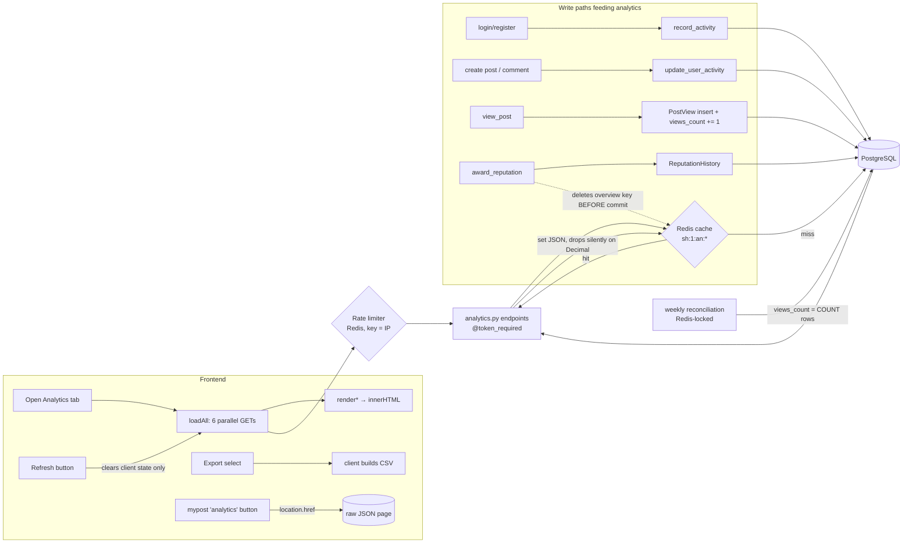

# Feature Production-Readiness Audit — Analytics

| | |
|---|---|
| **Feature audited** | Analytics dashboard (student-facing): overview, activity heatmap, engagement, impact, insights, platform comparison, per-post analytics, weekly summary, CSV export |
| **Repository / commit** | `Devpaul-01/StudyHub` @ `d41565a` (shallow clone, read-only) |
| **Audit date** | 2026-11-23 |
| **Scope rule** | Only the analytics feature and what it depends on. No application code, tests, config or data were modified. |
| **Evidence labels** | **[PG-VERIFIED]** reproduced on a real PostgreSQL 16 instance · **[CODE-VERIFIED]** established by reading and cross-referencing the code (and, where noted, running it in isolation) · **[UNVERIFIED RISK]** plausible from the code, not reproduced |

> **How verification was done.** The repo was copied to a scratch directory outside the project; the existing analytics tests were run there on SQLite (how CI runs them) and then against a throwaway PostgreSQL 16 server (production dialect, per `config.py:41-45`). Extra "probe" tests were written **in the scratch copy only** to reproduce suspected defects. Nothing in the real clone was changed except creating this report file (see §10 note on the filename).

---

## 1. Executive Summary

**Assessment: Important improvements required. Not safe to call production-ready in its current state.**
No finding was verified as a data-loss or security *Critical*, but one analytics endpoint is completely broken on the production database engine, and the data-capture write path can make users' posts/comments fail under concurrency.

| Severity | Count |
|---|---|
| Critical | 0 |
| High | 2 |
| Medium | 9 |
| Low | 11 |
| **Total** | **22** |

### Most important findings

1. **AN-01 (High) — `/analytics/insights` fails for every user on PostgreSQL.** `generate_insights()` calls SQLite-only functions `strftime('%w', …)` and `julianday(…)` unconditionally. Reproduced on PG 16: `function strftime(unknown, timestamp without time zone) does not exist` → HTTP 400 even for a brand-new user. CI never sees it because the whole suite runs on SQLite.
2. **AN-02 (High) — The activity write path can fail a user's post or comment creation, and loses counts.** `post_service.update_user_activity` does check-then-insert on a unique `(user_id, activity_date)` row with no conflict handling, inside the same transaction as post/comment creation. Reproduced: 10 concurrent first-of-day writes → **8 `IntegrityError`s**; 10 concurrent updates to an existing row → counter ended at **2 instead of 10**.
3. **AN-05 (Medium) — Post view tracking is not deduplicated** (the unique constraint includes a microsecond timestamp, so it never fires). 12 concurrent views by one user produced **2–7 `PostView` rows**; the weekly reconciliation job then makes `views_count` equal the row count, baking in the duplicates.
4. **AN-04 / AN-03 (Medium) — PostgreSQL returns `Decimal` from `AVG()`**, so cache writes for the engagement and platform-average payloads are **silently dropped** (the cache never works for them), and the API returns numeric strings. Separately, every server-side failure is returned as **HTTP 400** with the exception swallowed — which is why AN-01 is invisible to monitoring.
5. **AN-06 / AN-07 / AN-10 (Medium) — The numbers shown to users are partly wrong or hard-coded:** platform averages are computed over the wrong population (reported average posts 2.5 vs a true 10.0 in a probe) and connections are halved (an exactly-average user is shown as "2.0× above average"); "Helpful marks" and "people helped" are literal zeros; the login streak never decays.

### Reliability / scalability headline

The feature is **architecturally sound for multiple instances** in the ways that matter most: no process-local state in the analytics module, Redis-backed cache and rate limiter (production refuses to boot on `memory://` limits, `config.py:196-203`), and the weekly scheduler jobs take a distributed lock. The multi-instance problems are in the **data-capture write paths** (AN-02, AN-05), which are read-modify-write on shared rows and already fail under concurrency on a single database.

### What I could not verify

Production data/schema, the production server timezone, Redis-outage behaviour, real browser rendering, and load/performance. Details in §3 per finding and in §10.

---

## 2. Feature Architecture and Execution Flow

### 2.1 Components

**Frontend** (`static/js/analytics/`, markup in `templates/post/feed2.html` ~L1515-1600)
- `analytics.init.js` — lazy init when the analytics tab opens.
- `analytics.delegation.js` — controller: `loadAll()` fires six fetches (overview, heatmap, engagement, impact, insights, comparison), per-section `render*()` functions, refresh button (`#an-refresh-btn`, wired directly at L305-319), export handler, heatmap tooltips.
- `analytics.api.js` — thin wrappers over the global `api.get`; **every fetcher returns `null` on failure**; only `fetchOverview` and `fetchExportData` show an error toast.
- `analytics.state.js` — `loaded` flags and cached payloads per section.
- `analytics.templates.js` — HTML builders (`buildHeroStats`, `buildInsights`, `buildAnalyticsSkeleton` are used; see §5).
- Entry point for per-post analytics: `templates/post/mypost.html` (~L609) `viewAnalytics(id)` → `window.location.href = /student/analytics/post/${id}`.

**API** — `routes/student/analytics.py` (1001 lines), blueprint under `/student`, all `GET`, all `@limiter.limit(PUBLIC_READ "300 per minute", key_func=ip_key)` + `@token_required`:

| Endpoint | Lines | Cache key / TTL |
|---|---|---|
| `/analytics/overview` | 253-350 | `sh:1:an:overview:{uid}` 120 s (also deleted by `award_reputation`) |
| `/analytics/activity-heatmap?days=` | 355-460 | `sh:1:an:heatmap:{uid}:{days}` 300 s |
| `/analytics/engagement` | 463-550 | `sh:1:an:engage:{uid}` 180 s |
| `/analytics/impact` | 553-637 | `sh:1:an:impact:{uid}` 180 s |
| `/analytics/insights` | 640-673 (+`generate_insights` 66-205) | `sh:1:an:insights:{uid}` 300 s |
| `/analytics/comparison` | 676-746 | none per viewer; shared `sh:1:an:platform_avg` 600 s via `@cache_service.cached` (L208) |
| `/analytics/post/<id>` | 749-824 | none |
| `/analytics/weekly-summary` | 827-904 | `sh:1:an:weekly_summary:{uid}` 3600 s |
| `/analytics/export?type=` | 907-1001 | none |

**Data sources** (analytics is almost entirely a *read model* over data written by other features):
`users` (denormalised `total_posts`, `reputation`, `total_helpful`, `login_streak`, `last_active`), `user_activity`, `post_views`, `posts` (denormalised `views_count`, `positive_reactions_count`, `comments_count`, `bookmark_count`), `comments`, `post_reactions`, `bookmarks`, `reputation_history`, `connections`, `thread_members`, `threads`, `user_badges`/`badges`, `student_profiles`.

**Write paths that feed analytics**
- `services/auth_service.py` — `record_activity()` (L85-109) on login/register; `update_login_streak()` (L112+).
- `services/post_service.py` — `update_user_activity()` (~L185-225) on post/comment creation (`routes/student/posts/crud.py:1182`, `comments.py:638`).
- `routes/student/posts/crud.py` — `view_post` (~L915-984) inserts `PostView` and increments `Post.views_count`.
- `services/reputation_service.py` — `award_reputation()` writes `ReputationHistory` and invalidates the overview cache.
- `services/reconciliation_service.py` — weekly job recomputes `views_count` from `PostView` row counts (L133-141, L185).

**Infrastructure:** PostgreSQL via Supabase PgBouncer (transaction mode, `statement_timeout=15000`, `config.py:41-45`); Redis for cache (`services/cache_service.py`) and rate limiting; APScheduler jobs guarded by a Redis lock (`scheduler.py`, `services/distributed_lock.py`). No WebSockets, queues or file uploads are involved in analytics.

### 2.2 End-to-end flow

---

## 3. Findings and Issues

Legend: **Confirmed** = reproduced or established directly · **Risk** = unverified.

### AN-01 — `/analytics/insights` is broken on PostgreSQL (SQLite-only SQL)
- **Severity:** High · **Category:** Bug · **Status:** Confirmed [PG-VERIFIED]
- **Location:** `routes/student/analytics.py` — `generate_insights()`: `func.strftime('%w', Post.posted_at)` (L78), `func.julianday(...)` (L104-106); `_SQLITE_WEEKDAY_NAMES` (L55-62); route L640-673.
- **Evidence:** Both queries run unconditionally at the top of `generate_insights`. Running the existing analytics integration tests against PG 16: 34 pass, **2 fail** (both in the Insights test class). Direct probe (P9) for a brand-new user: `HTTP 400 {"message":"Failed to generate insights"}`; server log: `psycopg2.errors.UndefinedFunction: function strftime(unknown, timestamp without time zone) does not exist`. Production is PostgreSQL (`config.py:41-45`).
- **Problem:** The function was written and tested only against SQLite. PostgreSQL has neither function.
- **Impact:** The Insights panel never loads in production for any user (and, via AN-03, nothing alerts anyone).
- **Reproduction:** Run the analytics integration suite with the DB URI pointed at PostgreSQL; or `GET /student/analytics/insights` against a Postgres-backed instance.
- **Recommended solution:** Replace with dialect-neutral SQL: weekday via `func.extract('dow', Post.posted_at)` (Postgres, 0 = Sunday — same mapping as the existing `_SQLITE_WEEKDAY_NAMES`), average response time via `func.extract('epoch', Comment.posted_at - Post.posted_at) / 3600` — or compute both in Python from a bounded row set. Keep SQLite working for the test DB (e.g. branch on `db.engine.dialect.name`, or compute in Python).
- **Implementation considerations:** `extract('dow')` works on PostgreSQL but not on SQLite (which the test DB uses), so either use a dialect switch or the Python approach; the latter is simplest and bounded by the existing `.limit`/date filters. No migration.
- **Verification:** Existing insight tests pass on **both** SQLite and PostgreSQL; add a test with posts on known weekdays and a known comment latency asserting the exact insight text.

### AN-02 — Activity write path fails/loses updates under concurrency
- **Severity:** High · **Category:** Data Integrity / Reliability · **Status:** Confirmed [PG-VERIFIED] (worst-case synchronised burst; mechanism is certain, real-world frequency is lower)
- **Location:** `services/post_service.py::update_user_activity` (~L185-225); callers `routes/student/posts/crud.py:1176-1184` (post create) and `routes/student/posts/comments.py:638` (comment create); contrast `services/auth_service.py::_get_or_create_today_activity` (L55-82) which handles the race. Constraint: `models.py:1528-1531` (`unique_daily_activity`).
- **Evidence:** `update_user_activity` does `SELECT … WHERE user_id AND activity_date`, inserts if absent, then does `activity.posts_created = activity.posts_created + 1` / `activity_score = activity_score + 5` (ORM read-modify-write). There is no conflict handling; in `create_post` the activity row is flushed/committed in the **same single `db.session.commit()`** (`crud.py:1184`) as the post itself. Probes: **P5b** 10 concurrent first-activity-of-day writes → 2 commits OK, **8 `IntegrityError`**, final `posts_created=2`. **P5c** 10 concurrent comment increments on an existing row → all 10 commits succeed, final `comments_created=2` (expected 10).
- **Problem:** (a) Two requests by the same user at the start of a UTC day (double-click, client retry, login + first post at the same moment) can violate the unique constraint at commit → the whole post/comment transaction (post, mentions, notifications) is rolled back and the user sees an error. (b) Concurrent increments lose updates under READ COMMITTED, so heatmap counts and `activity_score` under-count. (c) Two independent implementations of the same logic exist (this one has no retry; the auth one does).
- **Impact:** Rare but user-visible failure of a core action caused by *analytics bookkeeping*; silently wrong heatmap data.
- **Reproduction:** Scratch probe `test_p5b_user_activity_race` / `test_p5c_lost_update` (threads + barrier, PostgreSQL).
- **Recommended solution:** One shared helper using an atomic upsert: `INSERT INTO user_activity (...) VALUES (...) ON CONFLICT (user_id, activity_date) DO UPDATE SET posts_created = user_activity.posts_created + EXCLUDED.posts_created, activity_score = user_activity.activity_score + EXCLUDED.activity_score` (SQLAlchemy `postgresql.insert(...).on_conflict_do_update`). Make activity bookkeeping non-fatal to the business action (execute it in a `begin_nested()` savepoint, or after commit). Route both `record_activity` and `update_user_activity` through it.
- **Implementation considerations:** `ON CONFLICT` is dialect-specific; SQLite supports it too (`sqlalchemy.dialects.sqlite.insert`), so tests can still run, but use a small dialect switch. Keep one definition of "today" (UTC; see AN-18). PgBouncer transaction mode is fine for this (no session state).
- **Verification:** Concurrency test: N threads × first write of day → exactly one row, counters = N, zero failures; and a test that a failure inside activity bookkeeping does not fail post creation.

### AN-03 — Server failures returned as HTTP 400; exceptions swallowed
- **Severity:** Medium · **Category:** Reliability / Observability · **Status:** Confirmed [PG-VERIFIED for status; CODE-VERIFIED for logging]
- **Location:** every `except Exception` in `analytics.py` (L350, L458, L548, L635, L671, L744, L822, L902, L999); `routes/student/helpers.py::error_response` (default `status_code=400`).
- **Evidence:** Handlers call `error_response("Failed to …")` with no status → HTTP 400 (observed on AN-01). They log only `str(e)` via `current_app.logger.error` (no traceback/exception type), and because they return a response instead of raising, the app's global handler that reports ≥500 errors to Sentry is never reached.
- **Problem:** A database error is indistinguishable from a client error in logs, metrics and error trackers; clients may treat 4xx as non-retryable.
- **Impact:** AN-01 shipped and stayed invisible; any future query failure will too.
- **Recommended solution:** Return 500 for unexpected exceptions (and `current_app.logger.exception(...)`), or let them propagate to the central handler; reserve 4xx for validation/ownership. Keep user-facing message generic.
- **Implementation considerations:** Check that the frontend does not special-case 400 for these routes (it only logs/returns `null`, §AN-08). Alert on 5xx rate for `/student/analytics/*`.
- **Verification:** Test that a forced DB exception yields 500 and an error-tracker event.

### AN-04 — `Decimal` from PostgreSQL defeats the cache and changes the API types
- **Severity:** Medium · **Category:** Bug / Performance · **Status:** Confirmed [PG-VERIFIED]
- **Location:** `analytics.py` `get_average_user_stats` (L208-246, `func.avg(...)`), `get_engagement_stats` (L478-485, `func.avg`, `round(post_stats.avg_likes or 0, 1)` L520-521); `services/cache_service.py` `set` (plain `json.dumps`).
- **Evidence:** On PG, `AVG(int)` is `numeric` → Python `Decimal`. Probe **P1**: cache log `Redis SET failed for key='sh:1:an:platform_avg' — write silently dropped. Error: Object of type Decimal is not JSON serializable`; key absent after two calls; `/comparison` returned `"average_stats": {"posts": "2.5", "reputation": "7.5", "helpful": "0.5"}` and string multipliers (`"1.2"`, `"2.0"`) while `connections` is a float. Probe **P8**: `/engagement` returned `avg_likes_per_post: '1.5'`, `avg_views_per_post: '5.0'` and the `sh:1:an:engage:{uid}` key was **never written**.
- **Problem:** Cache writes fail silently (design: fail-open) so these payloads are recomputed on every request in production; the JSON contract differs between SQLite (floats) and PostgreSQL (strings). The frontend appears to tolerate string numbers (JS arithmetic/formatting coerces them) — not verified in a browser — which would hide the mismatch.
- **Impact:** The "cached" platform average (600 s TTL) and engagement (180 s) caches are no-ops; extra DB load on every dashboard load; fragile typing for any other API consumer.
- **Recommended solution:** Cast at the query boundary: `float(x or 0)` for every `AVG`/`SUM` result before it enters a payload (or `func.cast(..., Float)` in SQL). Optionally make `cache_service` serialize `Decimal` via `default=`—but fixing the payload types is the real fix.
- **Verification:** On PG, assert numeric JSON types and that the cache key exists after the first call.

### AN-05 — `PostView` is not deduplicated; counts inflate and "views" semantics are unclear
- **Severity:** Medium · **Category:** Data Integrity / Product · **Status:** Confirmed [PG-VERIFIED] for duplicates; semantics CODE-VERIFIED
- **Location:** `models.py:628-639` (`unique_daily_view` on `(user_id, post_id, viewed_at)`); `routes/student/posts/crud.py` `view_post` (~L915-984, check at ~L923-928); `services/reconciliation_service.py:133-141, 185`.
- **Evidence:** The unique constraint includes `viewed_at` (default `utcnow`, microsecond precision), so it can never fire. Real dedupe is a check-then-insert. Probe **P5a** (3 runs): 12 concurrent view requests from one user → **7, 2, 6 `PostView` rows**, `posts.views_count == 1` (lost updates on `views_count += 1`). `_post_views_actual()` counts **rows** (`COUNT(PostView.id)`), so the weekly reconciliation will set `views_count` to the duplicated row count.
- **Semantics (CODE-VERIFIED):** because a user gets at most one row per post *ever*, "this week's views" (`overview.hero_stats.monthly_views`, L275-283), the insight "views today" (L127-130), and the per-post timeline (L768-782) only count a user's **first-ever** view of a post, not views on that day. The key is also named `monthly_views` but covers 7 days. The author's own views increment `views_count` but are excluded from "people reached".
- **Impact:** Inflated/inconsistent view counts; timeline and "trending" insight under-report; naming misleads.
- **Recommended solution:** Decide semantics first (Q1). If "unique viewer per post": replace the constraint with `UNIQUE (user_id, post_id)`, insert with `ON CONFLICT DO NOTHING`, increment `views_count` only when a row was actually inserted (`RETURNING`), and make reconciliation count `COUNT(DISTINCT user_id)`. If "every view per day": use `UNIQUE (user_id, post_id, view_date)` with a date column. Increment counters atomically (`UPDATE posts SET views_count = views_count + 1`).
- **Implementation considerations:** Needs a data migration that removes existing duplicate rows (keep earliest per key) **before** adding the constraint; then re-run reconciliation. Rename `monthly_views` → `weekly_views` only together with the frontend (`analytics.templates.js:62`).
- **Verification:** Concurrency test: 12 simultaneous views by one user → 1 row, `views_count == 1`; reconciliation leaves it unchanged.

### AN-06 — Platform averages computed over the wrong population; connections halved
- **Severity:** Medium · **Category:** Bug / Product · **Status:** Confirmed [PG-VERIFIED]
- **Location:** `analytics.py:226-246` (`get_average_user_stats`), used by `get_comparison_stats` L691-706.
- **Evidence:** `total_users` counts `status="approved"` (L226) but `AVG(total_posts/reputation/total_helpful)` (L238-240) has **no status filter**, so pending/rejected users dilute the average. Probe **P4b**: 1 approved user with 10 posts + 3 pending users with 0 → reported average **2.5** (approved-only average = 10.0). `avg_connections` = `COUNT(accepted connections) / approved users` — each connection involves two users, so the per-user average is understated by 2×. Probe **P4**: 4 users, 2 accepted connections (every user has exactly 1) → reported average **0.5**, user's multiplier **2.0 "above"**.
- **Impact:** Users are told they are "above average" when they are average or below.
- **Recommended solution:** Apply the same population filter to every aggregate (decide the population, Q10); `avg_connections = 2 * accepted_connections / total_users`, or compute `AVG` over a per-user connection count.
- **Verification:** Tests with a known population (including non-approved users) asserting exact averages and multipliers.

### AN-07 — Hard-coded / never-populated metrics and an unsupported claim are shown to users
- **Severity:** Medium · **Category:** Product / Data Integrity · **Status:** Confirmed [CODE-VERIFIED]
- **Location:** `analytics.py:293, 326` (`this_week_helpful = 0` → `hero_stats.helpful_count`), `L870, 892, 895` (weekly `people_helped = 0`, message "helped 0 people!"), `L609-610, 620` (`study_buddies_helped = 0` "placeholder"), heatmap/export fields `messages` / `helpful` (L395-396, L936-937), `analytics.templates.js:70` (hero card "Helpful marks"), `analytics.py:117` ("faster than 75% of users!").
- **Evidence:** The code comments state these are literal zeros. `record_activity` has no caller with `"message"` or `"helpful"` (callers: register ×2, login ×2, `update_user_activity` for post/comment only), so `UserActivity.messages_sent` and `helpful_count` are never incremented; the heatmap's `messages`/`helpful` and the export's columns are always 0. The "faster than 75% of users" text is a constant — it is shown whenever the user's average response time is under 3 hours (L112), with no comparison to other users.
- **Impact:** A permanently-zero hero card, a weekly message that says "helped 0 people", and a fabricated comparative claim erode trust in the dashboard.
- **Recommended solution:** Product decision (Q2, Q3, Q7): either wire the metric to a real source (e.g. `Comment` helpful marks / `User.total_helpful` deltas), or remove/relabel the element. Remove the "75%" claim or compute a true percentile.
- **Verification:** UI/E2E check that no always-zero card remains; unit test for the percentile if kept.

### AN-08 — Frontend swallows failures, marks sections loaded on failure, and "Refresh" cannot refresh
- **Severity:** Medium · **Category:** Bug / Product · **Status:** Confirmed [CODE-VERIFIED]
- **Location:** `analytics.api.js` (all fetchers `return null`; toasts only at L20 and L117); `analytics.delegation.js:52-62` (`renderOverview`: `markLoaded('overview')` after a possibly-`null` result, then `setHTML('an-hero-grid', buildHeroStats(data))`), same pattern in the other renderers (L69, 111, 122, 165, 185); refresh handler L305-319; dead `'analytics-refresh'` handler L348-358; `analytics.templates.js:78` (`#${h.department_rank}`).
- **Evidence:** Seven of the nine fetchers log to the console only. A failed section is marked loaded and shows an empty/skeleton area with no retry affordance. `department_rank` is `null` for users without a department (backend L311), which renders `#null`. The refresh button only calls `analyticsState.invalidateAll()` then `loadAll(true)`; no route supports a cache bypass (grep: none in `analytics.py`), so the server Redis cache (120–3600 s) returns the same data while the UI toasts "Analytics refreshed". The `analytics-refresh` delegated handler has no matching `data-action` in the HTML (only `id="an-refresh-btn"`), so it is dead code (no double-fire).
- **Impact:** Users stare at blank panels (this is exactly what AN-01 looks like), see "refreshed" when nothing changed, and see `#null`.
- **Recommended solution:** Per-section error state with a retry button; do not `markLoaded` on `null`; guard `department_rank`; honest refresh (either an authenticated `?refresh=1` that deletes that user's `sh:1:an:*` keys, rate-limited, or drop the success toast / show "updated Ns ago" from `generated_at`).
- **Implementation considerations:** A cache-bust parameter must be limited to the caller's own keys and counted against rate limits.
- **Verification:** E2E: simulate a 500 on one endpoint → that panel shows an error + retry; others unaffected.

### AN-09 — Per-post analytics button navigates the browser to a raw JSON endpoint
- **Severity:** Medium · **Category:** Product / Bug · **Status:** Confirmed [CODE-VERIFIED]
- **Location:** `templates/post/mypost.html` (~L609, `viewAnalytics(id)` → `window.location.href = /student/analytics/post/${id}`); `analytics.py:749-824`; no HTML route for that path exists (grep of `routes/` and `app.py`).
- **Evidence:** The URL is the JSON API route registered at `analytics.py:749`. `fetchPostAnalytics()` in `analytics.api.js:99` is defined but never called.
- **Impact:** Clicking the button shows raw JSON (or a login failure if the page is opened without the expected auth context). The endpoint's data is otherwise unreachable from the UI.
- **Recommended solution:** Product decision (Q6): build a small panel/modal that calls `fetchPostAnalytics`, or remove the button. Do not invent the UI without approval.
- **Verification:** E2E: click leads to a rendered analytics view; owner-only enforcement still returns 403 for others.

### AN-10 — Login streak is stale and login-only
- **Severity:** Medium · **Category:** Product / Data Integrity · **Status:** Confirmed [PG-VERIFIED]
- **Location:** `analytics.py:450` (`current_streak: current_user.login_streak`), `L335`, `L196-203`; `services/auth_service.py::update_login_streak` (only caller path: login, L163/L170).
- **Evidence:** Probe **P3**: user with `login_streak=10`, `last_active` 30 days ago → heatmap `current_streak = 10`, overview `login_streak = 10`, and Insight 6 ("On Fire! 10 day streak… come back tomorrow") would also fire. The value only changes at login; users staying signed in via refresh tokens never extend it.
- **Impact:** Displays a streak that was broken weeks ago.
- **Recommended solution:** Compute the displayed streak on read from `user_activity` dates (consecutive days ending today/yesterday), or reset in a daily job; decide whether streak means logins or any activity (Q4).
- **Verification:** Tests with activity histories (gap, today missing, yesterday present).

### AN-11 — Test suite cannot see production-dialect defects
- **Severity:** Medium · **Category:** Maintainability / Testing · **Status:** Confirmed [PG-VERIFIED]
- **Location:** `tests/integration/conftest.py` (header states "SQLite in-memory, not Postgres"), `tests/unit/conftest.py`.
- **Evidence:** 51 analytics tests (36 integration + 15 unit) all pass on SQLite. The same integration file on PG 16: 34 pass / 2 fail. No test exercises Decimal types, concurrent writers, or Redis-backed caching (the integration run shows `redis_client` is `None` unless a fixture patches it). One misconfiguration trap discovered during the audit: setting only the fixture's URI has **no effect** because Flask-SQLAlchemy binds engines in `init_app`; `DATABASE_NEW_URL` must be set before `create_app()`.
- **Recommended solution:** Add a PostgreSQL CI job (service container) running at least the analytics + activity-writer + reconciliation tests; see §7.

### AN-12 — Overview cache invalidated *before* commit
- **Severity:** Low · **Category:** Data Integrity · **Status:** Confirmed [PG-VERIFIED], narrow window
- **Location:** `services/reputation_service.py::award_reputation` (docstring: "Does NOT commit"; cache delete ~L160-170) → `analytics.py:267-346`.
- **Evidence:** Probe **P6** (3 runs): after `award_reputation` (uncommitted) the key is deleted; a concurrent reader then re-populates it with **pre-commit** data and a fresh 120 s TTL; after the commit the next read still shows `reputation_change = 0` while the committed sum is 15 (TTL 120 s remaining).
- **Impact:** A user's own dashboard can show stale reputation for up to 120 s after a change. The TTL is a real backstop; the window is the remainder of the writer's request.
- **Recommended solution:** Invalidate after commit (e.g. SQLAlchemy `after_commit` hook that deletes keys collected during the transaction), or accept the 120 s TTL and correct the "hard-invalidated" comments.

### AN-13 — Heatmap window off-by-one and weak `days` validation
- **Severity:** Low · **Category:** Bug · **Status:** Confirmed [PG-VERIFIED]
- **Location:** `analytics.py:364-365, 379, 401-402, 437, 445-447`.
- **Evidence:** Probe **P2**: `days=90` → **91 cells**, `total_days=90`; `days=0` → 1 cell; `days=-5` → 0 cells and `total_days=-5`; `days=365` → 366 cells; non-integer falls back to 90. Only an upper clamp (`min(days, 365)`) exists. The cache key includes `days`, so one user can create up to 365 distinct keys.
- **Recommended solution:** Clamp to `[1, 365]`; build the range as `days` cells (`start = today - (days-1)`), or document inclusive semantics and report `len(heatmap)`; optionally restrict `days` to an allowlist (30/90/180/365).

### AN-14 — CSV export is malformed for quotes, allows formula injection, and is unbounded
- **Severity:** Low · **Category:** Bug / Security · **Status:** Confirmed [CODE-VERIFIED + Node run]
- **Location:** CSV builder in `analytics.delegation.js` export handler (`keys.map(k => `"${r[k] ?? ''}"`)`); `analytics.py:941-969` (`.all()` on `reputation_history` and `posts`).
- **Evidence:** Executing the builder on `title = He said "hi", then =SUM(A1)` yields `"He said "hi", then =SUM(A1)"` — broken quoting. Leading `= + - @` are not neutralised. Data exported is the caller's own, so this is self-inflicted (Low). Export queries have no limit.
- **Recommended solution:** Escape `"` as `""`; prefix risky leading characters with `'`; add a sane row cap or stream server-side.

### AN-15 — Rate limiting keyed by IP on authenticated routes
- **Severity:** Low · **Category:** Scalability / Product · **Status:** Confirmed [CODE-VERIFIED]
- **Location:** `analytics.py:254, 356, 464, 554, 641, 677, 750, 828, 908` (`key_func=ip_key`); `services/rate_limit_service.py` (docstring: `ip_key` is "for pre-auth routes"; `user_or_ip_key` exists for authenticated routes).
- **Evidence:** All nine routes share a 300/min bucket per IP. One dashboard load issues 6 requests (plus refreshes), so ~50 loads/min per IP exhausts it. Students behind a campus NAT share an IP.
- **Impact:** Legitimate users may get 429s on shared networks; abusive users are not limited individually.
- **Recommended solution:** Use `user_or_ip_key` (Redis-backed counters already enforced at boot, so this is multi-instance safe). See Q11.

### AN-16 — Soft-deleted comments counted
- **Severity:** Low · **Category:** Data Integrity · **Status:** Confirmed [CODE-VERIFIED] (not reproduced)
- **Location:** `analytics.py:493-497` (engagement `comment_stats`), `L577-586` (impact `questions_answered`, `questions_solved`); `models.py:665` (`Comment.is_deleted`). `analytics.py` never references `is_deleted`.
- **Note:** `Post` hard-deletes and decrements `total_posts` (`crud.py:1516`), so only comments are affected.
- **Recommended solution:** Add `Comment.is_deleted == False` to those queries (confirm intended behaviour, Q10).

### AN-17 — Unescaped values interpolated into `innerHTML`
- **Severity:** Low · **Category:** Security (defence in depth) · **Status:** Confirmed [CODE-VERIFIED]
- **Location:** `analytics.delegation.js:150` (`best_post.title`), `:230` (tooltip), `analytics.templates.js` (`buildInsights` renders `ins.message`, which embeds `recent_post.title[:40]`, `analytics.py:137`, and `badge.name`).
- **Impact:** Titles are the viewer's *own* data, so this is self-XSS today; it becomes stored XSS if any of these fields ever show another user's content or admin-edited badge names.
- **Recommended solution:** Use `textContent`/an `escapeHtml` helper for all dynamic strings.

### AN-18 — Server-local `date.today()` vs UTC
- **Severity:** Low · **Category:** Data Integrity · **Status:** [UNVERIFIED RISK] (production TZ unknown)
- **Location:** `post_service.py` (`datetime.date.today()` in `update_user_activity`), `analytics.py:129, 318, 379, 402, 766, 926`, `models.py:1519` default; vs UTC in `auth_service.py` (comments at L61, L91).
- **Problem:** If the server's local timezone is not UTC, login activity and post/comment activity land on different "days"; the same user could get two rows for one local day.
- **Recommended solution:** One helper `utc_today()` everywhere; set container `TZ=UTC` and assert it at boot.

### AN-19 — Insights query cost and inconsistent filters
- **Severity:** Low · **Category:** Performance / Bug · **Status:** [UNVERIFIED RISK] (not measured; moot until AN-01 is fixed)
- **Location:** `analytics.py:141-167` (one `calculate_badge_progress()` call — itself several queries — per unearned badge, per cache miss); Insight 5 (L171-193) omits the `status == "approved"` filter that overview's `dept_rank` (L305-309) uses; `get_engagement_stats` best-post `ORDER BY (positive_reactions_count + comments_count) DESC` (L488-490) treats NULLs differently on PostgreSQL (NULLs first on DESC) than SQLite.
- **Recommended solution:** After fixing AN-01, measure query count per request; reuse `/badges/progress` cached results; apply one population filter; `COALESCE` counters.

### AN-20 — No retention for analytics tables
- **Severity:** Low · **Category:** Scalability · **Status:** Confirmed absence [CODE-VERIFIED]; growth rate UNVERIFIED
- **Evidence:** `post_views` (one row per user×post, more with AN-05), `user_activity` (one row per user per active day) and `reputation_history` are only referenced in the stale-account purge (`services/jobs/maintenance_jobs.py:181` covers `UserActivity`); nothing prunes old rows.
- **Recommendation:** Decide retention (Q9); the dashboard reads at most 90–365 days of activity.

### AN-21 — Schema/index hygiene
- **Severity:** Low · **Category:** Maintainability / Performance · **Status:** [UNVERIFIED RISK] (production schema not inspected)
- **Evidence:** `user_activity` and `post_views` do not appear in `migrations/versions/*` (3 files), so how production DDL/indexes are created is unknown from the repo. In the model, `idx_user_activity_user_date_score` (`models.py:1530`) duplicates the unique constraint's index (and omits `score` despite its name), and `index=True` on `user_id` is redundant with the composite. The hot analytics predicate `post_views JOIN posts … WHERE viewed_at >= …` has only single-column indexes.
- **Recommendation:** Confirm actual prod indexes; later consider `post_views(post_id, viewed_at)`; drop the duplicate index with the migration that fixes AN-02/05.

### AN-22 — Existence oracle on per-post analytics
- **Severity:** Low (informational) · **Category:** Security · **Status:** Confirmed [PG-VERIFIED]
- **Location:** `analytics.py:757-763`. Probe **P7**: nonexistent post → 404, someone else's post → 403. Ownership is correctly enforced (positive), but IDs are sequential integers and posts are not otherwise secret, so impact is negligible. Optional: return 404 for both.

---

## 4. Horizontal Scalability Assessment

### 4.1 Current architecture and assumptions
Stateless Flask app; shared state lives in PostgreSQL and Redis. Analytics endpoints are read-only aggregations with Redis cache-aside; writes that feed analytics happen inside other features' transactions.

### 4.2 What is already correct (evidence-based)
| Concern | Finding |
|---|---|
| Instance-local state | None in `analytics.py` (only constants `_SQLITE_WEEKDAY_NAMES`, `_VALID_EXPORT_TYPES`); no locks/threads/globals. |
| Local caches | None. Caching is Redis (`sh:1:an:*`), shared by all instances. |
| Auth/session | JWT + `token_required`; no instance affinity. |
| Rate limiting | Redis-backed; `Config` refuses to start on `memory://` when limits are enabled (`config.py:196-203`). |
| Background jobs | Weekly snapshot/reconciliation run under a Redis distributed lock (`scheduler.py`). |
| Restart tolerance | Reads are idempotent; writes are single-transaction. |
| File/WebSocket | Not used by this feature. |

### 4.3 Immediate problems (already failing on one database, worse with more instances)
- **AN-02** — read-modify-write and check-then-insert on `user_activity`. More instances → more simultaneous writers.
- **AN-05** — check-then-insert on `post_views` and `views_count += 1`; reconciliation then locks in the duplicates.
- **AN-04** — cache silently ineffective for two payloads on PG, so those queries run on every request from every instance.
- **AN-15** — IP-keyed limits do not scale with users behind NAT.

### 4.4 Future scaling improvements (not needed yet)
- **Cache coherence:** deletes in Redis are visible to all instances; only the pre-commit ordering (AN-12) is a gap. Fix with after-commit invalidation, not new infrastructure.
- **Redis outage:** cache helpers fail open (every request goes to PostgreSQL). Behaviour with a hung (not refused) Redis was **not tested**; confirm client socket timeouts (`extensions.py`).
- **Query load:** one uncached dashboard load is roughly 25+ queries across 6 requests; the heaviest are `post_views` joins. Current TTLs (120–600 s) are adequate; add `post_views(post_id, viewed_at)` and move to pre-aggregated daily counters only if measurements justify it.
- **Cache key cardinality:** bound the `days` parameter (AN-13).
- **PgBouncer transaction mode:** nothing in analytics uses session-level state; advisory locks/temp tables are not used.

No distributed locking is recommended: the upsert/`ON CONFLICT` approach solves AN-02 and AN-05 at the database with no new infrastructure.

---

## 5. Data Usage and Cleanup Report

Classification key: **1** Confirmed unused · **2** Potentially unused — requires verification · **3** Required indirectly — retain · **4** Redundant — consolidate.

| Resource | Current usage | Evidence | Class. | Recommendation |
|---|---|---|---|---|
| `user_activity` table | Heatmap, overview activity level, export | `analytics.py:314-319, 382-385, 927-930` | 3 | Retain. Fix write path (AN-02). |
| `UserActivity.posts_created`, `comments_created`, `activity_score` | Written for post/comment/login/register; read by heatmap/export | writers: `post_service.py`, `auth_service.py:85-109` | 3 | Retain. |
| `UserActivity.messages_sent`, `helpful_count` | Read by heatmap/export; **never incremented** (no `record_activity("message"/"helpful")` caller) | caller grep: only register, login, post, comment | 2 | Product decision Q3: wire up or drop (drop needs a migration, preserve zeros — nothing to preserve). |
| `UserActivity.threads_joined` | Written only as `0` on row creation (`post_service.py:199`); never incremented or read from this table (`profile.py:251` counts `ThreadMember` instead) | repo-wide grep of `.py/.js/.html` | 1 | Candidate to drop with a migration; no data worth preserving. Low value — bundle with other schema work. |
| Index `idx_user_activity_user_date_score` | Duplicates the unique constraint's index | `models.py:1528-1531` | 4 | Drop in the same migration as AN-02 (verify prod index list first). |
| `PostView` unique constraint `unique_daily_view` | Never enforces anything (includes `viewed_at`) | `models.py:638` | 4 | Replace per AN-05 after de-duplication migration. |
| `post_views` rows | Source for views-this-week, trending insight, people reached, per-post timeline | `analytics.py:278-283, 127-130, 569-574, 768-774` | 3 | Retain; dedupe + retention (AN-05, AN-20). |
| Two activity writers (`auth_service.record_activity`, `post_service.update_user_activity`) | Same table, divergent logic (race handling, date source) | AN-02 / AN-18 | 4 | Consolidate into one shared helper. (`services/activity_service.py` is a *different* feature per its docstring — out of scope.) |
| `Post.views_count` | Engagement totals, best post, per-post metrics, export | `analytics.py:478-485, 810` | 3 | Retain; fix increment atomicity (AN-05). Reconciled weekly. |
| `User.total_posts`, `total_helpful` | Overview, comparison, impact score | `analytics.py:332-336, 694-696, 626` | 3 | Retain. Note `total_posts` is not part of reconciliation (`reconciliation_service.py` handles post display counters only) — [UNVERIFIED RISK] drift. |
| `User.login_streak`, `last_active` | Heatmap summary, overview, insight 6 | AN-10 | 3 | Retain; stop displaying raw value (AN-10). |
| `hero_stats.helpful_count`, weekly `people_helped`, impact `study_buddies_helped` | Hard-coded `0` | `analytics.py:293, 870, 610` | 1 | Remove or wire up (Q2). |
| API: `GET /analytics/weekly-summary` | No consumer found in `static/` or `templates/`; docstring says "for email/notification" | grep of `fetchWeeklySummary` / `weekly-summary` outside the route | 2 | Confirm whether any external client/job uses it (Q8) before touching. |
| API: `GET /analytics/post/<id>` | Only reachable by the raw-JSON navigation in `mypost.html` | AN-09 | 2 | Keep; give it a proper UI or remove the button. |
| FE: `fetchWeeklySummary`, `fetchPostAnalytics` (`analytics.api.js:87, 99`) | Defined, never called | grep: no callers | 1 | Remove or use (tied to the two rows above). |
| FE: `buildEngagement`, `buildImpact`, `buildComparison` (`analytics.templates.js`) | Exported, never imported | grep: 0 references | 1 | Remove (the render functions in `delegation.js` build DOM directly). |
| FE: `buildHeatmap` in `analytics.templates.js:102` | Never imported by analytics modules (`profile.templates.js:340` defines its own function of the same name) | grep + definition check | 1 | Remove the analytics copy. |
| FE: `'analytics-refresh'` delegated handler (`delegation.js:348-358`) | No element has that `data-action`; button is wired directly at L305 | grep of templates | 1 | Remove. |
| FE: `analytics.showcase-data.js` (≈21 KB) | No importers; header: "PORTFOLIO / DEMO USE ONLY — NOT FOR PRODUCTION" | grep: no references | 2 | **Do not delete without your decision (Q5).** It appears to be a deliberate demo asset; consider moving it out of the production static path. |
| Response fields with no frontend reader: `overview.quick_facts.*`, `current_stats.{total_posts,total_reputation,login_streak,total_helpful}`, `engagement.posts.{avg_likes_per_post,avg_views_per_post}`, `engagement.comments.total_created`, `engagement.posts.total_comments`, `heatmap.summary.best_day`, `insights.generated_at` | Returned and cached, not read by the analytics UI | field-by-field grep in `static/js/analytics` and `templates/` | 2 | Verify no other client (tests, mobile, external) reads them, then trim. Low payoff; do last. `current_stats.reputation_level` **is** read (`templates.js:50`). |
| Export `type=overview/activity/reputation/posts` | All consumed by the export `<select>` | `feed2.html:1515` | 3 | Retain. |
| `an-hero-*` placeholder ids in `feed2.html` (~L1531-1560) | Replaced wholesale by `setHTML('an-hero-grid', …)`; no JS references the ids | grep | 2 | Cosmetic; ignore unless touching the template. |

**Dependencies/migrations for removals:** DB changes are limited to `threads_joined`, the redundant index, the `PostView` constraint (needs duplicate-row cleanup first — back up `post_views` before running), and optionally `messages_sent`/`helpful_count`. Frontend removals need no migration.

---

## 6. End-to-End Data Consistency Report

| Data path | Mismatch | Evidence | Correction |
|---|---|---|---|
| Insights: DB → API → UI | Endpoint errors on PG; UI shows an empty panel with no error | AN-01, AN-08 | Fix SQL; surface errors |
| Averages: DB → API → "vs platform" cards | Wrong population and halved connections → wrong "above/below" | AN-06 (P4, P4b) | Same population filter; per-user connection average |
| Averages: JSON types | PG gives numeric **strings**, SQLite floats; frontend coerces | AN-04 (P1, P8) | Cast to float at query boundary |
| Views: `post_views` ↔ `posts.views_count` | Duplicate rows vs lost increments (`rows=7`, `views_count=1`); reconciliation copies rows into the counter | AN-05 (P5a) | Unique constraint + atomic increment; reconcile with distinct users |
| Views over time | Only first-ever view per user counted; key named `monthly_views` is 7 days | AN-05 | Decide semantics; rename together with FE |
| Heatmap day boundaries | `date.today()` (server-local) vs UTC in other writer; heatmap returns 91 cells for "90 days" | AN-18, AN-13 | One UTC helper; clamp/range fix |
| Heatmap fields | `messages`, `helpful` always 0 | AN-07 | Wire or drop |
| Streak | Login-based, never decays | AN-10 (P3) | Compute from activity dates |
| Reputation freshness | Overview cache re-populated with pre-commit data for 120 s | AN-12 (P6) | After-commit invalidation |
| Hero "department rank" | `null` → `#null`; insight 5 uses a different population than overview | AN-08, AN-19 | Guard null; unify filters |
| Comment counts | Soft-deleted comments included | AN-16 | Filter `is_deleted` |
| Post button → analytics | Navigates to JSON endpoint | AN-09 | UI or remove |
| Error semantics | Server errors surface as 400 → no alerting; UI treats as `null` | AN-03, AN-08 | 500 + error state |

**Partial-failure lifecycle:** A request that fails *after* the DB commit cannot corrupt analytics (reads only). The one cross-transaction hazard is AN-02: analytics bookkeeping failing at commit rolls back the user's post/comment.

---

## 7. Testing Gaps

Nothing was written or modified in the repo. Existing tests: `tests/integration/test_analytics_routes.py` (36), `tests/unit/services/test_analytics_service.py` (15) — all green on SQLite, 2 fail on PostgreSQL.

| # | Missing test | Behaviour to verify | Level |
|---|---|---|---|
| T1 | Run analytics suite on PostgreSQL in CI | All analytics tests pass on the production dialect (guards AN-01, AN-04) | CI / integration |
| T2 | Insights weekday + response-time on PG and SQLite | Exact "best day" and latency text for seeded data | Integration |
| T3 | JSON type contract | `/comparison`, `/engagement` average/multiplier fields are JSON numbers; cache key is written | Integration (PG + fake Redis) |
| T4 | Activity upsert concurrency | N threads first-write-of-day → 1 row, counters == N, 0 failures | Concurrency (PG) |
| T5 | Activity failure isolation | Forced error in bookkeeping does not fail post/comment creation | Integration |
| T6 | View dedupe concurrency | 12 simultaneous views by one user → 1 row, `views_count == 1`; reconciliation no-op | Concurrency (PG) |
| T7 | Average correctness | Known population incl. pending users → exact averages; connections average == per-user mean | Unit/Integration |
| T8 | Streak decay | Gap/missing-today/yesterday scenarios | Unit |
| T9 | Heatmap window | `days=90` → 90 cells; `0`, `-5`, `abc`, `100000` clamp/validate | Integration |
| T10 | Error status mapping | Forced DB error → 500 (not 400) and logged with traceback | Integration |
| T11 | Cache invalidation ordering | Concurrent reader during uncommitted reputation award doesn't re-cache stale data | Concurrency |
| T12 | Frontend states | Failed fetch → error + retry, `department_rank=null` → no `#null`, refresh actually refetches | E2E / FE unit |
| T13 | CSV builder | Titles with `"`, commas, newlines, leading `=` export correctly | FE unit |
| T14 | Soft-deleted comments | Excluded from impact/engagement | Integration |
| T15 | Authorization | Another user's post → 403; unauthenticated → 401; ownership on every `{id}` route | Integration |
| T16 | Export limits | Large history is bounded | Integration |
| T17 | Redis outage | Redis down/slow → endpoints still 200 within timeout | Failure/recovery |

**Tests that pass but under-verify:** the existing Insights tests pass on SQLite precisely because SQLite has the functions the production code wrongly depends on; tests that expect `200` for `/comparison` do not check numeric types.

---

## 8. Recommended Implementation Plan

*(Plan only — nothing will be implemented until you approve.)*

### Milestone 1 — Production-dialect correctness (Priority 1/3)
- **Objective:** Make every analytics endpoint correct on PostgreSQL and make failures visible.
- **Issues:** AN-01, AN-03, AN-04, AN-11.
- **Files:** `routes/student/analytics.py`, `routes/student/helpers.py` (status usage only), `services/cache_service.py` (optional Decimal-safe serializer), CI workflow, `tests/integration/conftest.py` (env-driven DB URI, bound before `create_app()`).
- **Proposed implementation:** Dialect-neutral insights SQL (or Python computation); float casts; 500 + `logger.exception`; PG CI job.
- **DB/infra:** CI Postgres service container. No schema change.
- **Tests:** T1, T2, T3, T10.
- **Dependencies:** none. **Risks:** low; behaviour change from 400→500 on failures (confirm no client depends on 400).

### Milestone 2 — Write-path integrity (Priority 3)
- **Objective:** Stop analytics bookkeeping from failing user actions or losing/duplicating counts.
- **Issues:** AN-02, AN-05, AN-18 (UTC helper), AN-21 (duplicate index).
- **Files:** `services/post_service.py`, `services/auth_service.py`, `routes/student/posts/crud.py` (`view_post`), `services/reconciliation_service.py`, `models.py`, new migration.
- **Proposed implementation:** Shared atomic upsert helper for `user_activity`; savepoint-isolated bookkeeping; `post_views` unique key + `ON CONFLICT DO NOTHING` + atomic `views_count` increment; reconciliation by distinct viewers.
- **DB:** Migration that removes duplicate `post_views` rows (keep earliest) then adds the unique constraint; drop redundant index. **Take a backup first.**
- **Tests:** T4, T5, T6. **Dependencies:** Q1, Q5 (migration policy). **Risks:** migration on a live table; sequence: dedupe → constraint → code deploy (code must tolerate both states).

### Milestone 3 — Metric correctness (Priority 5)
- **Issues:** AN-06, AN-07, AN-10, AN-16, AN-19 (filters/COALESCE).
- **Files:** `analytics.py`, `auth_service.py` or read-time streak helper, `analytics.templates.js`.
- **Tests:** T7, T8, T14. **Dependencies:** Q2, Q3, Q4, Q7, Q10. **Risks:** visible number changes for users (communicate).

### Milestone 4 — Frontend resilience and UX (Priority 5)
- **Issues:** AN-08, AN-09, AN-14, AN-17, plus removal of dead FE code.
- **Files:** `analytics.api.js`, `analytics.delegation.js`, `analytics.templates.js`, `templates/post/mypost.html`.
- **Tests:** T12, T13. **Dependencies:** Q6, Q5. **Risks:** low.

### Milestone 5 — Cache and rate-limit hygiene (Priority 4/6)
- **Issues:** AN-12, AN-13, AN-15, AN-22 (optional).
- **Files:** `reputation_service.py` (after-commit invalidation), `analytics.py`, rate-limit decorators.
- **Tests:** T9, T11, T17. **Dependencies:** Q11. **Risks:** low.

### Milestone 6 — Cleanup (Priority 7)
- **Issues:** AN-20, AN-21 remainder, unused columns/fields in §5.
- **Dependencies:** Q3, Q8, Q9 and verification of external consumers. **Risks:** schema drops are irreversible — do last, with backups.

---

## 9. Questions and Decisions Required

| # | Question | Why it matters | Options |
|---|---|---|---|
| Q1 | What should "views" mean? | Drives the `post_views` schema, dedupe migration and every views metric (AN-05). | (a) one row per user per post (unique viewers); (b) one row per user per post per day; (c) every view (needs a different dedupe/abuse model). |
| Q2 | What should the hero **"Helpful marks"** card show? | It is a hard-coded `0` today (AN-07). | (a) wire to real helpful marks received this week; (b) show total helpful; (c) remove the card. |
| Q3 | Keep `UserActivity.messages_sent` / `helpful_count` / `threads_joined`? | Never populated; heatmap/export always show 0. | (a) wire up (needs hooks in messaging/helpful flows); (b) drop columns and fields (migration); (c) leave until needed. |
| Q4 | Streak definition? | AN-10. | (a) consecutive **login** days; (b) consecutive **activity** days; computed on read vs daily reset job. |
| Q5 | Is production schema managed by Alembic? May I add a migration that de-duplicates `post_views`? Is `analytics.showcase-data.js` a portfolio asset to keep? | `user_activity`/`post_views` are absent from `migrations/versions`; the dedupe is destructive; the showcase file is deliberately "demo only". | Provide how prod DDL is applied; approve backup + migration; keep/move/remove the showcase file. |
| Q6 | Per-post analytics UI? | AN-09: current button opens raw JSON. | (a) build a modal/page using `/analytics/post/<id>`; (b) remove button and endpoint's FE hook. |
| Q7 | "Faster than 75% of users!" insight | Unsupported claim (AN-07). | (a) remove claim; (b) compute a true percentile (extra query + cache). |
| Q8 | Who consumes `/analytics/weekly-summary`? | No consumer in repo; docstring mentions email/notification. | Keep (document consumer), wire into the weekly notification, or remove. |
| Q9 | Retention for `post_views`, `user_activity`, `reputation_history`? | Unbounded growth (AN-20). | e.g. keep 12–13 months raw, then aggregate/delete; or keep forever. |
| Q10 | Which users form the "platform average" population, and should soft-deleted comments count? | AN-06, AN-16. | Approved only / approved + active in last N days; exclude deleted comments (recommended). |
| Q11 | Rate-limit key for analytics routes? | AN-15: shared campus IPs. | `user_or_ip_key` (recommended) vs keep per-IP. |
| Q12 | OK to change failure status from 400 to 500? | AN-03; any client that special-cases 400 would change behaviour. | Yes (recommended) / keep 400 with better logging only. |

---

## 10. Final Recommendation

**Must fix before calling the feature production-ready**
1. AN-01 — insights endpoint (broken on PostgreSQL).
2. AN-02 — activity write path (can fail posts/comments; loses counts).
3. AN-03 + AN-11 — correct error status/logging and run the analytics suite on PostgreSQL in CI (otherwise this class of bug recurs unseen).

**Fix soon**
AN-04 (cache/types), AN-05 (view dedupe — needs Q1 and a migration), AN-06 (wrong averages), AN-07/AN-10 (hard-coded metrics, stale streak), AN-08/AN-09 (frontend failure states, per-post button).

**Can safely be postponed**
AN-12–AN-22 (Low): cache ordering window, heatmap off-by-one, CSV edge cases, rate-limit key, soft-deleted comments, self-XSS hardening, UTC helper, insights cost, retention, index hygiene, 404/403 oracle.

**Candidates for removal (after your approval)**
Dead frontend code (`buildEngagement`, `buildImpact`, `buildComparison`, analytics `buildHeatmap`, `fetchWeeklySummary`/`fetchPostAnalytics` if Q6/Q8 say so, the dead `'analytics-refresh'` handler), `UserActivity.threads_joined`, the duplicate index, and always-zero fields — all subject to §5 and Q3/Q5/Q8.

**Requires your approval or clarification:** Q1–Q12 above (Q1, Q5 and Q12 gate Milestones 1–2).

**Recommended order:** M1 → M2 → M3 → M4 → M5 → M6.

### Positive evidence (so this is not a one-sided list)
- Ownership is enforced on per-post analytics (403 for other users) and every other endpoint is scoped to `current_user`.
- No instance-local state; Redis-backed cache and rate limiting with a boot-time guard; scheduler jobs are Redis-locked.
- The auth-side activity writer already handles the unique-constraint race — AN-02 is a matter of reusing that approach, not inventing one.
- Export `type` is allowlisted; cache failures fail open without breaking requests.

### Verification log (what was actually run)
| Check | Result |
|---|---|
| Existing analytics tests on SQLite (scratch copy) | 51 passed (36 integration + 15 unit) |
| Same integration file on PostgreSQL 16 (DB URI bound via `DATABASE_NEW_URL`) | 34 passed, **2 failed** (Insights) |
| P9 insights, new user, PG | HTTP 400, `UndefinedFunction: strftime` |
| P1 / P8 Decimal | cache writes dropped; averages returned as strings |
| P2 heatmap windows | 91 cells for `days=90`; `days=-5` → 0 cells, `total_days=-5` |
| P3 stale streak | `login_streak=10` shown after 30 days inactive |
| P4 / P4b averages | connections avg 0.5 (true 1.0); posts avg 2.5 (approved-only 10.0) |
| P5a view race (3 runs) | 7 / 2 / 6 `PostView` rows; `views_count = 1` |
| P5b activity first-write race | 2 commits ok, 8 `IntegrityError` |
| P5c activity lost update | 10 commits ok, counter = 2 |
| P6 cache before commit (3 runs) | stale `reputation_change = 0` vs committed 15, TTL 120 s |
| P7 export / existence oracle | raw title unescaped server-side; 404 vs 403 |
| CSV builder in Node | `"He said "hi", then =SUM(A1)"` (malformed) |

**Not verified:** production database contents/schema and server timezone; real-browser rendering (frontend findings are from code reading plus the Node CSV run); Redis outage/hang behaviour; query counts and latency under load; git history beyond HEAD `d41565a`. An earlier attempt to run the suite "on PostgreSQL" silently used SQLite because the engine binds in `init_app`; results above are from the corrected run (engine confirmed by the psycopg2 error text).

*Note on this file:* the repository root already contains `FEATURE_PRODUCTION_READINESS_AUDIT.md` for a different feature (Auth & Onboarding). To avoid overwriting it, this report lives at `docs/audits/ANALYTICS_PRODUCTION_READINESS_AUDIT.md`.
